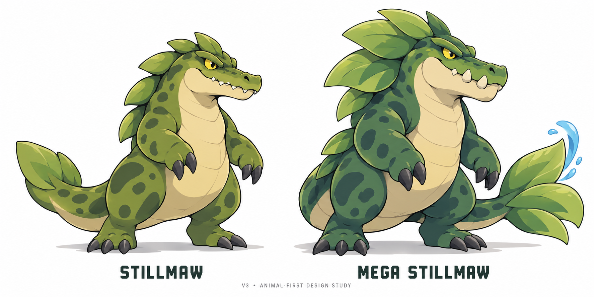

# Bogsnap family: three stages and a Mega audition
WB-BOGSNAP-FAMILY · Codex / root for Evan · 2026-10-19 · PR #600.

Evan explicitly requested a three-stage test of the approved Bogsnap direction, a Mega concept, dual Water/Grass identity and Pokemon-aligned starter stats/abilities. This is an independent art/balance study. It does not replace runtime art, change saves or edit Claude's active gameplay paths.

## Visual candidate, v3

Evan rejected v2 as too costume-like, closer to Power Rangers than Pokemon. V3 removes the shoulder guards, gauntlets, chest armour and root greaves; it tests clean rounded body masses, smooth organic limbs and a simpler leaf-scute identity. The Mega changes jaw/tusks, head frill and tail paddle instead of adding wearable armour. [V2](final-forms-study-v2.png) is historical/rejected. V3 remains a candidate, not an approved production design.

Evan's feedback: Boglet is approved; preserve Bogsnap. The low quadrupedal v1 Stillmaw and barely differentiated Mega were rejected. The [v1 board](family-study-v1.png) is retained as history and the approved early-form reference; its final/Mega panels are not production candidates. V2 tests taller bipedal forms with the upright armoured presence Evan referenced in Tyranitar/Aggron, while keeping an original Water/Grass marsh identity. That upright direction continues in v3, but v2's armour treatment is rejected.

- **Boglet**: Evan approved the v1 small marsh hatchling design. Its source pixels and file remain unchanged; no regeneration of the early form was needed.
- **Bogsnap**: the approved broad-jawed, leaf-armoured creature stays the identity anchor and becomes stage two.
- **Stillmaw**: stage three reuses the existing evolution's name/ID. V3 keeps an upright bipedal body, thick animal hind legs, short rounded forearms, broad crocodilian jaw, pale belly and a heavy leaf-paddle tail. A few large back scutes replace layered costume-like armour.
- **Mega Stillmaw**: a temporary form, not a fourth permanent evolution. V3 changes the jaw/tusks, swept leaf frill and broad three-lobed tail; no wearable armour, branching root crown or gauntlets. It remains a two-legged Water/Grass creature, with no new typing or extra stat buff implied by the art.

All four candidate forms are Water/Grass (Tide/Grove in older Wildbond vocabulary). Proposed normal evolutions are level16 and36, subject to progression/move testing. Boglet's v1 shape is accepted; new final/Mega shapes, names, evolution timing and Mega unlock remain candidates. Generating v3 does not approve those new details.

Reference: Evan's selected model sheet, SHA256 f7bfee867a10c3bc2bb5cdafc4af0a898e0548a998c3ba828a8a87ad4767111b, pinned in [the current chapter source](https://github.com/ecbarish/generations/blob/7c535ffa896abfc00bf01a96a12df2d7ad308d09/wildbond-godot/tests/battle_slice/approved_bogsnap/approved-model-sheet.jpg).
Built-in image_gen produced v1 from the inspected original reference ([v1 prompt](generation-prompt.txt)) and v2 from the inspected family board ([v2 prompt](generation-prompt-v2.txt)). V3 uses the original family board as reference, not the rejected armour board ([v3 prompt](generation-prompt-v3.txt)). Visually inspected: both full upright animal silhouettes, simpler rounded forms, no costume armour and unchanged early-form source assets. Mega distinctiveness remains for Evan to judge. Boglet/Bogsnap source assets were not edited. These are concept illustrations, not sliced/pixel-clean animation atlases. Simplify fine roots/water detail at native sprite size before production. The 530/630 candidate budgets and ability contracts below are unchanged by this visual revision. V2 and v3 are illustrated shape studies; native pixel-art production still requires an accepted design and its own asset pass.

## Pokemon parity: actual audit and proposed budgets
At source7c535ffa, the playable chapter uses six canonical stats, neutral nature, fixed IV15 and zero EVs. Its original starters total306 (Mosshog),313 (Ripplet),307 (Cindercub). Those are already in an ordinary early-starter range; retain their exact base spreads.

The separate legacy Godot evolution overlay totals372/379/372 for the middle starters and440/450/439 for Thornback/Tidewyrm/Blazefang. Legacy Bogsnap totals298 and Stillmaw460. These are legacy-overlay facts, not proof that those evolved forms are supported in the current chapter catalogue.

The current chapter explicitly lacks abilities, critical hits, held items, evolution and Mega mechanics. The existing legacy bond/species mechanics are not a substitute for Pokemon passive abilities. A stat declaration or label cannot claim these features work.

The [Pokemon Showdown species reference](https://raw.githubusercontent.com/smogon/pokemon-showdown/master/data/pokedex.ts), accessed2026-10-19, supplies comparison values: Venusaur530, Charizard534 and Blastoise530; their listed traditional Mega forms add100 without changing base HP. Our choice of530 for every normal final is a shared design budget, not a claim every Pokemon starter has the same total.

| Family | Stage1 | Stage2 candidate | Final candidate | Mega candidate |
|---|---:|---:|---:|---:|
| Mosshog | 306 unchanged | 405 | 530 | 630 |
| Ripplet | 313 unchanged | 405 | 530 | 630 |
| Cindercub | 307 unchanged | 405 | 530 | 630 |
| Boglet / Bogsnap / Stillmaw | 310 | 405 | 530 | 630 |

Canonical stat order: HP / Attack / Defense / Sp.Atk / Sp.Def / Speed.

| Candidate | HP | Atk | Def | SpA | SpD | Spe | Total |
|---|---:|---:|---:|---:|---:|---:|---:|
| Boglet | 55 | 55 | 65 | 35 | 60 | 40 | 310 |
| Bogsnap | 75 | 85 | 85 | 40 | 70 | 50 | 405 |
| Stillmaw | 95 | 110 | 115 | 55 | 100 | 55 | 530 |
| Mega Stillmaw | 95 | 140 | 145 | 65 | 125 | 60 | 630 |
| Thornback | 100 | 110 | 105 | 65 | 85 | 65 | 530 |
| Tidewyrm | 85 | 75 | 90 | 115 | 95 | 70 | 530 |
| Blazefang | 78 | 105 | 70 | 92 | 75 | 110 | 530 |

Full middle/Mega spreads for the starters are in [candidate data](balance-candidates.json). They do not change the approved starter/Mega artwork or settle future secondary typings. Starter Mega abilities are deliberately null until selected; this file is explicitly not runtime-ready.

## Abilities: a real mechanic, one active passive
Baseline candidates use established [Pokemon ability semantics](https://raw.githubusercontent.com/smogon/pokemon-showdown/master/data/abilities.ts):
- Mosshog line: **Overgrow**; Ripplet line: **Torrent**; Cindercub line: **Blaze**. Matching-type attacking stat multiplier1.5 when HP is at most one third, supporting physical and special moves.
- Bogsnap family: **Shell Armor**, preventing critical hits rather than reducing all incoming damage. It requires a working critical-hit implementation to have value.
- Mega Stillmaw: **Thick Fat**, halving the attacking stat used by incoming Fire/Ice attacks. It replaces Shell Armor; the two do not stack. It does not alter the type chart.

Custom names/effects remain allowed. First give any custom passive a precise trigger, effect, limit, stacking rule and tested power budget against a comparable established ability. Do not add an unbounded multiplier merely because a creature is ours.

Water/Grass retains ordinary weaknesses to Flying, Poison and Bug, with neutral ordinary Fire/Ice interactions before abilities. Its defensive niche and Mega ability do not make it immune to everything. Equal base totals do not establish equal battle strength: coverage, speed breakpoints, healing, ability, typing and availability all matter.

## Runtime-owner handoff
1. Use canonical stat keys and existing Pokemon stat/damage/type calculations for both namespaces. Legacy spd means Speed, not Special Defense; explicit mapping is included in JSON. Preserve the current IV/nature/EV assumptions until individually implemented.
2. Preserve stable bogsnap/stillmaw IDs and existing individuals. Never silently turn a player's Bogsnap into Boglet, downgrade its level or refill HP/PP. The old Bogsnap-to-Stillmaw level18 overlay must be reconciled deliberately with this proposed16/36 family.
3. Revisit Isolde's existing Bogsnap roster: upgrading that species to middle-stage405 is not a free, unmeasured first-Warden difficulty increase. Adjust encounters/roster only through the owned gameplay task.
4. Implement standard starter passives before tuning bespoke ones. Add deterministic boundary checks for HP thresholds, relevant physical/special moves, nonmatching moves, switching, suppression if supported, and fainted targets. Shell Armor must be tested against actual critical hits.
5. Mega is temporary, one per team per battle, plus100 base points and unchanged HP. It replaces one ability and returns to normal on battle end. Unlock/item rules remain undecided. New persistent fields need the existing explicit save-design approval before merge.
6. Matchups must compare equal levels, individual modifiers, legal move sets and equivalent item/form access, then test the real first-Warden experience for each starter. Stat arithmetic is not a matchup simulation. Only claim supported mechanics; record the chosen generation/extension contract instead of promising full cartridge parity.

## Verification and scope
Candidate generation checked97 arithmetic/structure assertions: exact six stats, integer bounds, totals, four distinct stages per family, unique IDs, every Mega plus100, unchanged Mega HP and nondecreasing Mega component stats. [Machine-readable result](validation.json). These are candidate-data checks, not native gameplay tests or simulated matchups. All passed; no battle simulation ran.

No runtime, save, move, existing art, lore clue or story text changes. No need to rerun full runtime suites for this isolated study; normal PR CI remains a separate gate. The concept board and balance candidates need review before any production integration.
