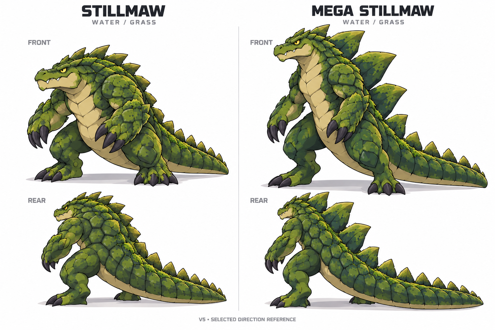

# Bogsnap family: three stages and a Mega audition
WB-BOGSNAP-FAMILY · Codex / root for Evan · 2026-10-19 · PR #600.

Evan explicitly requested a three-stage test of the approved Bogsnap direction, a Mega concept, dual Water/Grass identity and Pokemon-aligned starter stats/abilities. This is an independent art/balance study. It does not replace runtime art, change saves or edit Claude's active gameplay paths.

## Selected direction, refined reference v5

**Evan selected the direction:** normal third stage combines v4 C's broad jaw, strong haunches and stocky build with A's overlapping scales; Mega uses B's taller kaiju silhouette. Evan reported that voters liked B, but he preferred reserving its imposing appearance for Mega. This is his creative choice, not an independently measured public poll. V5 refines that chosen brief; the new drawing is not automatically a production sprite approval.

- **Stillmaw:** compact, strong, bipedal swamp alligator. Low-set head, broad jaw, thick hindquarters, natural scale-armoured forearms and heavy balancing tail. Avoid costume-like separate armour and goofy rounded proportions.
- **Mega Stillmaw:** taller upright transformation of the same animal, bold widely spaced reed-like dorsal scutes, stronger swimming tail and a more imposing profile. Keep the recognisable jaw, eyes and family colour language. The Mega is temporary, not a fourth permanent evolutionary stage.
- **Water/Grass theming:** olive/moss scales, sparse moss in seams, reed-shaped dorsal scutes and a swimming-tail shape. Hind-toe webbing is a requested production detail but not clearly resolved by the illustration; do not claim it is already delivered. No obligatory cannons, giant plant attachments, water ribbons or decorative armour.

The [v4 alternatives](final-form-directions-v4.png) remain the selection source. They are alternatives for one final form, not additional species or three stages. Use C+A for normal and B for Mega; do not switch back to a different direction without a design discussion.

## Production handoff
V5 includes front-three-quarter and smaller rear-angle references for both forms. These communicate the chosen massing, scale coverage, colour family, posture and tail/dorsal structure. They are illustrated concept references, not transparent cutouts, orthographic turnarounds or pixel-perfect animation frames. The rear views are angled/flank views, not finished battle-back sprites. Lock exact scute layout and simplify scale/moss texture at native sprite size before producing atlases; maintain the same anatomy between views rather than inventing extra plates per frame.

1. Preserve Boglet's accepted v1 design and the established Bogsnap identity. Neither early form's source file/pixels was edited.
2. Build Stillmaw and Mega from the selected brief above, with separate explicit front/back/overworld output specs when the asset task is claimed. Do not slice this decorative board and call it production animation.
3. Keep silhouettes recognisable at native size: C-like stocky normal, B-like taller Mega. Preserve feet and full tail, establish logical dimensions and common contact anchors, and use true alpha for actual sprites.
4. Animation should convey weight and wetland behaviour: restrained breathing/jaw/eye reactions, planted steps, swimming-tail motion and a modest shake-off after water. These are ideas for the future owned asset task, not an existing frame set.
5. The530 normal /630 Mega candidate stat budgets, unchanged Mega HP and ability contracts below stay intact. Visual size does not grant extra battle power. No gameplay/save/art integration occurs in this study.

**Accepted early anchors:** [v1 board](family-study-v1.png) Boglet/Bogsnap only. Authoritative Bogsnap model sheet: [pinned source](https://github.com/ecbarish/generations/blob/7c535ffa896abfc00bf01a96a12df2d7ad308d09/wildbond-godot/tests/battle_slice/approved_bogsnap/approved-model-sheet.jpg), SHA256 f7bfee867a10c3bc2bb5cdafc4af0a898e0548a998c3ba828a8a87ad4767111b.

**Rejected/historical final/Mega passes:** v1 too low/subtle; [v2](final-forms-study-v2.png) costume-like/Power Rangers; [v3](final-forms-study-v3.png) goofy. Do not integrate those final/Mega panels. Keep their files as decision history.

Built-in image_gen produced v5 from the inspected v4 source; [exact v5 prompt](generation-prompt-v5.txt). Earlier prompts remain alongside their versions. V5 visually inspected for complete bodies, front/rear-angle references, stocky-vs-tall silhouettes and original family continuity. No source, runtime, stats or approved starter art changed in this revision.

## Pokemon parity: actual audit and proposed budgets
At source7c535ffa, the playable chapter uses six canonical stats, neutral nature, fixed IV15 and zero EVs. Its original starters total306 (Mosshog),313 (Ripplet),307 (Cindercub). Those are already in an ordinary early-starter range; retain their exact base spreads.

The separate legacy Godot evolution overlay totals372/379/372 for the middle starters and440/450/439 for Thornback/Tidewyrm/Blazefang. Legacy Bogsnap totals298 and Stillmaw460. These are legacy-overlay facts, not proof that those evolved forms are supported in the current chapter catalogue.

The current chapter explicitly lacks abilities, critical hits, held items, evolution and Mega mechanics. The existing legacy bond/species mechanics are not a substitute for Pokemon passive abilities. A stat declaration or label cannot claim these features work.

The [Pokemon Showdown species reference](https://raw.githubusercontent.com/smogon/pokemon-showdown/master/data/pokedex.ts), accessed2026-10-19, supplies comparison values: Venusaur530, Charizard534 and Blastoise530; their listed traditional Mega forms add100 without changing base HP. Our choice of530 for every normal final is a shared design budget, not a claim every Pokemon starter has the same total.

| Family | Stage1 | Stage2 candidate | Final candidate | Mega candidate |
|---|---:|---:|---:|---:|
| Mosshog | 306 unchanged | 405 | 530 | 630 |
| Ripplet | 313 unchanged | 405 | 530 | 630 |
| Cindercub | 307 unchanged | 405 | 530 | 630 |
| Boglet / Bogsnap / Stillmaw | 310 | 405 | 530 | 630 |

Canonical stat order: HP / Attack / Defense / Sp.Atk / Sp.Def / Speed.

| Candidate | HP | Atk | Def | SpA | SpD | Spe | Total |
|---|---:|---:|---:|---:|---:|---:|---:|
| Boglet | 55 | 55 | 65 | 35 | 60 | 40 | 310 |
| Bogsnap | 75 | 85 | 85 | 40 | 70 | 50 | 405 |
| Stillmaw | 95 | 110 | 115 | 55 | 100 | 55 | 530 |
| Mega Stillmaw | 95 | 140 | 145 | 65 | 125 | 60 | 630 |
| Thornback | 100 | 110 | 105 | 65 | 85 | 65 | 530 |
| Tidewyrm | 85 | 75 | 90 | 115 | 95 | 70 | 530 |
| Blazefang | 78 | 105 | 70 | 92 | 75 | 110 | 530 |

Full middle/Mega spreads for the starters are in [candidate data](balance-candidates.json). They do not change the approved starter/Mega artwork or settle future secondary typings. Starter Mega abilities are deliberately null until selected; this file is explicitly not runtime-ready.

## Abilities: a real mechanic, one active passive
Baseline candidates use established [Pokemon ability semantics](https://raw.githubusercontent.com/smogon/pokemon-showdown/master/data/abilities.ts):
- Mosshog line: **Overgrow**; Ripplet line: **Torrent**; Cindercub line: **Blaze**. Matching-type attacking stat multiplier1.5 when HP is at most one third, supporting physical and special moves.
- Bogsnap family: **Shell Armor**, preventing critical hits rather than reducing all incoming damage. It requires a working critical-hit implementation to have value.
- Mega Stillmaw: **Thick Fat**, halving the attacking stat used by incoming Fire/Ice attacks. It replaces Shell Armor; the two do not stack. It does not alter the type chart.

Custom names/effects remain allowed. First give any custom passive a precise trigger, effect, limit, stacking rule and tested power budget against a comparable established ability. Do not add an unbounded multiplier merely because a creature is ours.

Water/Grass retains ordinary weaknesses to Flying, Poison and Bug, with neutral ordinary Fire/Ice interactions before abilities. Its defensive niche and Mega ability do not make it immune to everything. Equal base totals do not establish equal battle strength: coverage, speed breakpoints, healing, ability, typing and availability all matter.

## Runtime-owner handoff
1. Use canonical stat keys and existing Pokemon stat/damage/type calculations for both namespaces. Legacy spd means Speed, not Special Defense; explicit mapping is included in JSON. Preserve the current IV/nature/EV assumptions until individually implemented.
2. Preserve stable bogsnap/stillmaw IDs and existing individuals. Never silently turn a player's Bogsnap into Boglet, downgrade its level or refill HP/PP. The old Bogsnap-to-Stillmaw level18 overlay must be reconciled deliberately with this proposed16/36 family.
3. Revisit Isolde's existing Bogsnap roster: upgrading that species to middle-stage405 is not a free, unmeasured first-Warden difficulty increase. Adjust encounters/roster only through the owned gameplay task.
4. Implement standard starter passives before tuning bespoke ones. Add deterministic boundary checks for HP thresholds, relevant physical/special moves, nonmatching moves, switching, suppression if supported, and fainted targets. Shell Armor must be tested against actual critical hits.
5. Mega is temporary, one per team per battle, plus100 base points and unchanged HP. It replaces one ability and returns to normal on battle end. Unlock/item rules remain undecided. New persistent fields need the existing explicit save-design approval before merge.
6. Matchups must compare equal levels, individual modifiers, legal move sets and equivalent item/form access, then test the real first-Warden experience for each starter. Stat arithmetic is not a matchup simulation. Only claim supported mechanics; record the chosen generation/extension contract instead of promising full cartridge parity.

## Verification and scope
Candidate generation checked97 arithmetic/structure assertions: exact six stats, integer bounds, totals, four distinct stages per family, unique IDs, every Mega plus100, unchanged Mega HP and nondecreasing Mega component stats. [Machine-readable result](validation.json). These are candidate-data checks, not native gameplay tests or simulated matchups. All passed; no battle simulation ran.

No runtime, save, move, existing art, lore clue or story text changes. No need to rerun full runtime suites for this isolated study; normal PR CI remains a separate gate. The concept board and balance candidates need review before any production integration.
