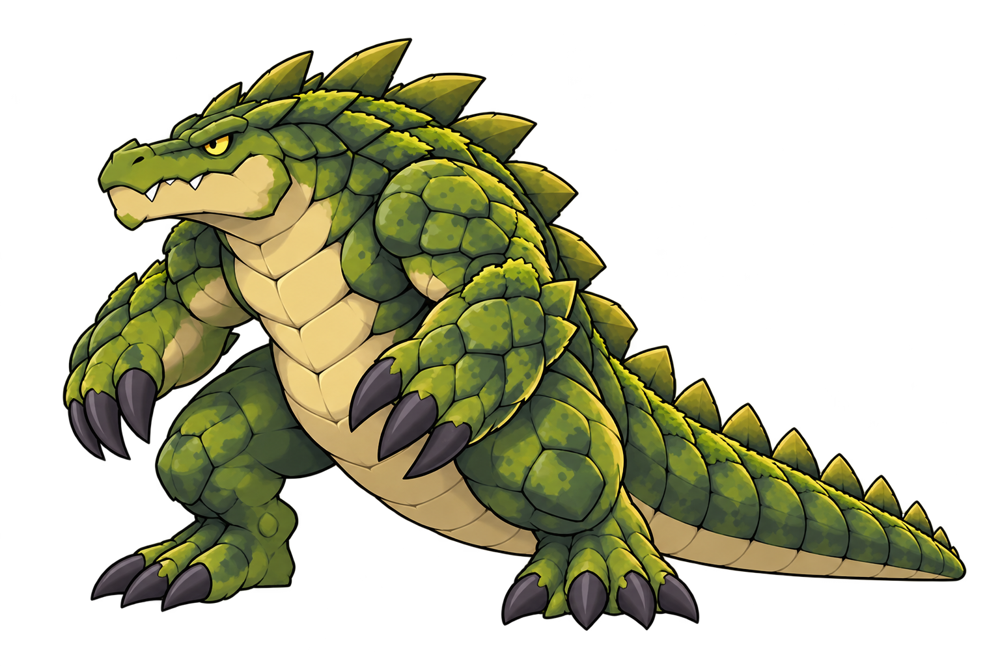
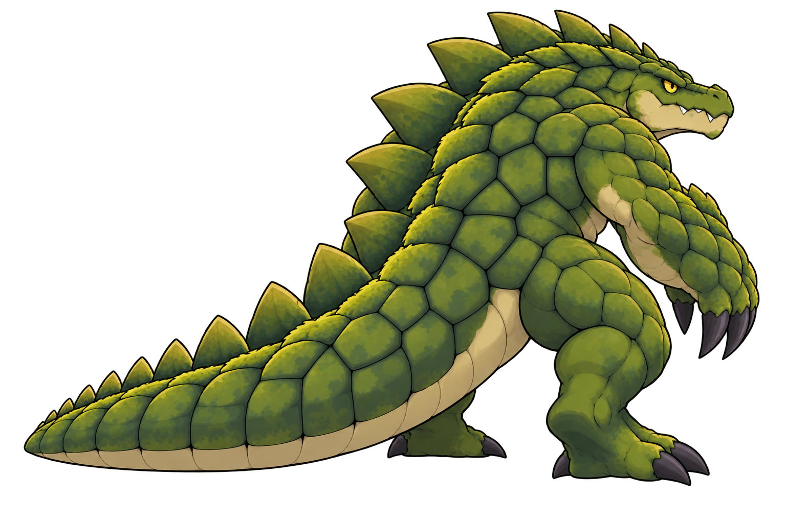
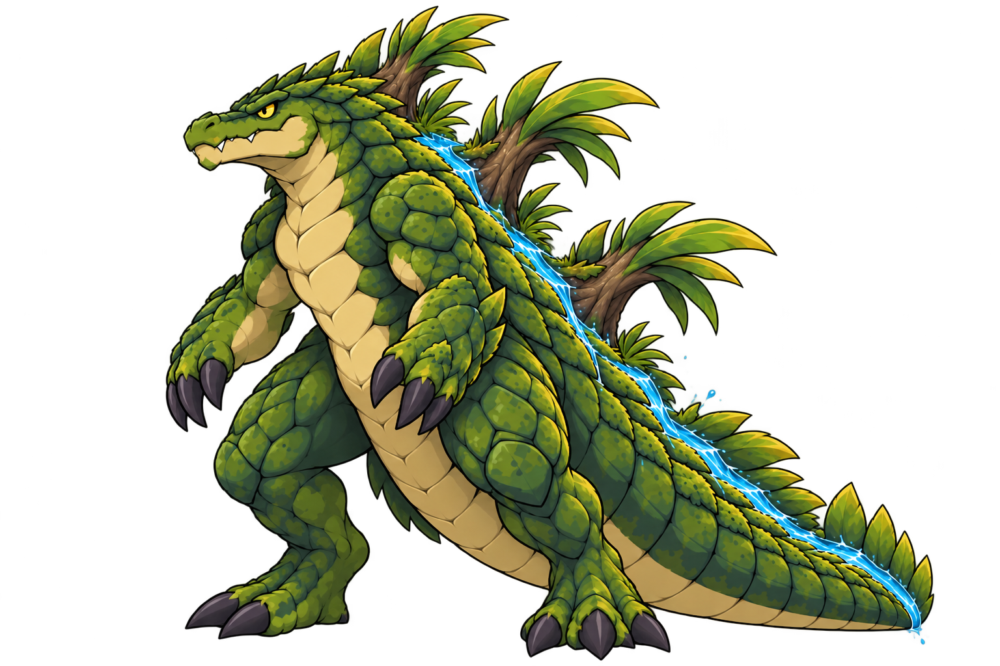
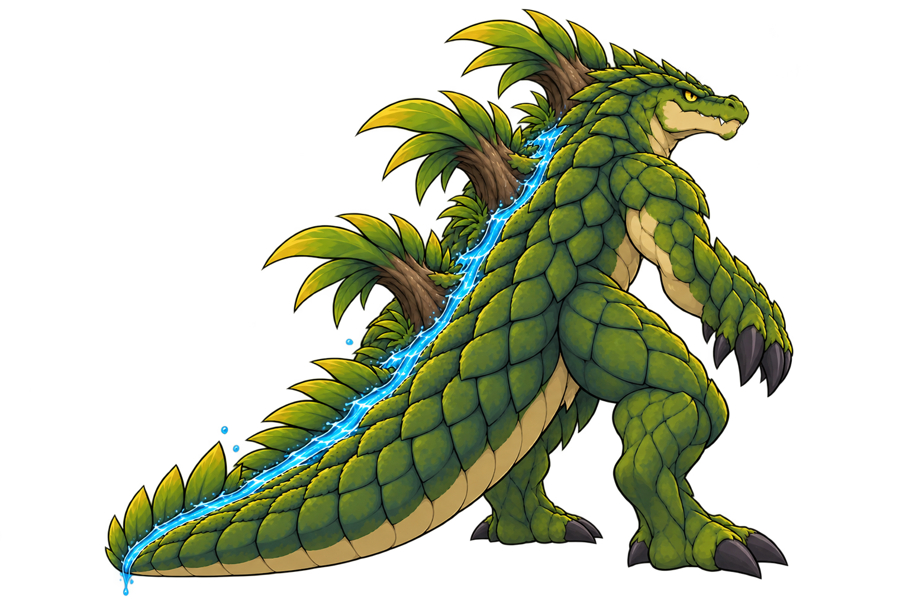

# Stillmaw static source candidates, v1
Codex / root for Evan · 2026-10-20 · PR #600

Four separate source candidates are saved below. Built-in image_gen generated them from the inspected approved v5 normal and v7 Mega references; exact prompts sit beside each PNG. Rear generation also used its corresponding new front candidate. Images are byte-preserved generated outputs; the intake inspection did not edit them.

**Import is blocked.** All four have visible diffuse halos. They contain transparent pixels, but the measured maximum alpha is254 and no pixel is fully opaque255. Most importantly, the background transition extends beyond the hard creature silhouette. A generated alpha-cleanup pass on normal front still retained the halo and was not adopted. We stopped repeated repairs; no CLI/API fallback or paid service was used.

| Form | Front | Rear |
|---|---|---|
| Stillmaw |  |  |
| Mega Stillmaw |  |  |

## What is usable from this pass
The normal retains a broad low crocodile head, heavy haunches, cream underside and natural overlapping armour. The Mega retains the upright kaiju stance, three main botanical masses and a visible back/tail water channel. Separate back views now exist to guide the next consistency pass. No source reference or early-form artwork was overwritten.

These are source illustrations, not native-resolution pixel sprites, matched orthographic turnarounds, approved game assets or an animation atlas. The normal rear appears more upright than the normal front; dorsal layouts and proportions still need to be locked between views. Mega rear retains three principal growths, but exact projection and scale texture need a matched review. Far-side limbs may be occluded; complete anatomical consistency is not certified.

## Intake and next action
[intake.json](intake.json) records each immutable file hash, dimensions, facing and measured alpha counts. All sources are1536×1024RGBA. Body-ink rectangles, visible contact anchors and runtime flips are deliberately null until the halo is removed and the body outline can be reviewed. Do not use the alpha bounding box as the body or contact point: it includes the halo.

Next: produce clean hard silhouettes without changing identity, recheck front/back anatomy, then record visible foot anchors and review in actual64logical-pixel/78×64battle bounds on light/dark backgrounds. Stop before animation or imports until those checks pass. The [production contract](../production-contract.json) continues to say not-built/not-approved; this source batch does not satisfy that gate.

The approved normal remains v5 and approved Mega direction v7. These new candidates do not replace either approval. Stat/ability/level proposals, saves, runtime art, starter atlases and game exports are unchanged.
