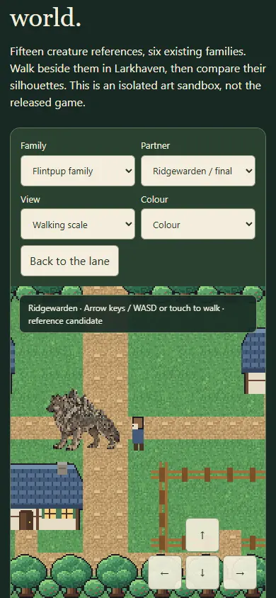
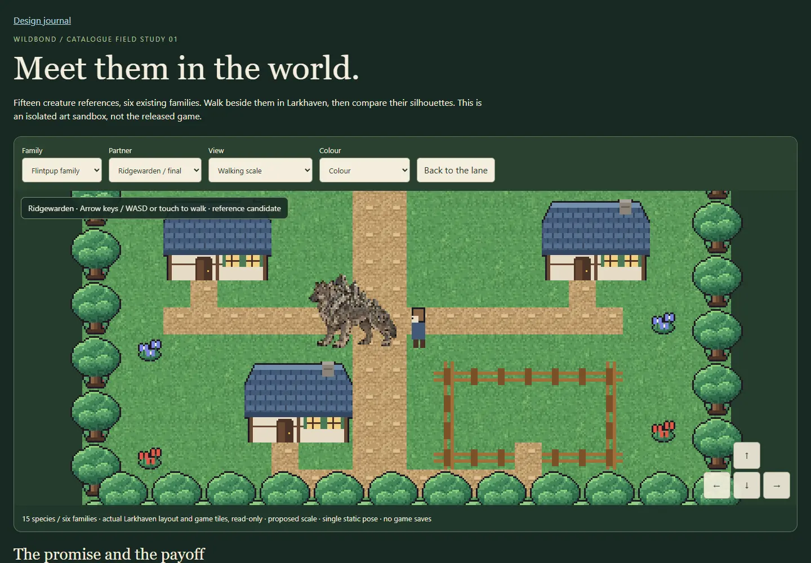
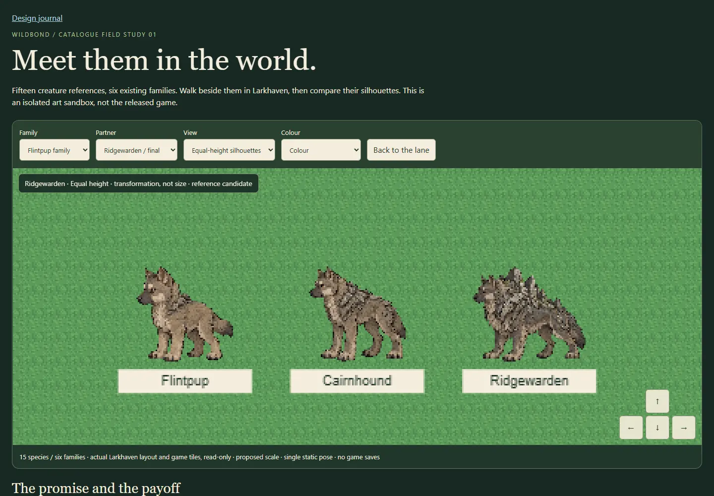

# WB-ART-BATCH1: creature field study

Open [the walkable scale review](index.html). Local stable preview: http://localhost:8781/docs/art/catalogue-batch-1/.

Evan requested catalogue creature generation and an in-game look. Higgsfield balance, preferences and model calls returned internal errors; Evan explicitly authorised the **built-in image generator fallback**. Eight generation calls produced six family sheets and two refinements. **No Higgsfield jobs or credits were spent.** Built-in model/cost details were not exposed, so none are invented here.

## Fifteen existing species, six lines

| Line | Stages | Visual promise and payoff |
|---|---|---|
| Flintpup → Cairnhound → Ridgewarden | 3 | A shoulder pebble becomes a mountain ridge on a wolf |
| Seedpip → Hedgelark → Boughchorus | 3 | A carried seed becomes wings of leafy boughs |
| Saillet → Draftscale → Stormfrill | 3 | A small sail becomes a storm-catching frill |
| Slaglet → Kilntusk | 2 | A dust crust becomes a vented living kiln |
| Hushpup → Hushmane | 2 | Listening becomes a sound-swallowing mantle |
| Clovercolt → Bloomcourser | 2 | A shelter ribbon becomes a banner of blossom |

The source catalogue and evolution plan determine stage counts. No middle species is invented for an existing two-stage line. All art is **candidate/reference only**; no owner approval, new ability or evolution mechanic is inferred. Source PNGs are preserved in the thread's built-in generated_images directory outside Git; original filenames, SHA-256 and exact prompts are in generation-record.json and iteration-record.json. Rights remain unverified for distribution or sale.

## What this lets us judge in the world

The isolated browser sandbox reads Larkhaven's real map rows and existing game tile atlas artwork. Arrow keys/WASD and touch controls move a simple 24-pixel human scale gauge; the chosen partner follows at size-aware spacing. Creature heights are explicit proposals, not new game data. Colour, faded-world and silhouette settings show readability. Equal-height comparisons prevent mere enlargement from looking like transformation. Battle-scale study is a portrait-size art comparison, **not combat**.

No Godot/game/preview-export file, gameplay rule, canon, game version or save is edited. Poses are static. Mirroring the left pose is a convenience, not a right/back/front animation set. Full production still needs accepted directional construction, coherent materials and markings, feet/pivot rules, true idle/walk/battle frames, import tests and rights review.

## Asset contract and slicing

Fifteen stable reference IDs (wildbond.reference.batch1.<species>) identify RGBA WebP cutouts, one left three-quarter pose, bottom-centre anchor, with original sheet component/bounds and source hash. Six compact whole-sheet previews retain the context. Cutouts use the main connected alpha region at threshold 128; excluded low-alpha halos and disconnected pixels are not claimed as finished alpha work. Original PNGs are untouched. No full-resolution image is duplicated into Git; each stored preview is under 300 KB. These IDs belong to the art-study manifest, not the shared production registry yet.

## Honest art review

- **Stone:** the ridge payoff is clear. Simplify the baby's excess stone; verify how slabs attach to fur.
- **Grove:** leafy wing silhouette is strong. Seedpip's seed resembles a pendant; make it held/tucked naturally. Simplify tiny twig detail at game scale.
- **Gale:** body identity holds, but the final still risks being a bigger dorsal sail. A separate adult refinement is preserved as an alternative; lateral membrane construction needs an accepted direction.
- **Kiln:** shell/vent/tusk reward reads well; check seam brightness and tusk overlap at small size.
- **Hush:** the source halo persisted through a cleanup attempt. Keep that attempt as rejected history; the connected-region study cutout excludes the low-alpha halo. Review true hyena proportions and mane weight.
- **Bloom:** the banner reward reads, but the young form already has too much leaf detail. Reduce the baby and rationalise ribbon attachment.

Do not use references as ready-made walking sprites merely because they appear in a moving sandbox.

## Verification

node docs/art/catalogue-batch-1/checks.cjs <served origin>: **250 checks pass**; 15 real species IDs, stage counts, image hashes/size/alpha, **54 family/mode/viewport views** at 390, 1440 and 3440px, keyboard walking, touch cancellation, collision, missing-intake feedback and no save writes. Captures visually inspected. Aggregate baseline: **all 22 suites pass** on e795357 plus this task; Little Ranch's previously intermittent hint check passed in this run. This does not prove that flake fixed. Final-main reconciliation evidence is recorded in the PR.

## Next production step

Get Evan's shortlist, correct the base forms and chosen payoffs, then generate each selected creature individually in the same front/side/rear construction and genuine animation frames. Hand that packet to the engine owner for a reversible in-game feature flag; do not replace the live catalogue wholesale.
