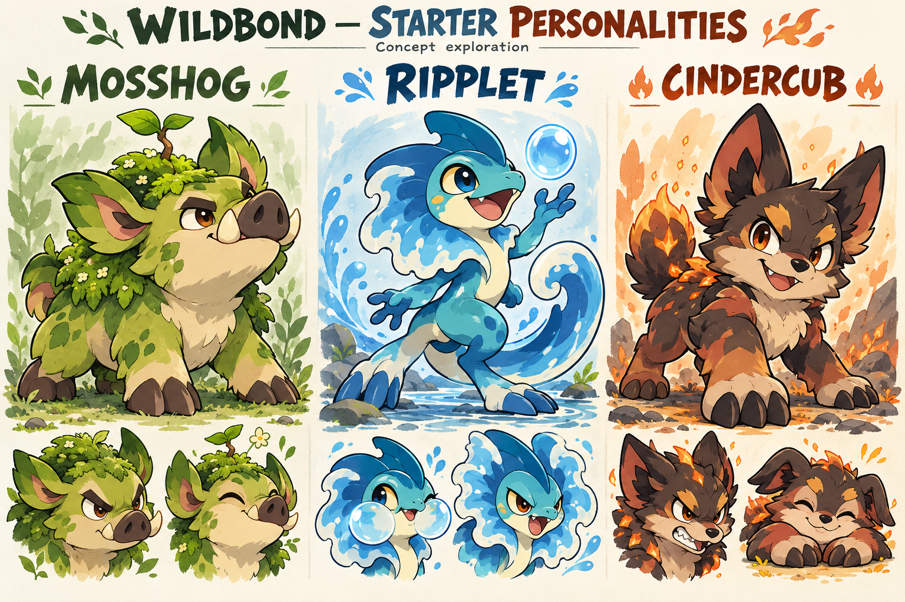

# Wildbond creature vision

Evan's direction, 2026-10-17: reimagine every existing and future creature with more personality and the expressive monster design of Pokemon Generations 1-4. This is the whole-roster direction; the first delivery is three starter concepts, not 189 finished sprites.

## Design bar

Give each species a recognizable silhouette, a signature motif and visible attitude. Exaggerate proportions, brows, mouth shapes, posture and movement. Make the element affect anatomy and behaviour rather than simply colouring an animal. Include quiet, strange, elegant and intimidating personalities alongside cute or fierce ones. More spikes and more detail alone do not create personality.

The selected [Bogsnap reference](bogsnap-selected-reference.jpg) remains the benchmark: squat heavy body, broad snout, cream underside, yellow eye, layered moss plates and thick tail. The different Muse ZIP Bogsnap and earlier held reference batches cannot substitute for this identity.

## First three proposals

These interpret the existing dex descriptions visually; they add no story clues or new mechanics.

| Species | Personality and signature | Existing evolution promise |
|---|---|---|
| Mosshog | Stubborn but tender gardener; huge snout, planted hooves, knowing eyebrows, moss garden and crooked sprout | Mosshog -> Thicketboar -> Thornback. Garden becomes awkward saplings, then a walking grove with tree and thorn crown. |
| Ripplet | Curious, mischievous river lizard; wave-fold neck frill, curled tail, buoyant proportions and bubble cheeks | Ripplet -> Riverwisp -> Tidewyrm. Compact lizard becomes gangly before gaining the river-dragon crest and tide ring. |
| Cindercub | Cocky scrapper with a cuddly side; big wolf ears/paws, coal shapes and banked ember cracks | Cindercub -> Smoulderpup -> Blazefang. Warm pup becomes lanky with glowing spine, then gains flame mane and glowing fangs. |

Keep Ripplet a river lizard and Cindercub a wolf. Leave the big tree, dragon crest and flame mane for their final evolutions. The concept board explores character poses and expressions; it is not a palette-compliant sprite atlas, consistent turnaround or animation sheet.

## Whole-roster rollout

[roster-review.csv](roster-review.csv) snapshots all 189 source species with stable ID, family, element, existing dex description and evolution requirements. Most are awaiting design; inclusion is not approval or a new runtime catalogue.

1. Establish the starter trio and preserve selected Bogsnap. Develop complete evolution families so recurring motifs grow coherently.
2. Select the opening-route encounter set from current maps. Prioritize screen time and contrasting silhouettes, including birds, bugs and stranger monsters.
3. Work region by region through the remaining roster, including previous art batches. Evaluate descriptions, evolution lines and uniqueness. Retain standout ideas; strengthen weak ones without deleting saved IDs.
4. For accepted designs, create consistent front/back construction, then idle, attack, hurt/faint poses and directional overworld walks. Use fixed individual canvases, foot anchors and explicit frame rectangles. Never slice a generated collage as a uniformly tiled atlas.
5. Review beside the selected reference and inside real battles/overworld scenes at game size for personality, cropping, silhouette, palette and motion before replacing textures. Existing art review applies before production merge.

Quality and playable needs set batch size. Existing art remains usable until replacement passes review. No mass generation of the catalogue.

## Pokemon inspiration and compatibility

Gen 1-4 provide design language: compact memorable silhouettes, bold anatomy motifs, anime expressions, personality and coherent evolution. We can reimagine a particular Pokemon too; record its source identity instead of relabelling a recognizable Pokemon as an original species. Broader inspiration can produce original Wildbond monsters while preserving their lore.

Species identity and art representation stay separate. Existing IDs and evolution links remain stable; new art gains a version/asset identity. Private Pokemon imports retain their own namespace, provenance and private storage. Registry work in #544 supports this boundary; this art task does not install imports or migrate saves.

## Same companions across visual eras

Game Boy, GBA, DS/HD-2D and modern toon 3D preserve silhouette, face, colour landmarks and evolution motifs. Simplify the same identity for small pixel budgets; add shading, animation and depth later. Controls can gain polish while familiar actions and accessible input remain consistent. A new renderer does not reroll a creature.

Evan explicitly identified Pokemon Battle Advanced as the goal on 2026-10-17. Its sprite-creatures-in-a-3D-world presentation is now the concrete target for Wildbond's modern world, rather than a distant optional reference. Keep the approved original starter identities, Wildbond locations/story and earlier visual-era progression.

Next implementation milestone: one bounded Thornwood clearing in Godot, using the approved starter identity, a readable camera, ground contact/shadows, depth/occlusion and a day/night or weather variation. Walk, encounter, enter battle, return to the same world position, and preserve the existing journey. Measure browser performance and input readability before expanding the region. Reuse suitable licensed environment props where practical; build recognizable Wildbond landmarks around them. This milestone is a plan, not an implemented 3D scene.

Directional/billboard sprites in a lit 3D scene can achieve this target without requiring every creature to have a fully rigged model. Later full-3D creature versions remain possible after modelling/rigging/animation work. Evan clarified on 2026-10-17: "Explore both but its more about the world presentation, likely with the standard turn-based battle but its whatever is easier to develop." Prioritize the world presentation and the fastest cohesive playable result. Use the existing turn-based work for the first slice. Real-time movement/combat may be explored as one bounded comparison prototype using the same species data and presentation, not as a requirement to build two full combat systems. Reassess only if that experiment demonstrates a meaningful development or playability advantage.

## Browser reference Evan supplied

Follow-up: [Public build architecture inspection](pba-inspection.md) confirms the Godot pack, Sprite3D/camera
boundaries and directional animation metadata. Read it for verified findings, REA assessment and limits;
the earlier page-only review below is historical.

Reviewed 2026-10-17: [GamingBible article](https://www.gamingbible.com/news/pokemon-firered-browser-game-is-the-glorious-kanto-remake-we-deserved-687652-20261016) and primary [Pokemon Battle Advanced developer page](https://thedaigan.itch.io/pba).

The developer describes pixel sprites in a 3D world, made in Godot 4.7, with real-time combat, weather and browser play. This supports exploring HD-2D presentation; Wildbond retains its requested turn-based direction. The page lists incomplete abilities and placeholder move effects. No source-code license was found on that page. No gameplay or performance testing was performed for this reference review.

Reuse candidate: the credited [Kenney Nature Kit](https://kenney.nl/assets/nature-kit) independently lists 330 3D files under CC0. Check each original pack before intake; generic props could accelerate a small Thornwood test. The demo also credits Pokemon/HGSS material, so its combined assets cannot be assumed CC0. Nothing was downloaded or installed.

## Provenance and validation

Generated with the built-in image tool, using selected Bogsnap as a style/quality reference. [Exact prompt](prompt.txt). No CLI fallback or external paid service. This is reference art, not implemented game content.

Bogsnap reference is copied byte-for-byte from Evan's selected 15642.jpg. [Manifest](manifest.json) records source and art SHA-256 hashes. Catalogue sources are wildbond.json SPECIES plus evolution.json species; evolution table overrides supply the relationships.

Validation reconciles unique IDs, existing descriptions and evolution targets against source, inspects concept labels/anatomy/framing/personality, and checks whitespace/path scope. Runtime/save/export files are unchanged. Full game suites are not needed for this reference-only change.
## Visual review of v1

The three names are correct, main bodies/feet/tails are contained, and the two expressions per species convey contrasting attitudes. Mosshog's garden, Ripplet's wave motif and Cindercub's coal/ember markings are visible. The designs are substantially more expressive than ordinary animal studies.

Evan approved this exact generation for the starters on 2026-10-17: "That generation is perfect for the starters." These are now the approved concept identities for Mosshog, Ripplet and Cindercub. Preserve the shown silhouettes, proportions, expressions, colours and signature features, including Cindercub's ember/flame treatment and Ripplet's wave frill. This approval supersedes the earlier suggestions to change those design features.

Production work should translate these identities faithfully into consistent front/back construction and game-size sprites. Palette reduction and frame construction are technical adaptations, not permission to redesign them. Animation, side/back consistency and in-game readability still need verification; the concept approval does not claim those deliverables already exist.
