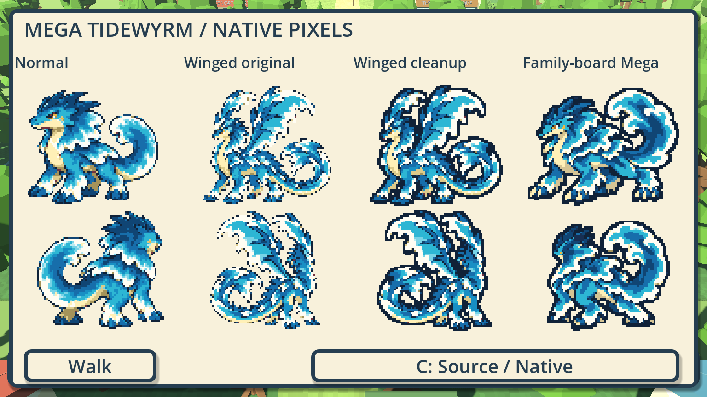

# Mega Tidewyrm: readability alternatives

WB-MEGA-TIDE-READABILITY · Codex / root for Evan · 2026-10-19 · [PR #584](https://github.com/ecbarish/generations/pull/584), stacked on #582.



Evan found the winged Mega rough at sprite size and asked to try the original family-photo Mega or clean up the existing sprite. This comparison does **both**: retain the exact winged input, provide a native-outline cleanup, and generate a simpler family-board-derived front/rear pair with its own native cleanup. Normal Tidewyrm stays beside them as a size/style reference. No option is automatically selected as canon or installed into gameplay.

## Open the comparison

[Compare Mega Tidewyrm.bat](../../../wildbond-godot/tests/mega_tide_readability/Compare%20Mega%20Tidewyrm.bat)

Or run Godot 4.7.2 with `--path wildbond-godot --rendering-method forward_plus res://tests/mega_tide_readability/play.tscn`.

The four columns show Normal, Winged original, Winged cleanup and Family-board Mega; front above rear. All native pixels retain integer scale. **C** compares source/native. **Walk** returns to the unsaved ordinary Tidewyrm world view; **Space/Views** returns to the comparison. The preview preserves the in-memory sample party and never opens a real profile. This is an appearance audition, not permanent evolution or a temporary battle mechanic.

## What changed

The simpler version follows the **bottom-right Mega on the original Ripplet-family board**, rather than the later standalone winged concept. It keeps the adult blue quadruped, cream jaw/neck/belly, golden eye and cheek mark, swept crest, broader wave mantle and large curled tail. One built-in **imagegen** call generated a new transparent front/rear sheet. [Exact prompt](prompt.json) and [source/reference hashes](provenance.json) preserve its identity and origin. The high-resolution output is copied unchanged; no earlier sheet or approved concept is overwritten.

Sampling a large sheet can miss a thin source outline. At native size that produces disconnected-looking edges, especially around white foam. The [workbench recipe](../../../tools/sprite-workbench/recipes/mega-tide-readability.gd) adds an explicit one-pixel navy outline to both cleanup candidates. It smooths only isolated interior colour flecks, retaining dark/gold eye details. An optional detached-component filter can remove only components of at most four pixels; **zero detached pixels were removed from these selected inputs**. Connected anatomy is retained. The added outline deliberately grows alpha by at most one native pixel; this is not a claim of identical before/after silhouettes.

Selected edits across both front/rear poses:

| Candidate | Interior colour edits | New outline pixels |
|---|---:|---:|
| Family-board Mega | 226 | 1,108 |
| Winged cleanup | 173 | 1,346 |

The winged cleanup uses an exact copy of #582's native winged atlas as its input. It is **not regenerated**. The simpler new sheet is measured from actual alpha; its native sampling budget is up to 80×64 before padding/outline so the body remains comparable with the existing final. No live size, stat, type, saved identity or form rule follows from these preview choices.

The two keys `mega_tidewyrm_simple` and `mega_tidewyrm_clean` are local display keys, not new canonical species IDs. The underlying eight-appearance art set remains intact. Both comparison Megas fall back to ordinary Tidewyrm for walking.

## Editable outputs and reproduction

Open an output's `assets/<key>/edit-session.json` in Sprite Workbench to resume its native edits against the retained `baseline/<key>/frames.json`. The combined [frames.json](../../../wildbond-godot/tests/mega_tide_readability/frames.json) also opens as measured native art. Source JSON uses LF to preserve exact input hashes across checkouts; original source pixels are immutable.

```powershell
# Re-measure without editing PNGs:
& $env:PYTHON wildbond-godot/tests/mega_tide_readability/measure_frames.py
& $env:GODOT --path tools/sprite-workbench --script res://recipes/mega-tide-readability.gd
& $env:GODOT --path wildbond-godot --rendering-method gl_compatibility --script res://tests/mega_tide_readability/checks.gd -- --capture C:/absolute/original-only-evidence
& $env:GODOT --path wildbond-godot --rendering-method forward_plus --script res://tests/mega_tide_readability/checks.gd -- --private --capture C:/absolute/private-evidence
node tools/run-all-checks.cjs
```

The recipe reopens both final edit sessions and checks every RGBA pixel/root against its exported atlas. Repeated-build hashes are recorded in provenance. Original-only [captures](captures/), native [before](before/) and [after](after/) sheets are retained. Private-pack captures stay outside Git at `C:/Users/evanb/AppData/Local/Temp/mega-tide-readability/private-*`.

Focused checks pass 46/0 portable and 47/0 with the actual private pack on each renderer. They cover measured bounds/alpha margins and hashes, native colours/padding/shared roots, body preservation and outline radius, unchanged old-wing input, appearance-only walking, all eight comparison portraits, source/native switching, layout and save/party isolation. All 28 repository suites pass (Wildbond 26,976/0; Starfall 488/0; 189 species and 23 unchanged save names). Exact-head GitHub CI is recorded separately in the PR. Passing tests do not decide art quality: Codex's preference is the family-board version for small-sprite readability; Evan chooses the direction.

Existing concept PNGs, all #582 source/native outputs, other starter families, live gameplay, save/schema/version and public export stay unchanged. Generations Reviewer owns merge; no publication is claimed.
