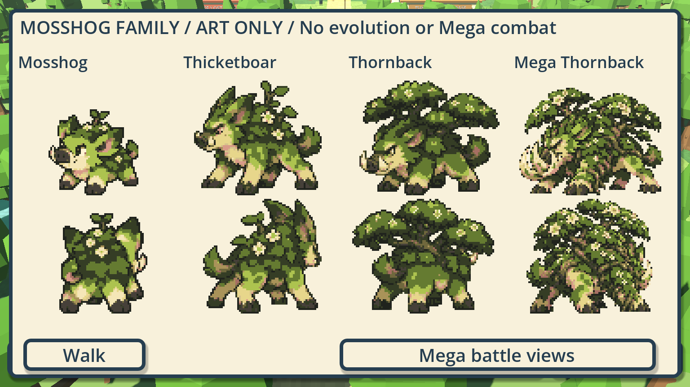

# Mosshog-family native atlas cleanup

WB-MOSSHOG-NATIVE-CLEANUP · Codex / root for Evan · 2026-10-18 · [PR #576](https://github.com/ecbarish/generations/pull/576), stacked on the reviewed workbench #574.

The approved Mosshog-family designs now have a native atlas pass covering **74 source-pose slots**: Mosshog, Thicketboar and Thornback each retain 24, and Mega Thornback retains its battle pair. These are edited derivatives made with the Sprite Workbench, not regenerated concepts. All approved boards, original high-resolution sprite sheets, prior pilot scenes, other starters, live party/species records and player saves remain unchanged.

## Inspect the result

Run [Play Clean Mosshog.bat](../../../wildbond-godot/tests/mosshog_clean/Play%20Clean%20Mosshog.bat), or Godot 4.7.2 with `--path wildbond-godot --rendering-method forward_plus res://tests/mosshog_clean/play.tscn`.

WASD/arrows walk, Shift runs, 1/2/3 select Mosshog/Thicketboar/Thornback, and Space/Views opens battle fronts/backs. **C toggles Original / Clean at the same world position**, including in the gallery. The selected mode is labelled. Family + Mega shows the entire line; the Mega remains a battle-only appearance and returns to ordinary Thornback walking. This scene is explicitly unsaved and does not implement runtime evolution or Mega combat.

To inspect/edit the results in [Sprite Workbench](../../../tools/sprite-workbench/README.md), use Open measurements on [the combined cleaned manifest](../../../wildbond-godot/tests/mosshog_clean/frames.json). To resume the actual root/pixel corrections, use Open draft on each creature's `assets/<name>/edit-session.json`. Those sessions refer to the retained native baseline atlas, with exact hashes and repository-relative paths. Native JSON uses LF via the local .gitattributes so checkout line endings do not invalidate those session references.

## Changes made

- Recenter each walking crop on its measured torso before editing pixels. Mosshog's old down/rear frames needed offsets from −5 to +3 native pixels; its planted upper body now stays put.
- Consolidate the six olive shading levels into three readable green tones in the foliage/upper body, retaining dark outlines, ivory/cream face/flowers and branch colours. A majority pass removes isolated interior green speckles without changing the silhouette.
- Use the idle/passing pose as the shared head/garden/upper-body reference for each direction. Preserve the generated articulated foot band and directional differences. All fifteen walking groups retain at least two distinct foot-band patterns; four source stride slots remain. This reduces texture crawl rather than pretending every generated body change is intentional animation.
- Restore Mosshog's two front-facing ivory tusk accents in all four forward walking poses. Remove three isolated foot-band pixels in Thicketboar.
- Rebuild Mosshog's front blink from its neutral front with changes confined to a small eyelid patch, preserving its body/tail alpha. Other fronts and rear alternates use neutral copies rather than whole-body twitches. New evolved eyelid animation and a proper subtle breathing pass remain future polish.
- Bake sixteen-colour, binary-alpha native atlases with shared padded cells/anchors. The new preview renders these pixels directly; it does not quantize the high-resolution source every frame. The inherited short creature stride cadence remains, while the trainer cadence is untouched.

These are cleanup candidates for visual/animation review, not automatic final art acceptance. The approved concepts have not been redesigned. Face/foliage stability and foot-pose diversity are measurable; subjective gait quality and foot contact still need a human viewing the walking preview.

## Reproduction and evidence

[Cleanup recipe](../../../tools/sprite-workbench/recipes/mosshog-cleanup.gd) calls the same workbench Session methods used by the editor: measured import, anchor changes, explicit palette-index pixel edits, draft saving and versioned export. It first bakes untouched native baselines, then edits those measured cells. Root alignment happens before root-relative pixel edits. The readable recipe plus [edit audit](edit-audit.json) and [hash provenance](provenance.json) preserve the derivation. Earlier generated PNGs are never rewritten.

Run the recipe with the workbench as project: `Godot --path tools/sprite-workbench --script res://recipes/mosshog-cleanup.gd`. It rebuilds only this task's selected baseline/final artifacts and before/after sheets. Every exported edit session is reopened and compared pixel-for-pixel/root-for-root against its atlas. Repeated generation reproduced every selected PNG, manifest and draft byte; the full artifact fingerprint is recorded in provenance. The raw PNG comparison includes alpha and hidden RGB; renderer motion checks ignore import-generated RGB bleed only where alpha is exactly zero.

Before / after contact sheets: [Mosshog before](before/mosshog.png) · [Mosshog after](after/mosshog.png) · [Thicketboar before](before/thicketboar.png) · [Thicketboar after](after/thicketboar.png) · [Thornback before](before/thornback.png) · [Thornback after](after/thornback.png) · [Mega before](before/mega_thornback.png) · [Mega after](after/mega_thornback.png).

Dedicated native checks pass **261/0 portable** and **262/0 with the actual private pack**, under Compatibility and Forward+. They cover all region bounds, shared roots, bounded palettes/binary alpha, clear borders, exact visible upper-body stability, retained moving feet, mirror mapping, no rear-body jumps, eyelid-only changes and correct brief timing, restored tusks, real held-key walking, Original/Clean location preservation, direct native rendering, battle-only Mega and unchanged in-memory party/no profile write. Actual private sprites were inspected; private captures stay outside Git at `C:/Users/evanb/AppData/Local/Temp/wildbond-clean-mosshog-private/`.

All **28 repository suites pass** (Wildbond 26,976/0; Starfall 488/0; 189-species catalogue; 23 save names; 21 context checks). No real save was opened. Committed export freshness, final-head evidence and remote CI state are recorded in the PR. No version bump, public export, author merge or publication is part of this step. Permanent evolution records/adapter and temporary Mega battle mechanics remain separate.
