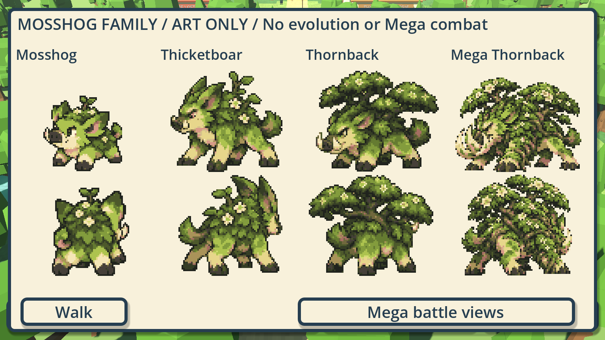

# Mosshog-family production pilot

WB-MOSSHOG-PRODUCTION · Codex / root for Evan · 2026-10-18 · [PR #573](https://github.com/ecbarish/generations/pull/573), stacked on #571.

Evan approved the selected starter-family concepts, including both standalone Mega revisions, before this task. This pilot preserves those concepts and the existing base Mosshog source. It supplies **50 new measured poses**: Thicketboar and Thornback each have four battle-source poses and twenty walking poses; Mega Thornback has a separate battle front and rear. Four strides in five drawn directions plus mirroring cover eight movement directions. No permanent evolution, evolved runtime species records, new stats, saved identities or Mega combat is introduced.

## Try it

Open [Play Mosshog Family.bat](../../../wildbond-godot/tests/mosshog_family/Play%20Mosshog%20Family.bat), or run Godot 4.7.2 with `--path wildbond-godot --rendering-method forward_plus res://tests/mosshog_family/play.tscn`. Compatibility also works. This is a separate **UNSAVED FAMILY PREVIEW**, using the chapter's world/camera/collision and optional real private pack. The actual development chapter stays at `tests/opening/play.tscn`.

Walk with WASD/arrows, hold Shift to run, and use 1/2/3 or the bottom buttons for Mosshog/Thicketboar/Thornback. Space or Views opens front/back beside the real private Pidgey when installed. Family + Mega opens all four appearances; Mega battle views shows the temporary form separately. Returning from that gallery restores ordinary Thornback walking. There is no generated Mega walking set. The underlying in-memory sample party never changes species when the displayed art changes; this is explicitly an appearance audition, not a runtime evolution adapter.

## Source preservation and measured rendering

Built-in imagegen generated the transparent PNGs from the approved family board. [Exact prompts](prompts.json) and [provenance](provenance.json) retain the role of the reference, output filenames and SHA-256 hashes. Original PNG bytes are copied unchanged, with generated alpha intact. Thicketboar v1, Thornback v2 and Mega Thornback v1 are selected. Thornback v1 is retained as a rejected iteration: its right edge clips and its small canopy does not follow the approved silhouette well enough. It is never referenced by the preview.

[measure_frames.py](../../../wildbond-godot/tests/mosshog_family/measure_frames.py) reads alpha, detects actual row/column components and records each complete silhouette, torso root and ground anchor in [frames.json](../../../wildbond-godot/tests/mosshog_family/frames.json). These are sprite sheets generated for this purpose, not chopped concept posters or assumed equal cells. The transparent row gaps can be only a few pixels; regions use a measured one-pixel clear boundary and checks reject source-edge clipping.

The pilot addresses relevant lessons from [Claude's #561 review](https://github.com/ecbarish/generations/pull/561):
- New roots use the torso band rather than whichever hoof is lowest. Sampling uses that root as its origin and one sample spacing per direction, so the crop corner does not shift the pixel grid between strides.
- Thicketboar advances a stride every 0.14 m and Thornback every 0.18 m, independent of the trainer cadence; walls/idle do not cycle feet.
- Front/rear art uses an integer UI-pixel scale. The private comparison retains its native source pixel scale instead of enlarging it to fill a box.
- Whole-body alternate battle poses remain preserved in the sources but are not animated. A clean eyelid-only blink/breath pass is still needed before enabling them.

The render adapter uses the existing Mosshog sixteen-colour palette and alpha threshold, with bounded 32-pixel base / 40-pixel evolved walking heights and up to 64-pixel evolved battle heights (80-pixel width ceiling). Sources remain high-resolution generated sheets, **not a baked, hand-cleaned native atlas**. The sampler is an audition tool; foliage speckle, small anatomical drift and foot contact still require visual acceptance and cleanup before scaling this pipeline to every family. Technical pose counts do not prove smooth animation. The old base sprite defects in #561 are not claimed fixed by this separate pilot.

## Verification and scope

Focused native checks pass **529/0 portable** and **530/0 with the installed private pack** before captures; the final capture/layout runs pass **537/0 portable** (Compatibility) and **538/0 private in both renderers**. All **28 repository suites pass**, including Wildbond 26,976/0, Starfall 488/0, the 189-species catalogue, 23 unchanged save names and 21 context checks. They check whole-source bounds/clear borders, exact pose counts, hashes/dimensions, mirror mapping, shared sampling/scale, stride selection, real held-key follower motion, gallery access, ordinary walking on leaving Mega views, unchanged in-memory party and no profile write. Renderer captures were inspected; an overview control/feet overlap and inflated private reference were corrected.

Public captures contain only original placeholder actors and original Wildbond art. Private Pokémon/NPC captures remain external at `C:/Users/evanb/AppData/Local/Temp/wildbond-mosshog-production-private/`; use that actual pack for visual acceptance. Existing saved starters, stats, save files, production engine, public PCK, versions and all approved concept PNGs are unchanged. No real player save is opened. The four requested window sizes are 375x812, 1366x768, 1920x1080 and 3440x1440. Godot retains the existing integer aspect-fit viewport: capture textures are 384x216, 1152x648, 1920x1080 and 2304x1296 respectively; screenshots omit window bars. Layout checks pass, but this native art preview is not mobile/touch acceptance. Final-head evidence is recorded in the PR.

The next gameplay piece, after sprite acceptance/cleanup, is explicit evolved records and a tested permanent evolution adapter; temporary Mega battle state follows separately. The other two families should follow a proven native atlas/animation pipeline, not a blind mass-generation batch. No merge or publication is claimed.
