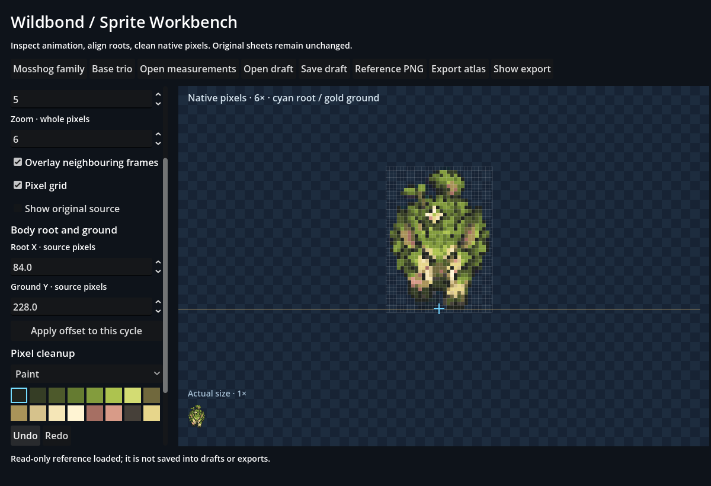

# Wildbond Sprite Workbench

WB-SPRITE-WORKBENCH · Codex / root for Evan · 2026-10-18 · PR #574, stacked on #573 for measured assets.

The first workbench is a standalone Godot project under `tools/sprite-workbench/`. This location keeps developer tools outside the game pack without changing export rules or rebuilding the public game. It reads current family/base measurements, previews and loops frames, overlays neighbouring poses, edits body/ground roots, paints or erases on a sixteen-colour native grid, supports Undo/Redo/reset, saves separate drafts and exports versioned native atlases with reloadable metadata.

[Launch, workflow and output contract](../../../tools/sprite-workbench/README.md) · [One-click launcher](../../../tools/sprite-workbench/Play%20Sprite%20Workbench.bat)

## Verification

The rendered dedicated suite passes **123 checks with zero failures**, including real pointer actions and exact exported-pixel comparisons. Compatibility and Forward+ are exercised. Four desktop sizes (900×680, 1366×768, 1920×1080, 3440×1440) retain a usable canvas and scrollable controls. Disabling game-style canvas stretching keeps the desktop UI text crisp when resizing. Original-art-only screenshots are retained here.

The actual Thicketboar/Thornback/Mega and base-trio inputs are loaded with exact source fingerprints. Tests paint/erase, edit roots, Undo/Redo, back up a draft, save/reopen it and compare metadata/pixels, export/reimport all selected creature frames, compare every native pixel/root, and make another separate export. Rejected malformed/future drafts and stale sources leave current work intact; controlled source changes after opening block export/save. Real source PNG/manifest hashes remain unchanged.

Optional reference PNGs are read-only, memory-only and excluded from output. No Pokémon/private NPC art was used in committed captures. No image-generation service, new concept art or source-raster rewriting is part of this change. The independent native project has no player-profile dependency. All output goes to its separate application-data folder by default; repository-backed drafts retain portable relative references and exact source hashes.

All **28 repository suites pass**, including Wildbond 26,976/0, Starfall 488/0, the 189-species catalogue, 23 unchanged save names and 21 agent-context checks. Committed export-freshness evidence and remote CI state are recorded in the PR. Art quality, polished starter animation, runtime evolution/Mega integration and public deployment are not completed by building the editor.

## Boundaries and next use

This first version imports existing measured manifests, not arbitrary grid-less concept posters. It provides palette-constrained pixel cleanup and root alignment; it does not invent anatomically correct walk cycles or automatically approve sprites. Exports are review artifacts until integrated deliberately. Apply the tool to the Mosshog pilot's foliage, motion and blink defects next, preserving the approved concepts.
