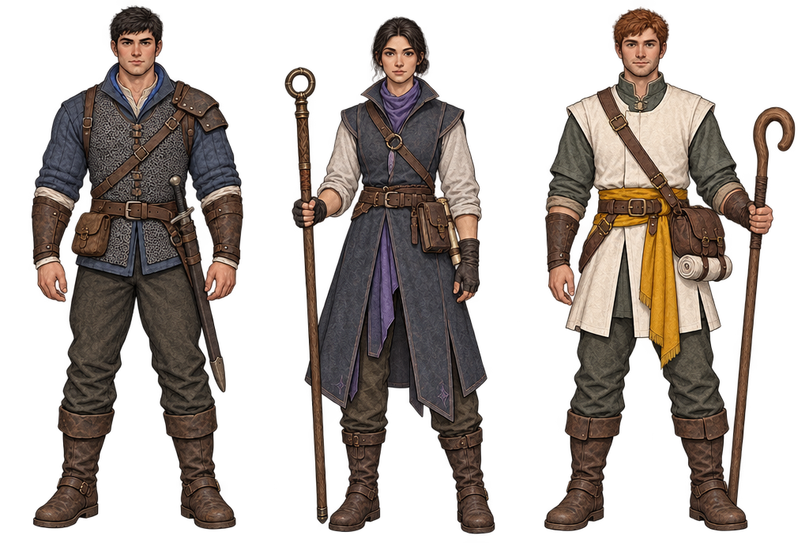

# Starfall: frontier adventurer reference pilot

Evan asked which next references would help development most. Wildbond now has a promising evolution direction; Starfall already has a coherent town palette but benefits immediately from recognisable people and attached equipment. This packet targets its opening roles rather than expanding late-game content.

Open [the review workshop](review.html). It compares Swordsman, Mage and Cleric front/rear studies in colour, greyscale and silhouette at reference, portrait and tiny-object sizes. A separate frontal lineup helps review faces. The existing Starfall town mock-up supplies environmental context; these characters have not been installed in it.

## What is established

| Role | Readable visual anchors | Practical equipment proposal |
|---|---|---|
| Swordsman | Compact fitted torso, blue collar, sturdy shoulders, hip scabbard | Padded jacket, mail vest, bracers, boots, plain sword and belt pouch |
| Mage | Tall staff, split long coat, muted violet collar | Wool layers, field-book pouch, rolled notes, plain staff |
| Cleric | Cream/ochre front, short split tunic, curved crook, rounded satchel | Travel clothes, cloth roll, medical satchel, boots and walking crook |

These are **unnamed adult role studies**. The starting game roster includes Aki (Swordsman), Ren (Mage) and Yuna (Cleric), but this packet does not decide their faces, gender, ancestry or clothing. Neither does it turn a proposed satchel/crook into a new gameplay item. Class appearance must remain available to different people and body proportions.

The references use substantial bodies and quiet material groups. Leather straps, cloth, mail and small class accents carry the design; oversized disconnected armour does not. Rear views show hair, back cloth and equipment instead of a front face pasted onto the back.

## Assessment and remaining corrections

- **Stronger base:** body/limb proportions, boots, fitted layers and coherent carrying positions are clearer than a pile of unrelated gear. The frontal lineup resolves the first mage/cleric views' turned-away faces.
- **Shoulder side:** the Swordsman reinforcement may switch anatomical sides between the initial views. Fix it to the character's left (picture right when frontal), or deliberately replace it with a documented symmetric design. Do not model each generated view independently.
- **Head direction:** first Mage/Cleric "front" studies look away. Use the frontal lineup to establish the face, then redraw proper matching front/profile/rear views.
- **Tiny read:** rich mail, straps and rolled notes cannot be expected to survive a 24-pixel object height. Keep role identity in garment masses, collar contrast, staff/crook shape and scabbard. Author the game sprite deliberately rather than reducing these illustrations and calling them finished.
- **Palette and style:** the established Starfall sheet remains authoritative: cool pine/moss/mud/log/stone, guild blue and warm lamplight, restrained pixel ramps. Generated illustrations have far more colours and different edge treatment. These are references for forms/materials, not replacements for its palette or sprite rules.
- **Views and rig:** clarify gear anchors and symmetrical body landmarks across all views before a mesh, rig or clothing kit is made. Cloth/armour must follow shoulders, elbows, hips and knees without hiding the body or intersecting it.

## Next useful build

Evan's follow-up is implemented as a [shared asset-library registry and browser](../asset-library.md). The four references are registered beside existing reusable bodies, outfits, animations, equipment factories and palettes. Search and reuse a compatible resource before making another; preserve its stable ID when improving its representation. This library is a foundation, not a claim that all existing rigs already fit every game.

Start with **one Swordsman body and one fitted kit**, rather than seven unrelated character meshes. Make front/profile/rear drawings with the correct shoulder side, neutral hands and a defined sheath mount. In 2D, prove a 16×24 silhouette plus front/rear walk frames. In 3D, prove a stable skeleton and compatible head/chest/hip/hand/foot anchors, then fit the vest, boots, bracers and scabbard during idle and walk. Add the Mage/Cleric clothing silhouettes to the same attachment contract once it works.

Only then explore equipment progression: a repaired coat, better fitted vest or distinctive tool should visibly improve the same person. This is an art-production recommendation, not new ranks, stat bonuses, loot tables or purchase tiers.

Realmbound can reuse the **method**, not automatically these costumes: one clear body, deliberate material groups, stable attachment points, front/back/profile checks and equipment that follows animation. Its existing contract in [docs/proposals/realmbound-assets.md](../../proposals/realmbound-assets.md) already defines metre scale, pivots, visual slot IDs and bone/pose behaviour. Starfall's muted frontier gear should remain distinct from Realmbound's high-fantasy journey.

## Evidence and provenance

Four 1K generations: three two-view role sheets and one reference-guided frontal lineup. Originals are unchanged in `originals/`; exact prompts, job IDs and billing snapshots are in `provenance.json`; hashes, dimensions and six cutout bounds are in `audit.json`. Total original size: **6,108,542 bytes**. The review thresholds alpha for display only.

Account balance changed **66.75 → 60.75**, so this round used **6 credits**. No purchase or subscription was made. Generated-art provider rights remain unverified; these are not cleared production game assets. The game, named cast, saved characters, Godot renderer and equipment systems are unchanged.

## Validation

The role workshop passed 54 direction/mode/size/layout combinations at 390, 1440 and 3440 px widths: three visible equal-height roles, loaded lineup/town context, no page errors or horizontal overflow. Evidence: `browser-checks.json` and `capture-*.png`.

The shared library passed 15 filter/layout cases plus four negative integrity cases: duplicate IDs, unverified production claims, changed source hashes and missing dependencies were all rejected. Its registry has 17 IDs pointing to 15 source files; no asset bytes are duplicated in the registry. The asset-library check is included in `tools/run-all-checks.cjs` for normal CI use. Evidence: `library-checks.json` and `library-1440.png`.

## Final paired-character push

Start with [paired role kits](kits.html), [the working fitting bench](../../../experiments/character-library/) and [the pause handoff](FINAL-PUSH.md). Three role sheets cover male/female front/rear views; the bench proves actual source-rig reuse with two outfit families. Exact new prompts and corrections: kit-provenance.json. The image sheets and source meshes are separate resources.
