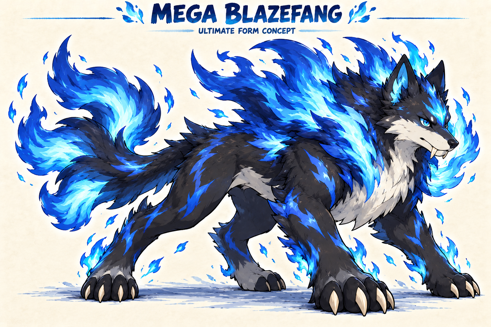
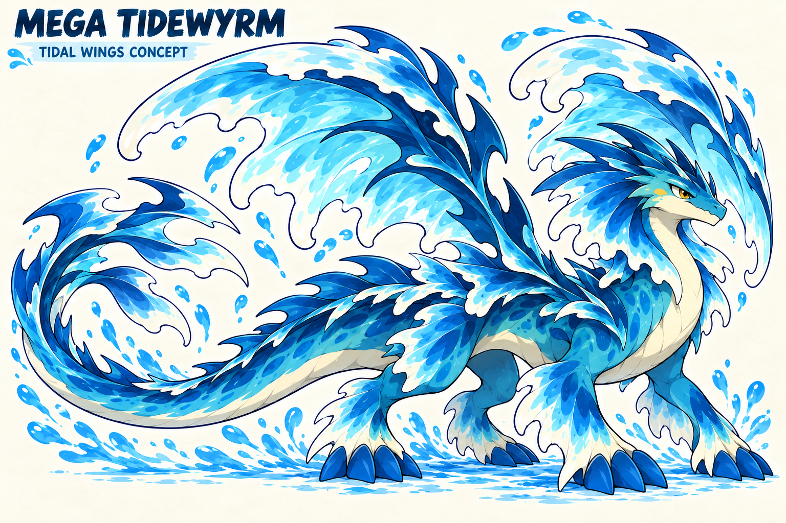
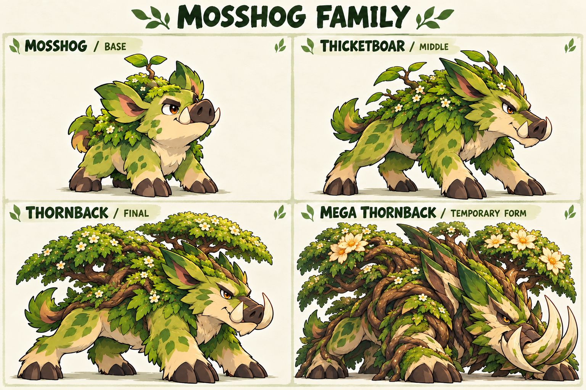
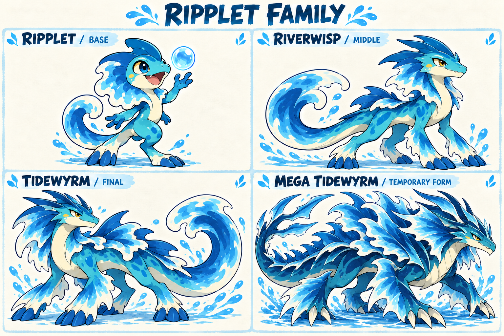
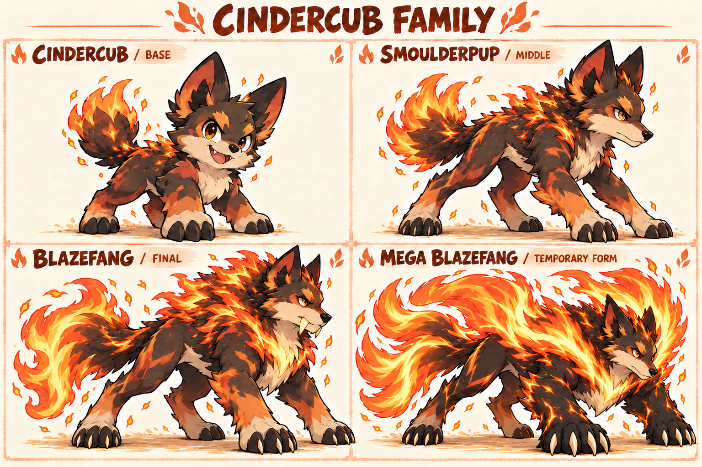

# Wildbond starter families: evolution and Mega concepts

WB-STARTER-FAMILIES, Codex / root for Evan, 2026-10-18. PR #571, stacked on #570. Three complete family concept boards, **12 stage/form designs**: base, middle, final and temporary Mega for each approved original starter. Mosshog's complete concept line and Ripplet's normal line are now approved; the two standalone Mega revisions and other unapproved appearances remain candidates. The approved base identities remain the authority; no saved creature, live evolution, combat stat, sprite atlas or public build changes.

## Current approved direction and focused Mega revisions

Evan explicitly approved **the entire Mosshog line** and **Ripplet's normal line**. Their current boards and normal designs remain byte-for-byte unchanged. He requested a more ultimate Mega Blazefang with a dramatic color change, supplying Mega Charizard X as the reference, and suggested water wings for Mega Tidewyrm.

The two new standalone images below are **candidates pending visual approval**, overriding only the old Mega panels on the retained family boards. They do not replace or redraw approved normal forms.

### Mega Blazefang: obsidian and blue fire

Charcoal-black/deep-cobalt coat, silver-white chest/muzzle, an icy-cyan blaze and blue-white fire mantle/tail create a substantial contrast to normal orange Blazefang. Mature wolf face and four-legged anatomy stay intact. The user reference guides the color transformation, not Charizard anatomy. Blue flame is an art choice: no Ice/Water typing or new abilities are assigned.

### Mega Tidewyrm: tidal wings

Two sweeping, connected wave-fin wings grow from its shoulders, with translucent blue membranes and white foam edges. The mature river-dragon face, four legs, fin crest and hydrofoil tail remain recognizable. Wings are a Mega-only art concept; they do not grant Flying type, flight traversal or a new field move.

The original supplied Charizard reference remains external; it is not copied into the repository. [Exact focused prompts](ultimate-prompts.json) and provenance record the source roles. The earlier family boards below retain their prior Mega panels for comparison; **the standalone portraits above are the latest Blazefang/Tidewyrm Mega candidates**.

## Revised after Evan's feedback

The selected boards below are Mosshog v2, Ripplet v2 and Cindercub v3. Evan pointed out that the first set kept baby faces while bodies grew, and that the Megas needed a much stronger transformation. The revisions change skull, muzzle, jaw, eye size and brow structure across ordinary evolutions; the reference is the degree of maturation in Charmander's line, not copying its designs. Megas now change silhouette and structure substantially. Base identities remain cute and familiar. Earlier boards remain alongside these for comparison. The approval update above governs concept selection; none of these posters is a runtime sprite.

## Mosshog family

**Mosshog → Thicketboar → Thornback → Mega Thornback (temporary).** The stubborn little gardener grows into a guardian whose strength supports a living grove. Keep the dark pig snout, cream cheek, leaf ears, cloven feet and tusks throughout. Thicketboar is longer and scruffier, with lopsided saplings. Thornback settles into a broad canopy attached to its shoulders with room for nesting. Its revised Mega is an ancient root-colossus: massively broadened root-wrapped forequarters, an ivory-bark facial mask, fierce wedge-shaped adult face and branching plough-like tusks under an open bough canopy. Proposed combat direction: a sturdy physical defender, with exact typing/stats/abilities unsettled.

## Ripplet family

**Ripplet → Riverwisp → Tidewyrm → Mega Tidewyrm (temporary).** The curious bubble-maker develops into a composed river dragon while keeping its playful face. Golden eyes, cheek spot, cream jaw/belly, head crest, wave frill and curling tail connect the line. Riverwisp stretches into its legs and frill. Tidewyrm has four weight-bearing legs and an unfurled wave crown. The revised Mega is a darker storm-tide dragon with a sharp adult skull, a sweeping layered dorsal sail, broad fin-edged limbs, ivory claws and a three-pronged hydrofoil tail. Proposed role: a flexible special attacker with staying power. Riverwisp's revised head and more restrained crown give it a clearer adolescent stage, although the fin treatment still needs simplification at sprite scale.

## Cindercub family

**Cindercub → Smoulderpup → Blazefang → Mega Blazefang (temporary).** The cocky pup becomes a loyal, proud hearth guardian. Keep pointed ears, amber eyes, orange forehead blaze, cream muzzle/chest and warm ember coat. Smoulderpup is lanky with oversized paws and an uneven smoldering ruff. Blazefang's shoulder ruff opens into a living flame mane, with a single high tail plume and glowing fangs. The current Mega has a long fierce wolf face, obsidian forequarters/paws with ember seams, a broad attached sunfire mantle and a sweeping three-plume tail, with a stronger black/gold palette split. Proposed role: fast aggressive attacker. The first Mega attempt looked too close to normal Blazefang; the intermediate v2 revised that panel, and the current selected v3 further matures the later faces and intensifies the Mega.

## Existing records and approval boundaries

The middle forms are already defined in **`wildbond-godot/data/evolution.json`'s species overlay**, although absent from the base `wildbond.json` SPECIES export. They are not missing from the legacy engine. Existing normal evolution rules are level 16 into the middle, then level 36 plus bond condition 3 into the final. These rules are recorded, not changed or newly approved here. Mega activation is a separate temporary battle mechanic under the [Stand with it plan](../../plans/wildbond-world/stand-with-it.md); it is not a fourth permanent evolution and does not inherit the old low-HP/last-survivor conditions.

The current native chapter supports only the three base original starter records/sprites. It does not gain evolved records, evolution mechanics or Mega combat from these boards. The native starter sprites from #559/#560 remain unchanged; #561 retains independent ownership of their existing sprite review. Older Higgsfield stage/payoff explorations are research, not substitutions for the later approved base identities. Names come from existing data, not a new rename. Secondary types, final balance and Mega form IDs are proposals until implemented deliberately.

## Art sources and delivery

Built-in **image_gen** generated the three selected 1536x1024 boards from the [approved starter reference](references/approved-starters.png). The approved board was copied byte-for-byte from `codex/wildbond-creature-vision`, commit `9905917e8186e1424b2b0c0af7397d28e8488099`. The first family board was also used as a presentation reference for the next two. These are original character concepts; no imported Pokemon assets appear on the boards.

[Exact prompt set](prompts.json), [file hashes/provenance](provenance.json) and [machine-readable family brief](families.json) preserve all inputs, selected outputs, stage links and readiness boundaries. Source PNG bytes were copied unchanged from the built-in generated-image output; no raster cropping, resampling or pixel rewriting. Earlier discarded Cindercub v1 remains in the built-in generation directory and is not the selected delivery.

## Visual inspection and next production piece

All three current boards were inspected for four named stages, complete silhouettes, retained family/palette landmarks, progressively mature heads and more dramatic Mega silhouettes. Mega Blazefang received one focused refinement. The illustrated boards include shading, foliage, flowing foam and flame details that are too dense for native game sprites. These are **concept boards, not production sprites, animation sheets or final art acceptance**. Front/back and walking assets need separate measured canvases, a simpler shared pixel palette, real feet anchors and consistent directional anatomy. Do not slice equal rectangles out of these posters to produce battle sprites.

Next: choose one family as the complete production pilot; derive the middle and final front/back sprites and measured walking cycle beside its current base and the real private Pokemon references. Test readable silhouette and motion first, then implement explicit evolved data and a tested permanent evolution adapter. Once the ordinary final works, produce and integrate its Mega battle front/back as a separate battle-local form. Repeat the proven pipeline for the other two families. Keep each family's approved identity rather than generating an unrelated animal at every stage.

Technical verification: all three selected PNG hashes/dimensions and the approved-reference hash match provenance; all 12 stage/form IDs are distinct; the nine ordinary names and six line links match legacy data/overlay; eight local links resolve; all 21 agent-context checks pass; whitespace is clean. The Mega-focused Cindercub edit re-rendered the whole board, so the other panels retain their visible identity but are not pixel-identical to v1. No production gameplay tests were rerun for concept art/documentation outside runtime; committed export freshness is checked before handoff. Evan/Game Art Director visual acceptance is still pending.

Revision verification: current Mosshog v2 / Ripplet v2 / Cindercub v3 are generated with built-in imagegen, copied unchanged, and selected explicitly in provenance/family metadata. Earlier boards remain retained, not silently overwritten. Exact follow-up prompts are in [maturation-prompts.json](maturation-prompts.json). This is still visual concept work; live starter records, sprites, evolution rules, Mega activation and saves are unchanged.

Focused revision verification: all earlier selected family-board hashes remain unchanged; both new standalone portraits are copied without pixel rewriting. Approval scope and two Mega overrides are explicit in family/provenance data. New portraits remain candidates; concept approval of the Mosshog/Ripplet normal lines does not imply production animation or battle readiness.
