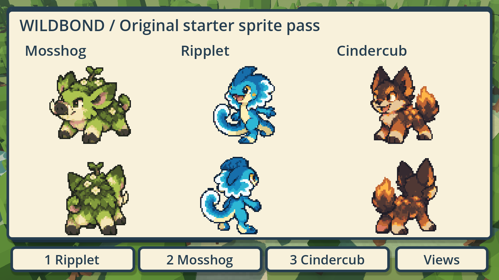

# Approved starter sprite production

WB-STARTER-SPRITES · Codex / Evan · 2026-10-18 · [PR #559](https://github.com/ecbarish/generations/pull/559), stacked on #558; approved concept authority is separate #548.



## Delivered

Mosshog, Ripplet and Cindercub each have a complete first sprite-production candidate: **24 measured poses**, **72 total**. Four battle poses provide front normal/blink and rear normal/breathing. Twenty walking poses provide four stride frames for each of five drawn directions: down, down-right, right, up-right and true rear. Mirroring supplies the other three movement directions; these are not eight independently drawn walk cycles.

The approved identities remain: Mosshog's moss garden, flowers, sprout, tusks and attitude; Ripplet's expressive river lizard, wave frill and curled tail; Cindercub's oversized ears/paws and ember/flame wolf treatment. This is technical adaptation of the chosen trio, not replacement starter selection. [Exact built-in imagegen prompts](prompts.json) and [provenance/hashes/limits](provenance.json) are retained. Four original PNG outputs are preserved without pixel rewriting: the detailed first Ripplet reference, its coarser correction, and the other two sheets. Runtime selects Ripplet v2. No paid CLI/API fallback was used.

## Play the art preview

Open [Play Starter Sprites.bat](../../../wildbond-godot/tests/starter_sprites/Play%20Starter%20Sprites.bat), or from repository root:

```powershell
& $env:GODOT --path wildbond-godot --rendering-method forward_plus res://tests/starter_sprites/play.tscn
```

WASD/arrows walk, Shift runs, **1/2/3** or the bottom buttons select Ripplet/Mosshog/Cindercub. **Space**, Menu, E, B or Views opens battle art beside the appropriate optional Pokémon reference (Wooper/Pidgey/Vulpix). The front briefly blinks and the rear switches to its breathing pose. All starters opens the trio overview. Escape/Back returns to walking. Map retains the measured local geography. The world view includes the selected reference Pokémon nearby when the private pack is installed; foliage can hide it as you walk, and the battle comparison remains unobstructed.

This is explicitly marked **UNSAVED SPRITE PREVIEW**. It reuses the actual chapter camera, walking/collision/follower pipeline and scenery, but does not open Evan's chapter/adventure save or change starter stats, species records, quests or the original party. It uses a process-specific unsaved in-memory chapter only to exercise presentation. Party/battle/item interactions route to the art gallery to avoid implying that a displayed original is a renamed Pokémon record. The real playable chapter stays at `tests/opening/play.tscn` with its existing saves and rules. These starters are not yet selectable in its persistent opening.

## Why this does not repeat the chopped-sprite problem

Generated canvases do not obey exact tiles. [frames.json](../../../wildbond-godot/tests/starter_sprites/frames.json) records each actual complete region and foot anchor, not equal-width guesses. [measure_frames.py](../../../wildbond-godot/tests/starter_sprites/measure_frames.py) reads source alpha, finds separated rows/poses, rejects unexpected counts or clipped bounds, and writes metadata only. It never crops/redraws/re-encodes a PNG. Four clear source pixels surround every rendered silhouette. Anchors follow the lower foot area, not the frill/tail tip. Runtime physical scale is fixed from one neutral reference pose per starter; directional changes do not rescale its body.

The generator's raw sources remain more finely shaded than the installed Pokémon. Game-side renderers deliberately sample a stable **32-pixel-high world reference canvas / 64-pixel-high battle reference canvas**, with **16 chosen colours per starter** and nearest sampling. Transparent source padding is included in that canvas budget. Palette/alpha decisions happen in the Godot material, not destructive edits to the generated source. Alpha below 0.5 is discarded to prevent generation matte/halos. These technical adaptations make the first pass comparable to existing sprites without claiming the generator produced a hand-cleaned, exact 16-colour native-resolution atlas.

Gait advances only from actual travelled distance, pauses at stops and uses the existing retained direction/hysteresis. Battle frames have a brief blink interval and fixed reference scale/ground alignment. Preview display heights (0.55/0.55/0.60 m) are audition values, not new lore measurements. Imported reference art remains external; only original generated assets and fallback captures are committed.

## Verification

- **369 focused checks pass**, with final native **Forward+ public fallback** and **Compatibility private** captures inspected. Tests cover hashes/dimensions, all 72 regions, clear rendered margins/anchors, stable scale, 16-colour material data, 8-direction/4-phase selection, actual held W following with at least three stride poses, stopping, real collision-aware walking, battle views, no record mutation and no test/profile save writes. Both GPU shader paths compile cleanly on the local RTX 4090. No mobile/low-end performance acceptance is claimed.
- **All 28 repository suites pass**, including Wildbond **26,976/0**, Starfall **488/0**, the unchanged 189-species catalogue and 23 save names. Godot import, whitespace and committed export freshness are recorded at handoff. Production source and the public PCK remain unchanged.
- Public evidence contains original/fallback actors only: [trio](captures/starter-trio.png), [Ripplet world](captures/ripplet-world.png), [Mosshog world](captures/mosshog-world.png), [Cindercub world](captures/cindercub-world.png), and each named `*-battle.png`. Actual Pokémon/trainer comparison screenshots remain external at `C:/Users/evanb/AppData/Local/Temp/wildbond-starters-compat-private/`. Earlier private Forward+ captures are at `wildbond-starters-private/`; the Compatibility set is the final palette/anchor pass.

Focused commands:

```text
Godot --headless --path wildbond-godot --script res://tests/starter_sprites/checks.gd
Godot --path wildbond-godot --rendering-method forward_plus --script res://tests/starter_sprites/checks.gd -- --capture ABSOLUTE_PUBLIC_OUTPUT
Godot --path wildbond-godot --rendering-method gl_compatibility --script res://tests/starter_sprites/checks.gd -- --private --capture ABSOLUTE_EXTERNAL_OUTPUT
```

## Remaining quality work

This delivers usable candidate source poses, metadata, materials and a native preview, **not final human art acceptance or starter gameplay integration**. Four generated stride poses cannot yet equal the hand-tuned frame richness of PMD. Minor pose/anatomy/flower/ember placement differences remain candidates for artistic cleanup. Overworld resting uses a settled passing pose, not a complete dedicated idle/blink set in every direction. Attack/hurt/faint art, evolution stages, full learnsets and the original-starter Pokémon-rules adapter are future work. Concept approval is already recorded; approval of these production sprites has not been presumed.

Next inspect the playable preview with Evan, address concrete visible issues, then integrate the accepted trio with their own original identities and conservative rules/save adapters. Never relabel a Pokémon save record as an original starter. Do not mass-produce evolution/roster art until this first trio's game-size readability and motion meet the bar.
