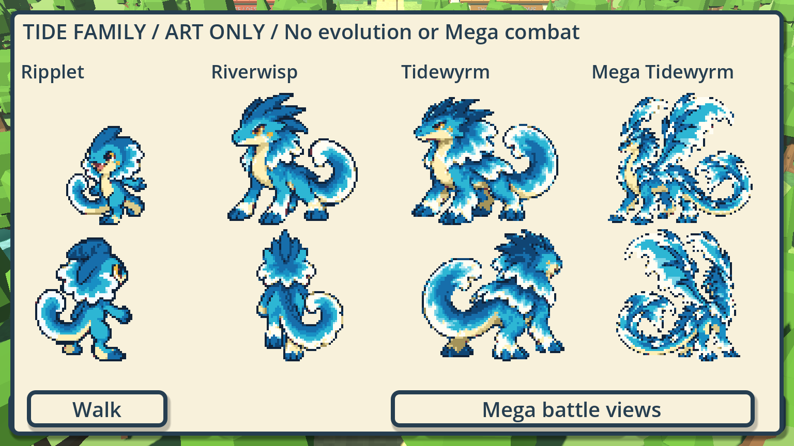
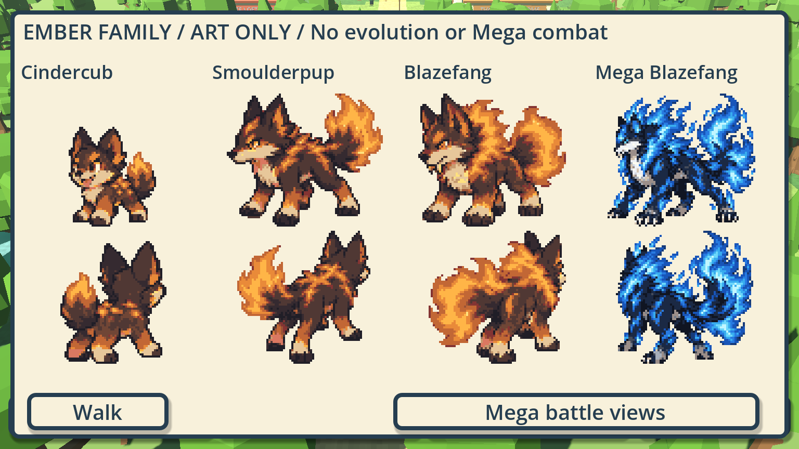

# Tide and Ember starter production

WB-TIDE-EMBER-PRODUCTION · Codex / root for Evan · 2026-10-19 · [PR #582](https://github.com/ecbarish/generations/pull/582), stacked on safety repairs #581.




The remaining approved families now have the same production/cleanup workflow as the Mosshog pilot:

- Ripplet → Riverwisp → Tidewyrm, plus the approved **winged Mega Tidewyrm**.
- Cindercub → Smoulderpup → Blazefang, plus the approved **blue-fire Mega Blazefang**.

Six selected new source sheets provide **100 measured pose slots**. Existing Ripplet/Cindercub sources supply another 48. The native derivative set therefore contains **148 slots**: six ordinary forms with 24 each, plus two Megas with front/rear pairs. “Slots” does not mean 148 unique drawings: neutral alternates and Riverwisp's selected true rear are intentionally repeated. Every ordinary direction retains at least two visibly different foot-band patterns.

## Play the art preview

Open [Play Tide and Ember Families.bat](../../../wildbond-godot/tests/tide_ember_family/Play%20Tide%20and%20Ember%20Families.bat), or Godot 4.7.2:

```powershell
& $env:GODOT --path wildbond-godot --rendering-method forward_plus res://tests/tide_ember_family/play.tscn
```

WASD/arrows walk; Shift runs. **T** or the Tide/Ember button switches families. **1/2/3** select that family's base/middle/final. **C** compares Original/Clean at the same world position. **Space/Views** opens front/back; Family + Mega shows all four appearances, and Mega battle views shows its pair separately. Leaving Mega views returns to the ordinary final walking appearance.

This is an explicitly **unsaved art audition**. Display selection does not change the underlying sample party's species. The active chapter is still `tests/opening/play.tscn`; permanent evolution, evolved rules/save identities and temporary Mega combat are separate work. No real profile is opened.

## Source and native editing

Built-in **imagegen** made the eight retained output PNGs; [all exact prompts](prompts.json), [source/reference hashes and iteration history](provenance.json) are recorded. Approved concept boards and existing base sheets are unchanged. Six outputs are selected. Mega Tidewyrm v1 is retained as too busy at native size; v2 simplifies its wave panels but its silhouettes overlap horizontally; v3 separates them and is selected. V3 uses v2 as its edit target; v1/v2 ultimately derive from the approved standalone winged reference. Mega Blazefang retains obsidian/cobalt/silver-white/cyan fire, rather than inheriting the normal orange palette. No type or combat ability is inferred from appearance.

[measure_frames.py](../../../wildbond-godot/tests/tide_ember_family/measure_frames.py) reads actual alpha runs, rejects clipped/merged pose groups, and records complete regions, torso roots, shared sampling per direction and clear borders. It does not slice assumed grid cells or concept posters. Riverwisp's generated battle rear is too side-on: measured slots2/3 deliberately use its complete true-rear passing pose21, sampled at battle resolution. The original rejected angles stay in the unchanged PNG.

[The workbench recipe](../../../tools/sprite-workbench/recipes/tide-ember-cleanup.gd) uses the repaired Session backend to bake untouched native baselines, align roots, stabilize each direction's head/body/frill or mane, retain articulated feet, neutralize whole-body battle jumps, and paint small eyelid-only front blinks. All six ordinary fronts blink briefly; rear bodies/tails stay neutral. Megas remain a battle pair, without invented walking animation. Upper-body stabilization deliberately reduces texture crawl; a human still needs to judge stiffness and foot contact.

Selected output is under [assets/](../../../wildbond-godot/tests/tide_ember_family/assets/), with `atlas.png`, `frames.json` and `edit-session.json` per appearance. Open its edit-session in Sprite Workbench to resume native edits against the retained baseline. The combined [frames.json](../../../wildbond-godot/tests/tide_ember_family/frames.json) opens as measurements. Drafts retain repository-relative references and source hashes; JSON has stable LF checkout endings. Original/Clean comparison uses the same measured source selection.

Native pixels have opaque sixteen-colour palettes and binary alpha. Shared padded cells/roots keep animation aligned. World rendering uses nearest native texels; clean UI portraits use an AtlasTexture directly at integer scale. The palette pass is a production candidate, not automatic approval of every pixel or gait.

## Evidence and reproduction

The recipe reopens every final draft and compares every exported native pixel/root with its atlas. Running it twice reproduced **all 49 selected PNG/JSON artifacts byte for byte**. [Artifact hashes](reproduction-before.json) and the aggregate fingerprint are retained in provenance. Eight source PNG copies match their unchanged built-in outputs exactly. Before/after native contact sheets are in [before/](before/) and [after/](after/).

```powershell
& $env:GODOT --path tools/sprite-workbench --script res://recipes/tide-ember-cleanup.gd
& $env:GODOT --path wildbond-godot --rendering-method gl_compatibility --script res://tests/tide_ember_family/checks.gd -- --capture C:/absolute/original-only-evidence
& $env:GODOT --path wildbond-godot --rendering-method forward_plus --script res://tests/tide_ember_family/checks.gd -- --private --capture C:/absolute/private-evidence
node tools/run-all-checks.cjs
```

Dedicated checks pass **530/0 portable with captures** and **531/0 with private references and captures**. Both renderer results are recorded in the PR. They verify raw/native hashes and whole-source bounds, clear alpha borders, all 148 slots, palettes and shared roots, stable upper bodies, retained moving feet, eight-way mirrors, localized blinks/timing, neutral rears, real held-key movement, family button selection, Original/Clean position preservation, battle-only Mega, unchanged party and no profile write.

Public [captures](captures/) use original art/fallback actors only. Actual private Pidgey and trainer comparisons were inspected; those files remain outside Git at `C:/Users/evanb/AppData/Local/Temp/tide-ember-private/`. Four requested native window sizes are 375×812,1366×768,1920×1080 and3440×1440; integer aspect-fit viewport behavior is inherited. These are window/layout checks, not physical-phone or touch acceptance.

All **28 repository suites pass**, including Wildbond 26,976/0, Starfall 488/0, 189 catalogue species, 23 unchanged save names and 21 agent-context checks. The quiet helper runs the unchanged aggregate while muting test-browser speech/audio. Export freshness and exact-head remote CI are recorded separately in the PR.

Production/motion acceptance is pending human viewing. No approved concepts, Mosshog output, live species/stats, player saves, game version or public pack changed. No merge/publication is claimed.
