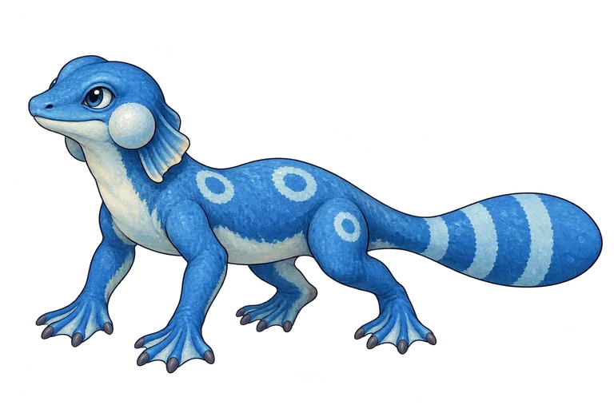
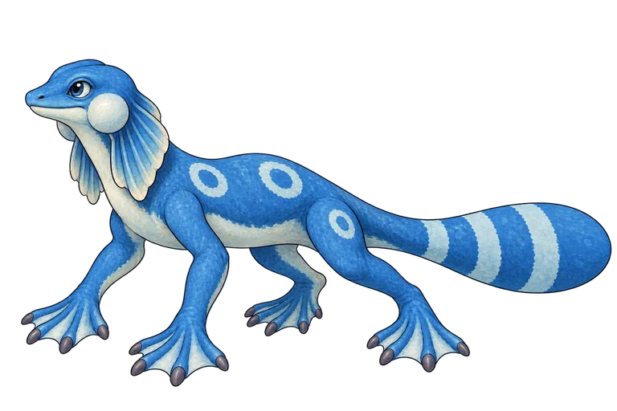
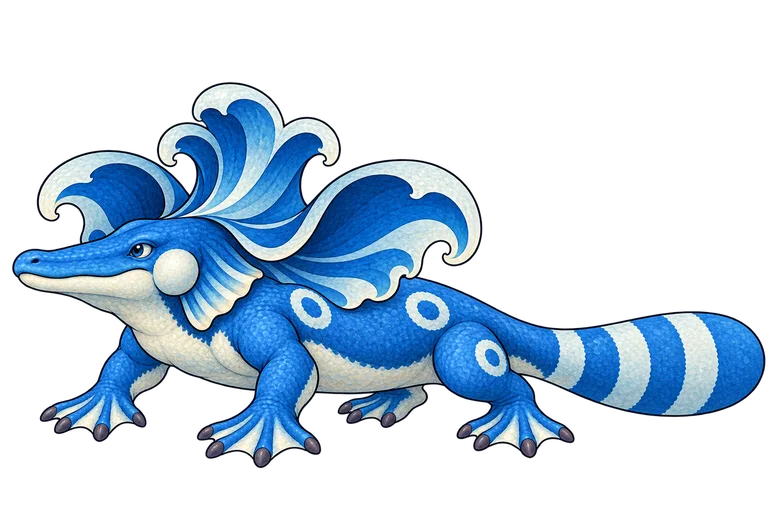

# Tide family: one identity, three promises

**AI-generated concept candidates. Not approved game art.** Created from Evan’s creature design journal, 2026-10-13. [Review PR #311](https://github.com/ecbarish/generations/pull/311).

## Ripplet · a folded promise

The humble river-lizard beginning now hints at its future crown with a small folded frill. It retains bubble cheeks, pale belly, paired flank rings, a thigh ring and three tail bands.

## Riverwisp · the unfinished middle

The same individual, with lankier limbs and a drooping closed mantle. **Riverwisp is a working name in the EVO-0 proposal.** Its frill remains visibly unfinished rather than a miniature open crown.

## Tidewyrm · the wave-crown payoff

A broader crocodilian muzzle, shorter neck and lower body support the opened wave crown. One anatomy refinement replaced an overly upright first attempt; that original remains archived. The retained cheek and ring map ties the transformation back to Ripplet.

## What this round establishes

- One matte painted storybook rendering language, consistent left-facing three-quarter views and upper-left lighting.
- Visible frill promise → awkward closed mantle → spectacular opened crown.
- Three generated candidates for review, not a new species implementation. Existing journal history, selected comparisons, approved directions and game data remain unchanged.
- The existing Ripplet asset ID gains a candidate representation while keeping its historical source/default preview; Riverwisp and Tidewyrm gain reference IDs in the shared library.

## Still needs art approval and construction work

These are single-angle illustrations. Frill attachment at the back of the skull/shoulders, far-side markings, toe counts, rig clearances and front/side/rear consistency are unproven. The base/middle shape change remains modest at small size. All source PNGs contain partial alpha (no fully opaque pixels); clean alpha, named palette ramps and a deliberate sprite/model pass are required before game use. There is no approved collision footprint, tile scale, animation, mesh or production clearance. No in-game scale acceptance is claimed.

This follows the journal’s EVO-0 plan, not the current game evolution graph. It does not settle names or migrations. Rights remain **unverified**.

## Sources and reproducibility

[Exact prompts, input/output hashes and generation provenance](provenance.json). [Ripplet prompt](ripplet-prompt.txt), [Riverwisp prompt](riverwisp-prompt.txt), [Tidewyrm prompt](tidewyrm-prompt.txt), [final anatomy refinement](tidewyrm-refinement-prompt.txt).

Reference anchors: [original Ripplet](../wildbond-higgsfield-pilot/originals/ripplet.png), [earlier Riverwisp](../wildbond-higgsfield-pilot/starter-stages/assets/riverwisp.png), [earlier Tidewyrm payoff](../wildbond-higgsfield-pilot/starter-stages/assets/tidewyrm-payoff.png), [journal](../portfolio/), [stage brief and corrections](../wildbond-higgsfield-pilot/STARTER-STAGES.md).

Unmodified 1536×1024 PNGs are preserved in Adam’s Library, including the unselected upright Tidewyrm. Repository readers can review these 768px compressed representations (184,252 bytes total); ask Adam for originals. Library access is not implied by this repository link.

**Review only:** no merge, deployment or replacement of production artwork was authorized.
