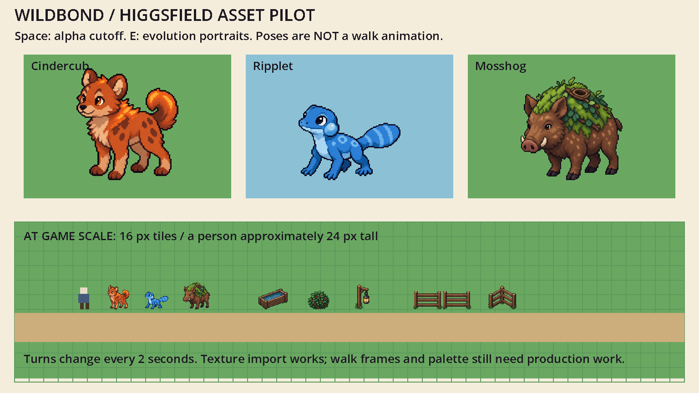

# Wildbond: Higgsfield trial pilot

Evan asked to maximise the three-day trial before deciding whether to pay. This is an isolated asset evaluation, not an installed game update. Claude's game, saves and web exports are untouched.

## Recommendation

**Current rule:** [Humble beginnings, spectacular payoff](EVOLUTION-PROMISES.md) applies to every evolving family. It includes all 15 live Godot families and their 17 final outcomes. [The Pyremane endpoint test](review.html?family=pyremane) demonstrates the rule with Blazefang hidden; [the handoff](PYREMANE.md) distinguishes insufficient early attempts from the stronger Crown Mantle direction. Thirteen generated source images are now preserved in this pilot.

Read [the creature and evolution reference guide](DESIGN-LANGUAGE.md) first. Evan wants varied, sometimes dramatic transformations; the two initial mature portraits are conservative candidates, not the template for every evolution.

**Evolution follow-up:** [the interactive evolution workshop](review.html) compares Ripplet with three Tidewyrm directions and a refinement. [The Tidewyrm handoff](TIDEWYRM.md) explains the selected wave-backed silhouette and precise corrections before production. Ten generated source images are now preserved across this pilot; the original six-image evaluation below remains its first-stage evidence.

Use generated art first for **Wilddex portraits, creature design references and prop concepts**. The starters read recognisably at game scale, and references offer a promising starting point for future models. Do not spend the trial generating the whole catalogue as animation sheets: the first four outputs are illustrations with pixel styling, not production pixel sprites. A two-portrait evolution test checks family consistency before wider batching.



The lower strip uses 16-pixel tiles and a neutral 24-pixel person gauge. This demonstrates scale and import, not a rebuilt Larkhaven or gameplay acceptance. The upper plates cycle direction poses, not movement frames.

## What is here

- `originals/`: unmodified Cindercub, Ripplet and Mosshog four-pose sheets, plus nine Larkhaven prop concepts.
- `portraits/`: unmodified Blazefang and Thornback portraits generated using the corresponding starter as a reference.
- `provenance.json`: exact prompts, model settings, source generation IDs and cost estimates. Generated via Higgsfield using GPT Image 2.5; not claimed to be hand-painted or CC0.
- `audit.py` and `audit.json`: reproducible hashes, dimensions, colour counts, alpha checks and object bounds. Requires Pillow and NumPy. Audit changes metadata only.
- `preview/`: standalone Godot project using nearest filtering and integer scaling. Open `project.godot` in Godot 4.7.2 and run; Space toggles alpha cutoff. Loads preserved originals at runtime, with no game dependencies.
- `capture/`: an actual GPU-rendered frame and the engine log, rather than a mockup of an imagined result.

The evolution portraits retain the starter families' markings, colours and body shapes, while adding a mature ember mane or woody thorns. Both introduced glow halos despite the isolated-cutout brief. They are useful candidates for the Wilddex and modelling references, pending art approval; not accepted production sprites. Press E in the preview to compare them with their young forms, or launch with `-- --evolutions`.

## Findings and limits

| Test | Finding | Production implication |
|---|---|---|
| Import | Four 2048-square RGBA PNGs load in Godot | Texture pipeline works |
| Small silhouettes | Three starters remain recognisable beside the person gauge | Useful source for portraits and deliberate sprite redraws |
| Alpha | Maximum alpha is 254; faint halos occur outside bodies | Preview applies a 0.5 alpha cutoff; original files stay unchanged |
| Palette | 167,231–371,756 distinct body RGB colours in the four sheets | Does not meet the game's named ramps; cleanup/redraw needed |
| Sheet layout | Some bodies cross nominal cell boundaries | Audit finds connected bodies, not blind equal-cell crops; detached details may be omitted |
| Direction and movement | Front/profile/rear/rest differ in perspective and proportions | No walk cycle, rig, battle animation or 3D mesh supplied |
| Canon | Cindercub's ears are pointier than requested; eye size needs review | Art lead must approve a model sheet before scaling production |
| Props | Trough, bush and lantern read; fence perspective is oblique | Not certified as seamless map tiles or collision footprints |

These assets do not supersede `docs/art/wildbond-art-direction.md`. Its palette, real proportions, lighting and authored-art rules remain the shipping standard. Evan authorised this generation experiment; adopting it as the production method is a separate art decision. Verify provider rights before distributing generated originals with a release.

## Getting trial value

1. Approve one starter silhouette and one mature evolution together, checking canon, proportions and perspective.
2. Use approved references on every subsequent generation; generate one creature per image to avoid sheet cropping problems.
3. Batch the opening-area portraits first, then evolution families. Track accepted, revision and rejected outputs rather than counting every image as finished art.
4. Keep world sprites, direction/animation frames and collision footprints as explicit production work. A pretty portrait is not a playable creature model.
5. Compare accepted output count and human cleanup time before subscribing. Current estimates: four sheets 11 credits; two evolution portraits 5.5 credits. This is not a billing reconciliation or an unlimited trial.

The trial endpoint reported by the provider was 2026-10-16 03:43:25 UTC (October 15, 11:43 p.m. Eastern). Check the live balance before more batches. No subscription or purchase has been made.

## Reproduce

From this directory, run `python audit.py`. Then run:

```powershell
& 'C:\Users\evanb\Godot\Godot_v4.7.2-stable_win64_console.exe' --headless --path preview --quit-after 3
```

For a visual capture use Godot's `--write-movie` with a PNG path and `--quit-after 3`; ignore generated `.godot` caches and silent WAV files. The preview is a separate project, so it never loads or writes a Wildbond save.
