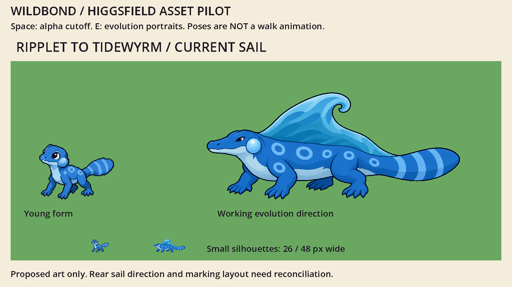

# Ripplet → Tidewyrm: an evolution with a new silhouette

2026-10-13. Working recommendation by Codex for Evan, using Higgsfield. **Candidate art, not final canon or an implemented creature model.**

Open [the interactive workshop](review.html) through the local server. It compares the young form, three alternatives and the refinement at equal display height, with greyscale, silhouette and small-size controls.



## Canon and room to design

Source: `games/wildbond/js/00-data.js`, `ripplet` and `tidewyrm`. Ripplet is a curious river lizard that blows bubbles when happy. It evolves at level 14 into a Tide crocodilian that rides currents and can call up a wave. The generated young reference supplies bubble cheeks, rings and a broad paddle tail as proposed visual family anchors. Those visual details are not additional gameplay abilities.

The dramatic change is a **low crocodilian body carrying a curling-wave dorsal sail**. The cheek and ring motifs keep the family recognisable. A new body rhythm and crest should make evolution exciting even if both pictures are shown at the same height.

## Why Current Sail

| Direction | Useful idea | Decision |
|---|---|---|
| Current Sail | A single high wave crest over a long, low swimmer | Develop. Most immediately distinct outline and strongest link to currents/waves. |
| Estuary Mantle | Paired wave-like neck collar on a protective broad body | Keep as unused exploration. Still reads like the juvenile with an accessory; collar may look detached. |
| Ribbon Current | Swept cheek fins, long tail and an elegant body | Keep as unused exploration. Tail dominates; the body is less recognisably crocodilian. |

The fourth generation refines Current Sail into three directional views. Smaller eyes and a flatter skull help it feel transformed rather than simply enlarged. The rear view correctly hides the face. The sheet is useful to communicate the idea, but it has not passed final model-sheet consistency review.

## Corrections before modelling or final sprites

- **Crest direction:** in the front/profile views the curl points toward the tail; in the rear view it appears to point toward the head. Keep it tailward in every view. The first view is the working silhouette reference.
- **Markings:** ring number and placement drift between views. Draw a single marking map with landmark positions on shoulder, flank and hip. Match that map in every view; do not copy each generated view literally.
- **Feet:** establish one digit count and attachment layout, including naturally hidden far-side feet. The sheet is not an orthographic technical drawing.
- **Fin material:** the crest is proposed living fin tissue, not suspended water. Choose opacity and thickness once. The source rendering does not settle the material.
- **Surface and alpha:** large soft halos remain despite the prompt. The previews threshold alpha for viewing; originals remain unchanged. Reduce the palette deliberately to the game's ramps before making sprites.
- **Scale:** the small Godot comparison uses widths of 26 px for Ripplet and 48 px for Tidewyrm. These are review sizes, not new collision dimensions or canonical physical measurements.

## Handoff to the next artist or agent

Use `tidewyrm/current-sail-reference.png` as a **direction**, with the corrections above. Produce a clean front, strict side and rear drawing from the same anatomy; a top view would help the game camera. Resolve the fin curl and marking map before rigging. Then check the simplified silhouette at the actual intended camera and size, build one walk loop and one idle, and test contact points and tail clearance in the engine. Approve that small playable sample before expanding the family catalogue.

The current isolated preview can show this comparison with:

```powershell
& 'C:\Users\evanb\Godot\Godot_v4.7.2-stable_win64_console.exe' --path preview -- --tidewyrm
```

Run from this pilot directory. It reads only the preserved art and review metadata; it never loads the game or its saves.

## Evidence and cost

- Three concept images and one directional refinement completed; exact prompts and job IDs are in `tidewyrm/provenance.json`.
- Source hashes and visible bounds are in `tidewyrm/audit.json`.
- The browser workshop passed 27 viewport/mode/size combinations at 390, 1440 and 3440 px widths: five visible references, equal comparison heights, no horizontal page overflow or script errors. `tidewyrm/browser-checks.json` records the matrix.
- The selected source rendered successfully in the isolated Godot project; capture and engine log are in `capture/`.
- Account balance fell from 93.5 to 82.5 credits across this round: **11 credits**, matching the four-image estimate. The tool reported the trial as `cancelled_by_user`; no subscription or purchase was made.

This round proves a useful exploration-and-review process. It does not prove that generated turnarounds can go straight into production without correction.
