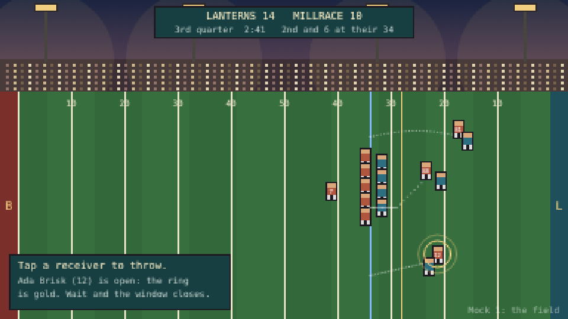
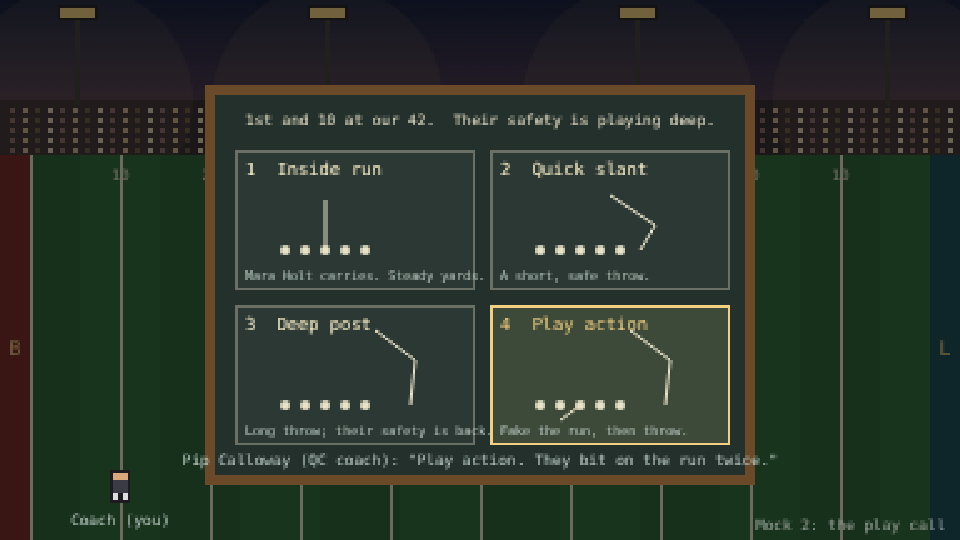
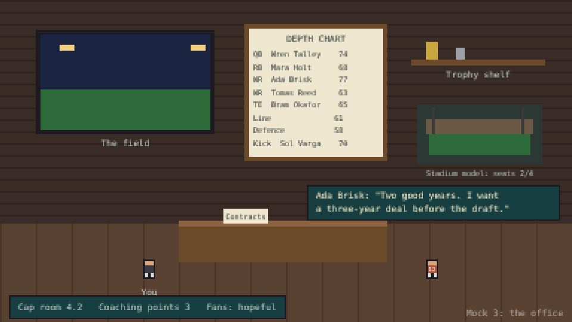

# Lantern Bowl: the pitch (LB0)

**Working title.** A football game in the spirit of Retro Bowl, our own from the ground up. Part of the sports plan
([sports-management.md](sports-management.md), Game 2). Mock screens: [mock.html](lantern-bowl/mock.html), drawn in
code at the arcade's 384 by 216 pixel scale.

## In one paragraph
The Brackenport Lanterns play football under the lanterns at Lamplight Field. You are the head coach and general
manager. On game day you **call and play your offence's drives**: pick a play on the chalkboard, then make the one
readable choice that matters (which receiver, and when). The defence, kicks and the other side's drives play out on
their own, shown quickly. A game is about six of your drives, two to four minutes. Between games you run the club
from the coach's room under the stands: who starts, who gets paid, what to build, whom to draft.

## Why it's fun (what we take from the mobile hits)
You act in the big moments, the simulation handles the rest, and a game is short (Retro Bowl, Football Manager
Mobile). Ratings visibly matter, money is the tension, and players are people you remember (Diamond Manager's own
lessons). Each game ends with one or two decisions, never a screen of forty columns.

## Three screens

| | What you see | What you do |
|---|---|---|
|  | **The field**, seen from the press box: the field runs left to right, under the lanterns. The line of scrimmage is blue and the first-down line is gold. Receivers run chalk-dotted routes. | When a receiver comes open, a lamplight ring appears around them and turns gold at the best moment. Tap or click the receiver (or press their number key) to throw. Wait too long and the window closes. Runs are chosen, not steered. |
|  | **The play call**: the coach's chalkboard held up on the sideline, four plays drawn in chalk, the down and distance, and what the defence is showing. | Pick one of four plays (keys 1 to 4). Your quality-control coach offers a hint grounded in what has happened this game; take it or not. |
|  | **The office**: the coach's room under the stands. The depth chart is a board on the wall, the facilities are a stadium model, trophies sit on a shelf, and players come to the desk. | Walk to (or click) a thing to use it: set the depth chart, hear a contract request, spend coaching points, build up the park. Cap room, coaching points and the fans' mood sit in one thin line. |

## The rules in brief
- **Players:** about twelve who matter: quarterback, running back, two receivers, tight end, the line (one rating),
  the defence (three ratings: pass rush, coverage, tackling), and a kicker. Each has two or three ratings in words
  first, numbers second.
- **A drive:** downs and distance as in real football; four play calls; the passing moment decides throws; runs and
  sacks come from ratings. Touchdown, field goal (simulated kick, odds shown), or punt.
- **The other side's drives:** simulated from your defence's ratings against theirs, shown as a two-line summary
  with a small replay of the key play.
- **Between games:** salary cap, contracts and renewals, coaching points (training or morale), facilities (stadium,
  training ground, rehab room), a draft each winter, owner and fan opinions. The office code is shared with Diamond
  Manager (`shared/sports-office.js`, LB1).

## Kept clearly apart from Retro Bowl
Retro Bowl's code and art belong to New Star Games. We copy no names, screens, art, layout or controls. Where it
helps to be specific:
- **View:** Retro Bowl runs its field up the screen and scrolls; ours runs left to right, seen from the press box.
- **Throwing:** Retro Bowl drags back to aim with a slingshot line; ours picks an open receiver whose lamplight ring
  shows the timing. No aiming line.
- **Look:** our pixel people have real proportions (art guide rule 2, no big heads), our palette is dusk and
  lamplight, the arcade's ink outline and lamp colour.
- **Front office:** ours is a place with people (the coach's room, players at the desk), not a menu of tiles, per the
  "in the game window" rule.
- **Names:** our own club (the Brackenport Lanterns), league clubs and players, drawn from the arcade's world.

Design decisions thread: please confirm nothing here sits too close to Retro Bowl's look (LB0's "checked by" step).

## Open questions (defaults chosen, change if the Design decisions thread disagrees)
- Defence: simulated by default. Default: an optional "call the defence" (three choices) on third down, later.
- Two-point tries and onside kicks: in LB3 as one-tap choices.
- Season length: twelve games plus a two-round final, as in the plan.
