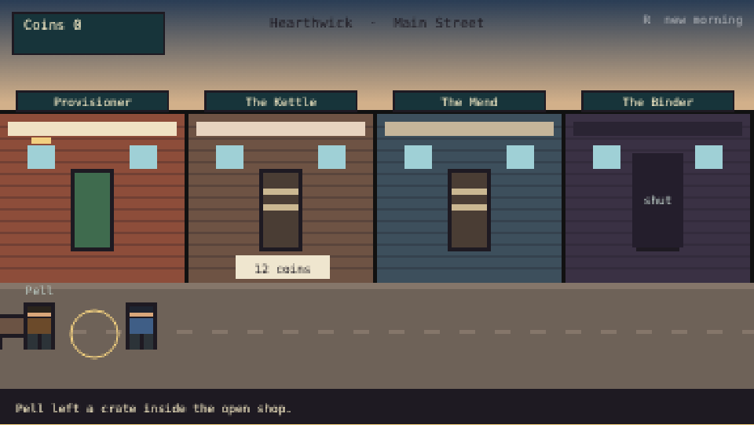
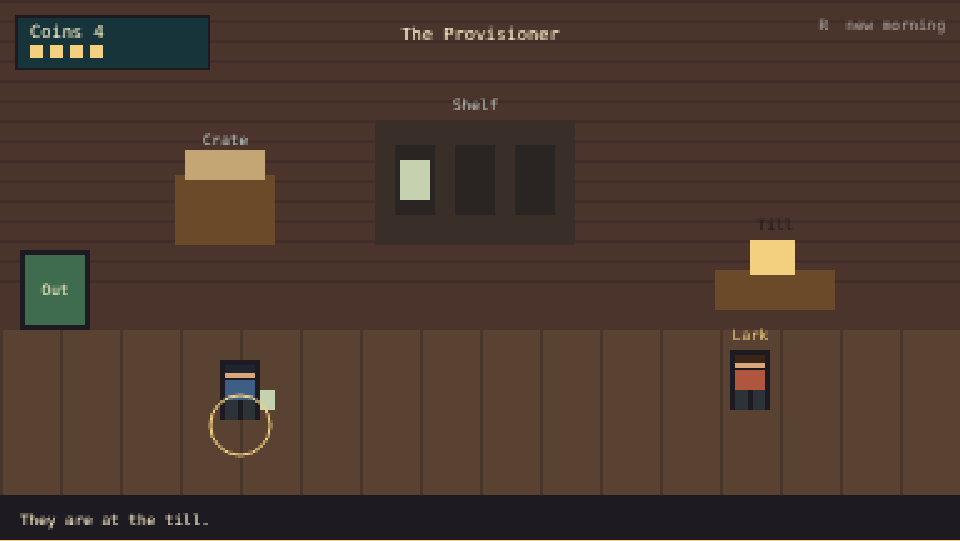
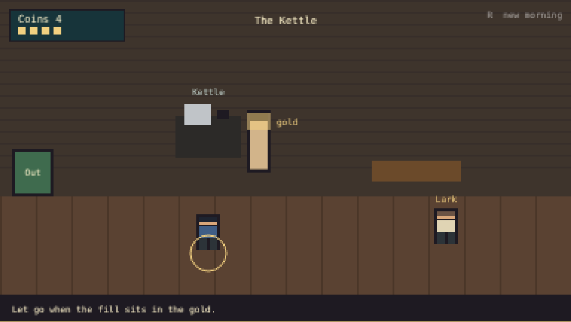
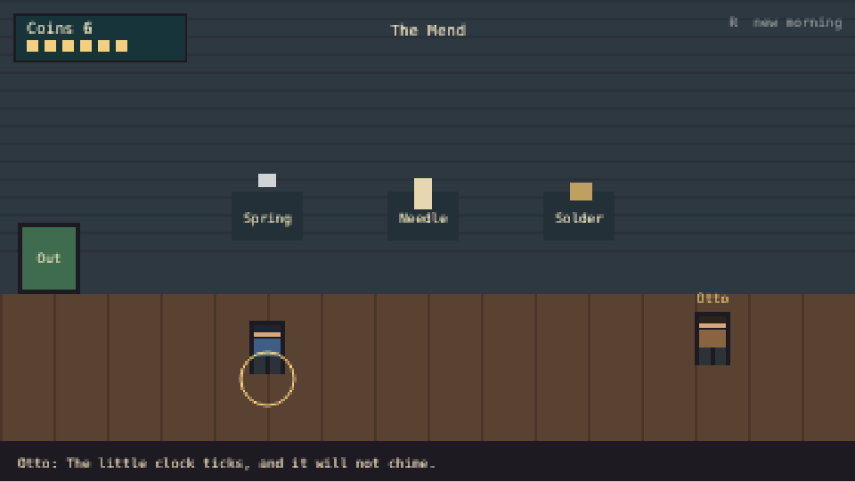
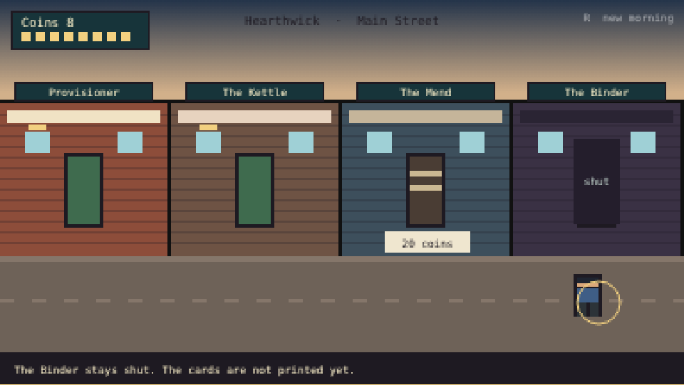

# Main Street: the pitch (MS0.1 and MS0.2)

**Working title.** Main Street, a small business game in the town of Hearthwick. You start with one open shop and buy the empty shops next door. The card shop is one of those shops, later. It is not the frame the street hangs on.

Mock of the first morning: [mock.html](main-street/mock.html), drawn in code at the arcade's 384 by 216 pixel scale. It is a playable sketch, not the game.

This page is the MS0.1 design (the street, the businesses, earned help, what the arcade already shares) and the MS0.2 design (the card shop inside that street). It does not build the card shop, and it does not import the creature roster. [DEVELOPMENT-PATH.md](../DEVELOPMENT-PATH.md) still has an older line that says "the card shop first." Evan's later direction is the one this page follows: **Main Street is the game. The card shop is one business on it, and it waits on Wildbond.** This page does not edit that line.

## In one paragraph

You are on Main Street with the key to one shop, the Provisioner. You carry jars to the shelf, take coins at the till, and learn the regulars by name. When the till can pay for it, you buy the empty shop next door and learn a new job with your hands: pouring at the Kettle, then mending at the Mend, then bunches at the Cutting Bench. People you have worked beside can take a chore you have already mastered. The last shutter, the Binder, stays shut until Wildbond's creatures are a stable set of species. Then that one shop sells their cards. The street is still the game.

## Why it should be fun

The fun is the job in your hands, then the moment the street gets bigger.

- **A shop you can feel.** Stocking, pouring, and mending are short physical actions, in the spirit of what players praise in shop games (the research names Supermarket Simulator and Moonlighter for this). We borrow the satisfaction of a thing landing in the right place. We do not borrow their layouts, names, or economies.
- **The next door.** Buying an empty shop is the goal you can see from the first minute, because the boards are on the street in front of you. This is the Main Street idea from [section A of the new-game notes](../proposals/new-game-ideas.md): grow one shop, then the shop beside it.
- **People, not multipliers.** A hire is a neighbour with a habit. Nia minds a till. She does not play the game for you.
- **Short sittings.** One rush is a complete morning. A five-minute return visit is one crate, a few customers, and the door you are saving for. The game pauses anywhere.

Comparable games, and the limit on what we take, are in [the village and business research](../research/village-and-business-research.md) and [Claude's review](../research/village-and-business-review.md). The street uses the business half of that report. The village half belongs to Starfall. Main Street is one street, not a second town builder, so it does not become "a game within a game within a game."

## The core loop

Everything happens on the street or inside a shop you have walked into. There is no board of numbers beside the game.

1. **Open.** A delivery crate is on the step. You carry goods onto the shelf. Customers walk in, look, and come to the till if the shelf has what they came for.
2. **Serve.** You take their coins. Prices stay small enough to see: a jar is a few coins, and the coins sit in a tray.
3. **Choose the next door.** Empty shops have a price on the boards. You pay it when you can. You do not lose a shop you already own if you spend down to nothing. The boards simply wait.
4. **Learn the new job.** Each shop has one action that is not the previous shop's action.
5. **Hand off the chore.** After you have done a chore enough times to know it, a person can do that chore while you are in another shop you own. You can take the job back.
6. **Come back.** Time away leaves a small crate on the step. It does not leave a day's takings.

A sitting ends when you want it to. The first morning is written to feel finished once the Kettle has served its first good cup. Later mornings have a rush, a repair, and a look at the door you cannot buy yet.

## The first ten minutes

The player has never seen Hearthwick. No other Generations game is required.

| Minute | What they see | What they do |
|---|---|---|
| 0 to 1 | Main Street. One door is open (the Provisioner). The Kettle and the Mend are boarded, with prices. The Binder's shutter is down. A crate sits inside the open shop. | Walk in. Optional: Pell, passing through with his mule Brisket, says the key is theirs and that he is not staying. |
| 1 to 4 | The shelf, the crate, the till. A regular comes in when a jar is on the shelf. | Carry a jar to the shelf. Take the coins at the till. Do it until the tray can pay the Kettle's price. |
| 4 to 7 | The boards on the Kettle. | Pay twelve coins. The boards come down. The kettle is dusty. This is a new room, not a second copy of the shelf. |
| 7 to 10 | A cup, a gold mark for a good pour, Lark at the counter. | Pour. A good cup pays. Lark says it is the first hot drink on the street in a long while. The player looks back down the street: the Mend is still empty, the Binder is still shut. The morning can end here. |

The mock plays this morning with the same prices. Walking is shorter than it will be in the real street, so a sitting can also reach Nia and, if you keep going, the Mend. The real first ten minutes are allowed to stop at the first good cup.

Words on screen stay in the world's voice. A price may be a number. A person does not say "unlock", "quest", or "id".

## The street

The screen is the world. You walk the pavement. Shop signs, boards, a coin tray, and people talking are inside that picture. A separate panel is not part of this game. Keyboard and touch both work: keys or a tap move you, and the thing in front of you is what you use. On a phone, the same street fits the width of the screen.

The working place names:

| Name | What it is |
|---|---|
| Hearthwick | The town. Working name. |
| Main Street | The only street in the game. |
| The Provisioner | The shop you start with. Dry goods. |
| The Kettle | The cafe next door. |
| The Mend | The repair stall. |
| The Cutting Bench | Flowers and herbs. After the Mend. |
| The Binder | The card shop. Last. Shut until the creature set is ready. |

Failure stays recoverable. You cannot go bankrupt and lose a shop in the normal game. A hard mode is not in the first build. There is no advertisement and no paid skip.

## The businesses

The card shop is last on purpose. The street has to be fun before any card exists.

| Order | Shop | The action (the fun) | The chore (what help may take later) | Buys |
|---|---|---|---|---|
| 1 | **The Provisioner** | Choose what goes forward on the shelf. Greet the person at the till. | Carrying every jar from the crate to a marked spot. | Yours at the start. |
| 2 | **The Kettle** | Pour. Let go when the cup is in the gold. Remember who takes it plain and who wants the herb. | Washing cups. Refilling the water. | 12 coins, from the street. |
| 3 | **The Mend** | Look at the fault and pick the tool. A clock that will not chime needs a spring, not a needle. | Sorting the parts tray. | 20 coins, after the Kettle is yours. |
| 4 | **The Cutting Bench** | Make a bunch. Carry a crate of herbs into the Kettle yourself. | Watering. | After the Mend. Price set when that shop is built. |
| 5 | **The Binder** | Open a pack. Price a single. Call the Friday table. | Sorting a stack of ordinary cards. Filing a grade that has already come back. | Not for sale until the roster is ready. Not in the first build. |

Each shop is a different verb. The Kettle is not a shelf with new goods. The Mend is not a till. The Binder, when it exists, is not a fifth crate.

Regulars in the first morning, kept small:

- **Lark**, who wants a hot cup and will buy a jar if that is all you have.
- **Otto Voss**, who buys from the Provisioner and later brings broken things to the Mend.
- **Nia Calder**, the neighbour who can mind a till after she has watched you do it.
- **Pell** and **Brisket**, one passing visit. He does not own a shop and he does not sell cards. This cameo is a proposal; see the questions at the end.

No Wildbond tamer appears on the street in the first build. The Binder is how Wildbond enters Hearthwick, later.

## The Binder, later (MS0.2)

Do not build this shop now. Do not import the catalogue into Main Street now. This section is the contract for the day someone does.

### Where creature data lives

Creature identity lives in the Godot data, not in a handwritten list inside Main Street:

- [`wildbond-godot/data/wildbond.json`](../../wildbond-godot/data/wildbond.json), object `SPECIES`, keyed by species id (`cindercub`, not a row number).
- [`wildbond-godot/data/evolution.json`](../../wildbond-godot/data/evolution.json), object `species` for creatures added or replaced there, and object `evos` for how a species changes.

The merged set is those two objects combined, species from the evolution file winning when an id is in both. That merge is what the generated catalogue counts. On 2026-10-14 it is **116 species**. The studio's aim is to grow it to **151**. Both numbers will go stale. The Binder must not store either number, and must not care what the count was on the day a save was made.

### Refer to a creature by species id, never by list position

A card stores the species id string. It never stores "card 12", "the 12th row of the catalogue", or "the next creature in the file."

- The generated table in [`docs/wildbond-creatures/catalog.md`](../wildbond-creatures/catalog.md) is a view. Row order there is not an id. Adding a species will move rows. Ids do not move.
- Evolution targets are ids too. A species may have `evo.to` (a string such as `blazefang`). Richer changes live in `evolution.json` under `evos[speciesId]`, each with a `to` id. Branching lines have several `to` ids (Poolkit can become Mistlynx, Sunlynx, or Rilllynx). None of those are "the next entry."
- A pack, a price, a grade, and a trend all key off the species id. Shuffling the file or inserting a creature must not change which card is which.
- A save stores the id and the creature's name as it was when the card was pulled. If an id later disappears from the data, the sleeve still shows that saved name and does not crash. If a new id appears, the shop can stock it without renumbering the binder.
- Missing ids are skipped. The game does not invent a blank card to keep a fixed pack size of 151, and it does not refuse to open because the count is not 151 yet.
- Tiers already on the creature (`Plain`, `Strong`, `Legend`) are the only rarity words. There is no second ladder of common and rare.
- Friday's table, when it exists, uses the creature's element field (`el`: Ember, Tide, Grove, and the others already in the data), the same element rules as Wildbond. It is one short match, not a second card game with a deck to build.
- Card art, later, is drawn from that species' Godot figure and filed under the same id. This plan does not generate art.

`shared/catalogue/wildbond-batch1.json` is a habitat note. It is not the card list. `shared/creatures.js` is the older browser roster. The Binder does not read either one as its source of truth.

### What you do in the Binder, once it exists

You open a pack because you want to see what is in it. You price a single because the street is asking for one species this week (someone says so, out loud). You send a card to be graded and it comes back later with a mark on the sleeve. You call a small Friday table. Nia may sort a stack of ordinary cards. She does not open your pack, set the price of a card people are chasing, or decide the Friday match.

### What this plan does not do

No pack odds, no shop code, no save format for cards, no import of `wildbond.json` into a Main Street folder, and no pictures of creatures. A later docs-only ticket (MS0.2b below) may write one example pack using real ids from that day's files. It still does not build the shop.

## Play for the fun, automate the grind

The studio line is **Play for the fun. Automate the grind.** On this street that means: the action that makes a shop worth buying stays yours until you choose to hand off a chore you already understand. Help is a person. It is not a switch that plays the morning.

| Shop | Stays yours (the fun) | May be handed to a person (the grind) | Not until |
|---|---|---|---|
| The Provisioner | What faces forward, and any price you care about | Carrying jars, wiping the counter | You have placed eight jars yourself |
| The Kettle | The pour, and who gets the herb | Washing, water | You have poured eight good cups |
| The Mend | The diagnosis | Sorting the parts tray | You have mended four faults yourself |
| The Cutting Bench | The bunch | Watering | You have made four bunches |
| The Binder | The pull, the hot single's price, Friday's table | Sorting ordinary cards, filing a finished grade | The shop exists, and you have sorted a stack yourself |

Rules for every hire:

- The person is on the street. You watch them do the chore you used to do. Nia is careful and slow. A later hire can be fast and careless, and you put the dropped tool back. That habit is the reason to walk back in.
- They work only while you are in another shop you own. They do not run the shop you are standing in, and they do not play a shop you have not learned.
- You can take the job back the moment you walk up to them.
- Closing the game does not pay wages, sales, or packs. Time away is the morning crate: a few goods on the step, capped, which you still put out yourself. Active play earns more than being away.
- There is no full Auto. There is no mode where the street plays a day without you.
- Accessibility is not a reward. A player who needs it can skip a timing bar (one plain action instead of the gold mark). That is a setting, not a hire.

`shared/roster.js` pays unattended jobs from timestamps. Main Street does not use it for shop income. The only idea to keep from it is a cap: away time must not become a second way to get rich.

## What we reuse from shared/

The real game, when it is built, stays plain HTML and JS in the arcade, and uses libraries that already exist. The mock uses none of them. It is one file so the sketch cannot drift from a shared save.

| Already in the arcade | Use on Main Street | Do not use it for |
|---|---|---|
| [`shared/engine.js`](../../shared/engine.js) | The game's own save key, backup strings, and a progress card for the hall | Any other game's save |
| [`shared/world.js`](../../shared/world.js) | The walker, once the street is a tile map (click to walk, bump a person to talk) | The mock, which is a side-on sketch |
| [`shared/dialogue.js`](../../shared/dialogue.js) | Regulars speaking inside the picture | A menu of topics |
| [`shared/sound.js`](../../shared/sound.js) | The bell, the till, the pour, made in code | Audio files |
| [`shared/ambience.js`](../../shared/ambience.js) | Sky, weather, and lamplight on the pavement | A unique weather system |
| [`shared/settings.js`](../../shared/settings.js) | Text size and reduced motion | A Main Street-only settings box |
| Art library, [`shared/assets/catalog.json`](../../shared/assets/catalog.json) | Later, if a prop already has a stable id and a licence that fits | The mock, which is drawn in code and brings in no files |

Not reused as data: `shared/creatures.js`, `shared/catalogue.js`, and the habitat batch. The Binder's source of truth is the two Godot JSON files above, by species id, and only when that shop is actually built.

The first build does not edit `shared/`, `sw.js`, or the hall page. A hall link is its own later ticket because it changes the front door.

## What we will not copy

Shop games and card games are the evidence that this loop can be fun. Their code, art, names, and screens stay theirs.

- No dashboard of upgrades beside a tiny view. The pavement is the whole screen.
- No energy timer, no advertisement, no paid speed.
- No pack screen that looks like a particular trading-card shop, and no creature that could be mistaken for one from another game. Our creatures, our tiers, our element names.
- No make-change puzzle and no coin-roll delivery. The review set that aside. The till takes the price.
- No irregular grid or wave-function town. A straight street is the point.
- No prestige button that multiplies the morning. A new street, someday, would be a move with a person you take with you. It is not a ticket below.

## The mock

[main-street/mock.html](main-street/mock.html) is the incubator's ten-minute slice for this pitch ([studio plan, section 7](../STUDIO-PLAN.md)): the smallest version that shows the fun. Open it in a browser. Walk with the arrow keys or A and D, or tap the pavement. Space, Enter, or a tap uses what is in front of you. R starts the morning over.

The pavement. One door is open. The Kettle shows its price. The Binder is shut.

Carry a jar from the crate to the shelf, then take the coins at the till.

Hold to pour. Let go while the fill sits in the gold.

Pick the tool that matches the fault. A wrong tool does not take the coins.

The shutter stays down. There are no cards yet.

In one sitting you can:

1. Stock the Provisioner and sell a jar for four coins.
2. Pay twelve coins for the Kettle and pour a cup. Let go in the gold for four coins. Miss it and they still pay two.
3. Meet Nia after four jars (the real game asks for eight) and let her take one sale at the Provisioner while you are in the Kettle.
4. Pay twenty coins for the Mend and pick the tool that matches the fault.
5. Read the Binder's shutter. It cannot be bought.

The mock's crate does not run out, and Nia's count is four rather than eight, so the morning fits one sitting. Those two shortcuts are the sketch. The tables above are the game.

## Staged work

One ticket is one pull request. None of the build tickets start until Evan says the street may be built. The old path built the whole game after Wildbond 2.0 because the card shop needed the roster. The shops before the Binder do not need it. Whether those shops may start earlier is a question for Evan at the end of this page. Until he says yes, MS1 stays written, not claimed.

Default shell, if he says browser: `games/main-street/` and `tests/main-street.html`, plain HTML and JS, using the shared files in the table above. It does not edit `wildbond-godot/`, `starfall-godot/`, or `play/`. If he says Godot instead, the same tickets change folder, and they still do not edit those two projects.

### MS0, design

| ID | Work | Done when |
|---|---|---|
| **MS0.1** | This page and the mock. | The page covers the loop, the first ten minutes, the businesses with the Binder last, the species-id rule, earned help, and shared reuse. The mock plays in a browser: stock, sell, buy the Kettle, pour, and the Binder refuses. |
| **MS0.2** | The Binder section above. | A reader can see that cards key off species id, that the set grows from the current merge (116) toward 151, and that the shop is not to be built yet. No creature file is imported. |
| **MS0.2b** | One example pack, docs only, written when the merged set is nearer 151. Ten real species ids from that day's `wildbond.json` and `evolution.json`, including one evolution `to` id. | Every example is an id that exists in those files that day. The note shows that inserting an id does not renumber the others. No game code. Do not start it now. |

### MS1, the street you can play

The Binder is not in this list, except a blocked data check at the end that still does not open the shop.

| ID | Work | Done when |
|---|---|---|
| **MS1.1** | The street shell. Four fronts: the Provisioner open, the Kettle and the Mend boarded, the Binder shut. Walk. No money yet. | Arrow keys and a tap move you. Refresh restores where you were standing, under a new save key. Other games' saves are unchanged. A test page loads. |
| **MS1.2** | The Provisioner's crate, shelf, one customer, and till. Coins in a tray. | A test sells one jar. A person who has not read this page can do it from the words on the screen. Old saves from MS1.1 still load. |
| **MS1.3** | Buy the Kettle for 12 coins. The pour. | Under 12 coins the boards stay up. The pour is not stocking. The Binder still cannot be bought. |
| **MS1.4** | The Mend for 20 coins. One fault, three tools, one that fits. | A wrong tool does not take the coins. A right mend pays. The stall is not a reskin of the till. |
| **MS1.5** | Nia. She appears after you have placed eight jars. She can take payment at the Provisioner only while you are in another shop you own. | The offer is absent before eight. She never pours and never opens a pack. Closing the page does not add coins. You can take the till back. |
| **MS1.6** | The morning crate for time away. | An older save with no crate field still loads. The crate is a few goods, never coins, and never more than a short visit would stock. You still put the goods on the shelf. |
| **MS1.7** | The Cutting Bench, and one crate of herbs you carry into the Kettle. | The bunch is its own action. The herbs do not appear in the Kettle unless you carried them. |
| **MS1.8** | Phone and desktop. | The street is playable in a narrow window and on a wide one. Taps land on the doors. A picture of each is in the pull request. |
| **MS1.9** | Blocked. A data check only: read a fixture of species ids in two different orders. | The same ids make the same cards. Adding an id adds one card and does not shift the others. A missing id is skipped. No shop, no art, no edit to the Godot data. Do not start until Evan says the roster is ready. |

Linking Main Street from the hall is not one of these tickets. That change touches the front page and waits until the first morning is actually fun.

## Open questions for Evan

Defaults are in the page above. Only these need him:

1. **May the street be built before Wildbond 2.0?** The Binder waits either way. The Provisioner, the Kettle, and the Mend do not need the roster. The older path said the whole game waits.
2. **Browser or Godot?** This page assumes a browser game in the arcade, so it does not open a third Godot project beside Wildbond and Starfall. Say if you want Godot instead.
3. **Hearthwick, and no name for the keeper.** Both are working choices. The keeper is "you" until you want a name.
4. **Pell on the pavement.** The mock lets him hand over the crate and leave. Say if Main Street should stay clear of him until you decide otherwise.
5. **Cozy money.** You keep a shop even if the tray is empty. Say if a shop should be able to close.
6. **The incubator's order.** The studio plan still lists Main Street after Lantern Bowl, Keymaster, the card shop, and The Crossing. You have made Main Street the lead side game. Lane P would be the one to rewrite that order. This page does not.

## Sources

- Evan, 2026-10-09, in [DEVELOPMENT-PATH.md](../DEVELOPMENT-PATH.md): Main Street is the business game; the card shop is one business on it and needs Wildbond's roster.
- Evan, 2026-10-14: Main Street is the lead side game. The card shop is one later business, the way Wildbond's creatures eventually enter this world. Cards refer to species by id. The set is growing from 116 toward 151. Do not build that tie-in now.
- [New game ideas, section A](../proposals/new-game-ideas.md). The score there assumed the card shop was the frame. This page reverses that frame.
- [Village and business research](../research/village-and-business-research.md) and [the review](../research/village-and-business-review.md): do the job first, then hire; different verbs per shop; a capped welcome-back; no ads and no paid skips.
- [Studio plan, section 7](../STUDIO-PLAN.md): a ten-minute slice before a game joins the line-up.
- [GOALS.md](../GOALS.md), "Play, not watch", and the tagline "Play for the fun. Automate the grind."
