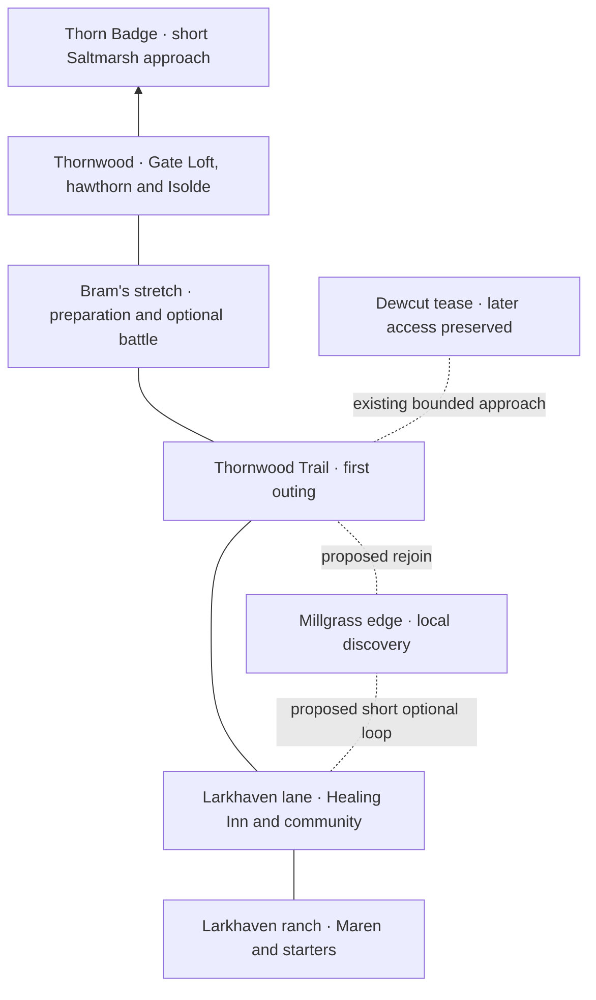

# Wildbond: make the first journey worth taking

WB-FIRST-WARDEN-PLAN — Codex / Evan, 2026-10-19. [PR #586](https://github.com/ecbarish/generations/pull/586), stacked on #584. Design and coordination only; no new playable feature or release is claimed.

## Priority from Evan

Build a compelling starter experience through the first Warden before extending the region or producing a large environment asset library. The map, encounters and story need to work together. Sightlines, shadows, landmarks and points of interest belong in the layout pass; final texture, foliage and effect polish follow playtesting. Simplify the mixed trees now when dressing the opening rather than generating more varieties.

Evan requested a professor, tutorial and early unlocks such as sprinting. Recommendation: use **Maren as the opening mentor and research contact**, preserving her established rancher/caretaker identity. She can perform the professor's gameplay functions without changing her title or inventing another character. A separate Professor, laboratory, name and backstory remain proposals if Evan wants them. Do not silently rename Maren or assign her secret knowledge.

## What exists, and what still needs building

| Element | Current feature-stack source | Next work |
| --- | --- | --- |
| Starter choice | Three original base starters are playable; family art auditions are separate. | Make the meeting and choice feel situated at the ranch. Evolution and Mega combat are separate unfinished systems. |
| Tutorial outing | Maren's catch → Healing Inn → safe return, persistent results, party/storage and friendly Wren/Bram battles. | Short demonstrations at the moment a player needs them; reduce any unexplained menu/errand friction. |
| First Warden | Connected Thornwood town, Gate Loft healing, Isolde's adapted three-partner challenge, one-time Thorn Badge and short Saltmarsh approach in #566. | Turn this working destination into the payoff of an intentional journey. Current adapted roster is not the final balance target. |
| Town life | Populated healing/community interiors and building sightline handling in #567/#568. | Give stops a distinct purpose and a visible approach; reuse these systems. |
| Sprint | Inherited movement reads Shift directly; it is available already. | An earned sprint requires an explicit progression flag, migration and UI lesson. It is not implemented by this plan. |
| Landscape | Existing measured grid, 3D scenery, lighting/shadows and foreground fading. | Choose a coherent regional tree kit, compose route views and verify them in the actual camera. |
| Wider world | Extensive world-graph, town/cave and guest planning data. | Treat blueprints as blueprints; build and test actual connections incrementally. |

Source routes: [current handoff](../WILDBOND-HANDOFF.md), [opening implementation](../research/wildbond-thornwood-destination/README.md), [cast guide](../lore/wildbond-cast-guide.md), [writer ledger](../lore/wildbond-threads.md), [world design](wildbond-world-design.md), `wildbond-godot/tests/opening/{map,scene,sight_lines}.gd`, and `wildbond-godot/tests/private_sprites/clearing.gd`.

## Opening beats and useful unlocks

These are proposed pacing targets for a fresh-player test, not measured completion times or a forced timetable. Exploration can take longer. Introduce one action at a time; all guidance lives in the game window and can be recalled from the existing Journey/book UI.

| Beat | Player action and purpose | Proposed unlock / teaching |
| --- | --- | --- |
| First 0–2 minutes | Find Maren from the starting view, approach the ranch and meet the three starters. | Walking/interacting, one clear immediate goal; brief optional world context. |
| Around 2–5 minutes | Choose a partner and take a short supervised path near the ranch. | Explain sprint and make it available **before the first extended route walk**. A brief partner exercise is enough; do not withhold comfortable travel until Isolde. Explain the map/book and supply the bounded catching kit before departure. |
| Around 5–12 minutes | Notice a wild creature, attempt a catch and visit the Healing Inn. | Teach battle choice/catching in context, then healing and party selection. Failure is recoverable, with sufficient supplies or a safe replenishment path. No required rare spawn. |
| Around 12–20 minutes | Return safely; choose an optional detour or Wren challenge and head north. | Maren recognizes the completed outing. Show the first Warden destination and how to prepare without requiring every optional trainer or pickup. |
| Around 20–40 minutes | Explore Thornwood Trail, meet Bram, reach town and choose when to face Isolde. | Healing and move/party preparation are close to the challenge. Defeat teaches and gives a safe retry; no forced grinding target is assumed. |
| First Warden victory | Claim the Thorn Badge and see the way ahead open. | Preserve the existing one-time badge/road opening. A new field ability is a separate design decision; do not award Stone Break, Tide Ride or a later shortcut early. |

Returning checkpoints must retain existing movement comfort if sprint becomes progression-gated: migrate pre-unlock saves conservatively to sprint enabled rather than unexpectedly slowing returning players. New flag versioning, frozen-reader behavior and an independent old-save fixture belong to the implementation PR. Restarts must not replay rewards or tutorials already completed. Never use a real profile for migration tests.

## The map to build first

This is a **topological composition**, not a replacement grid or proof of a connection. Keep established coordinates and graph requirements until a measured overlay proves proposed changes. Existing northbound route stays the spine; detours should rejoin it.

The Millgrass rejoin is proposed, not already traversable. Do not connect Larkburrow into this early loop: its Stone Break **and** Loom Badge requirement stays intact. Dewcut's later Stone-partner shelf stays at its planned location. Do not promise a cave, vista or far town that cannot actually be reached when the player meets its requirements.

| Place | Identity / landmark | Sightline and exploration job |
| --- | --- | --- |
| Larkhaven | Ranch/paddock and a recognisable home lane, open canopy and warm materials. | Starting camera makes Maren's approach legible. The inn is visible from the return path. A small nearby optional discovery teaches that looking off the main road pays. |
| Trail threshold | A tighter canopy and framed opening toward the route. | Reveal the next useful landmark before the path bends; preserve visible walkable ground and encounter edges. Use an existing clearing to let the player breathe after the first catch. |
| Millgrass edge | Proposed short local excursion using existing setting. | One visible curiosity, a modest useful reward or interaction, and a rejoin. No second mandatory quest chain or disguised corridor. Determine its exact cells and reward before implementation. |
| Bram's stretch | A working forest, with his foraging activity as the human anchor. | Show a route around an optional encounter and a clear onward path. Any promised mushroom interaction must be built and reachable. |
| Dewcut approach | A view toward a later destination. | Communicate distance and the unfinished boundary honestly. Avoid an enticing pickup placed behind an invisible wall. |
| Thornwood | Hawthorn/Warden focus, denser woodland and identifiable Gate Loft. | Arrival view establishes healing and destination without labels over every roof. Isolde's approach gives room to see and prepare; nearby paths and doorways remain readable. |

For later towns and cities, use the same test at a larger scale: a recognisable skyline/arrival landmark, a clear street hierarchy, a local activity or problem, an optional discovery, and a route that reconnects. Distinct purposes and inhabitants should create the identity before more buildings are added. Do not add an extra city to fill the opening's playtime.

## Minimum environment quality during layout

- Use one dominant tree family per opening biome, with at most one supporting shape. Reserve unusual specimens for deliberate landmarks. Shared scale, trunk proportions, palette, ground contact and shadow direction matter more than quantity. Random selection from unrelated tree sets is not regional variety.
- Block out landmarks before foliage. Capture the start, ranch exit, first route bend, optional-loop fork, Thornwood arrival and Isolde approach at the real play camera. From each, verify a destination cue or local next step; do not assume an overhead map proves visibility.
- Shape sunlit clearings and shaded woodland to support the path. Keep one consistent sun direction and readable character contact shadows. Shadows are part of composition; they must not obscure encounter boundaries, collectibles, doorways or the partner.
- Reuse existing building occlusion/fading. Test the player **and follower** behind trees/roofs, including near camera edges; do not solve every scene by making the entire forest transparent.
- Leave space around important people and interactions. A point of interest should offer a view, interaction, useful find, encounter or later return promise. Do not fill every empty patch with loot. Avoid arbitrary quotas of chests or trees.
- Defer final foliage detail, large asset production, advanced effects and decorative city expansion until the route is enjoyable. Test both renderers and a representative weaker device before calling the environment finished.

## Story through exploration

Reuse Maren's safe-return theme, Wren's competitive friendship and Bram's practical knowledge. The opening should establish people and one small satisfying payoff, while preserving unanswered questions about the world. Do not turn the tutorial into an explanation of the final mystery.

This plan places **no dialogue, signs, dex text or clues**. Before implementation writes any, read the writer ledger and record every clue there. Physical shadow improvements are rendering work, not an early story restoration of depth. Maren's professor-like gameplay role is a recommendation, not a new canonical title or revelation.

## Safari idea: keep it, build it later

A wildlife reserve could be an excellent later optional destination: distinct habitats, visible creatures, observation and catching goals, and revisits after new field access. Treat the location, name, rules and rewards as proposals. Do not put a large reserve, admission economy, timer or exclusive required catch into the opening. First prove that one small optional habitat on the first route is fun. Choose the reserve's place against the established region graph when its turn comes.

## Dad's AIs: live reconciliation on 2026-10-19

Checked [routing issue #373](https://github.com/ecbarish/generations/issues/373), open PRs and the actual guest-branch reports after fetching origin. Identity comes from signed handoffs, not the shared account.

| Contributor | Actual result | Relevance / unresolved point |
| --- | --- | --- |
| dot for Adam | Evolution-contract review [#578](https://github.com/ecbarish/generations/pull/578), workbench safety review [#579](https://github.com/ecbarish/generations/pull/579), retired-save audit [#580](https://github.com/ecbarish/generations/pull/580). | Reuse the evolution contract when that implementation resumes. The separate retired-line cut remains blocked; do not silently adopt replacement mappings. |
| dot for Adam | Coordinate guard ready in [#585](https://github.com/ecbarish/generations/pull/585), head `278cbbad7d076c43604d54ed03a0f311a2420982`, after Codex safety repairs #581. | Reported Linux Godot 4.6.3: unchanged probes 191/0 and 60/0; new suite 342/30 on base → 372/0 repaired; exact-head CI passed. This session inspected the report/source route; it did not rerun those probes or merge the fix. |
| Grok for Adam | Lowbell planning data/tests ready in [#583](https://github.com/ecbarish/generations/pull/583), head `183cb4f5`. | Later-region blueprint, not a playable cave. Outstanding level-cap mismatch, placeholder bell count and unplaced landing/jetty must be resolved when integrated. It does not justify extending beyond the first Warden now. |
| Grok for Adam | Claimed Mosshog motion review against #576 in #373. | In progress at this check, not completed evidence. Existing workbench UX, fresh-chapter walkthrough and Tide/Ember motion review scopes remain useful; no need to duplicate or interrupt his current review. |

## Implementation order and acceptance

1. **Measured opening overlay and walkthrough.** Reconcile the actual latest chapter, select exact points of interest and approach views, record current fresh-player friction. Deliver coordinates, collision/return paths and six camera captures before dressing. Use Grok's already-authorized fresh-chapter walkthrough findings when available.
2. **Mentor/tutorial and early sprint.** Implement the short partner exercise, contextual lessons and explicit unlock with migration/returning-player checks. Keep the first catch recoverable and optional conversations optional. Review any new story wording against the ledger.
3. **Route/town composition.** Build the selected small loop and purposeful discoveries, simplify the trees, compose shadows and Thornwood arrival, and test optional exploration against the main route. Do not regenerate starter art as a dependency.
4. **Play to Isolde.** Run an isolated fresh profile through all three starter choices, detour/skip paths, catch failure, healing, defeat/retry, save/reopen before and after each milestone, and victory/one-time reward. Check the challenge without a grind assumption. Inspect private and fallback presentation; keep copyrighted captures external. Run required repository suites for runtime changes.
5. **Polish what the playtest identifies.** Observe whether a new player can find the mentor, explain their next goal, discover one optional thing, reach the Warden and want to continue. Record actual timings and human observations separately from automated pass counts. Expand the region only after this opening works.

Next code task is step 1's measured opening composition, followed by the bounded tutorial/unlock implementation. This document completes planning only; none of these future tasks is claimed built, assigned to guests or released.
