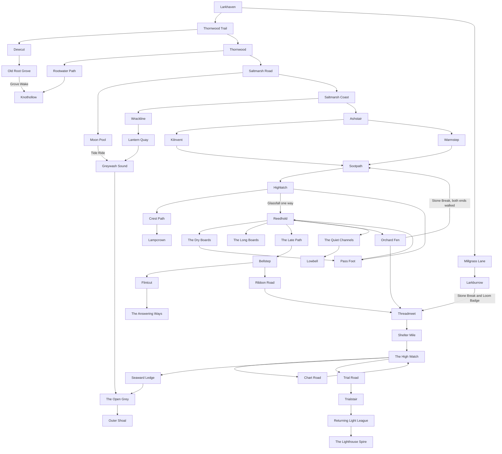

# Wildbond world design

Status: design plan only. Written 2026-10-15 from current `main` (`5764d95a`). This pull request adds this file. It also edits two files in docs/art: `docs/art/wildbond-art-direction.md`, including the Scale (locked v3) section, and `docs/art/README.md`. It does not change the game, the save format, the web pack, or the export.

Evan, 2026-10-14: "I want this game to be much more woven together and more interesting than a linear map and a one dimensional story. I want the world to be beautiful and interesting and I want players to want to explore and for different stories to be told throughout it and have it truly do Pokemon justice as a passion project based on it."

The shape below follows two research documents, both read from their own branches and both measured against main at `5764d95a`.

[PR #452](https://github.com/ecbarish/generations/pull/452) (`docs/research/wildbond-world-references.md`) supplies the skeleton: Stillreed Basin as the hub, 20 routes, 10 towns, 7 caves, 3 water routes, 3 loops, one one-way shortcut, four travel abilities (Stone Break, Tide Ride, Lantern, and Glide), a side story in every town, guardians at the high places, and a phased build. Grove Wake, Hush, and Daymark are introduced by this plan. Every placeholder name from that skeleton is replaced here with a name that fits the valley we already have.

[PR #453](https://github.com/ecbarish/generations/pull/453) (`docs/research/wildbond-vs-pokemon-benchmark.md`) ranks what makes the valley feel thin. Its top gaps, in order, are a line-shaped world, one town, no caves or water, no field lessons, few trainers, a party of three, no fast travel, shallow battles, two item types, and no quest log. The world-related gaps and the world-related ideas from its fan-game list are folded into the sections below: lessons that do not spend a move slot, a difficulty choice on top of the level caps, Wardens who can be met in more than one order, the quest log already named in section 3, and a second region after the league. Party size, battle traits, held items, two partners on the field at once, weather that changes a battle, and more trainers are listed in section 8 and are not designed here.

Nothing in this plan uses another game's names, maps, or pictures. The techniques are ours to use. The places are ours.

This is a plan for later pull requests, one feature area each. It is not yet canon. New people, the proposed roamer, and any new save field wait for Evan's yes, named in the phase that needs them. Clues stay inside the ledger in `docs/lore/wildbond-threads.md`. The decided account of the fading is not restated early, and it is not replaced.

## Where the valley is today

`wildbond-godot/data/wildbond.json` has 15 maps. `BUILT` in `wildbond-godot/scripts/main.gd` (line 146) is that same list. They form one path:

| Step | Map id | Name on the sign | How you leave |
|---|---|---|---|
| 1 | `larkhaven` | Larkhaven | North to the trail |
| 2 | `thornwood_route` | Thornwood Trail | North to Thornwood; east, Stone only, into the grove |
| 3 | `thornwood` | Thornwood | North, Thorn Badge, onto Saltmarsh Road |
| 4 | `saltmarsh_route` | Saltmarsh Road | North to the coast; west, Tide only, down to the pool |
| 5 | `saltmarsh` | Saltmarsh Coast | East, Tide Badge, into the highlands |
| 6 | `emberfall` | Emberfall Highlands | North, Ember Badge, onto the pass |
| 7 | `cloudglass` | Cloudglass Pass | East, Beacon Badge, into the basin |
| 8 | `stillreed` | Stillreed Basin | East, Reed Badge, into the hills |
| 9 | `hollowecho` | Hollowecho Hills | East, Echo Badge, into the commons |
| 10 | `sunthread` | Sunthread Commons | East, Loom Badge, toward the reach |
| 11 | `farwatch` | Farwatch Reach | North, all eight badges, to the league |
| 12 | `league` | Returning Light League | West, after the Champion ending, to the Spire |
| 13 | `spire` | The Lighthouse Spire | East, back to the league |
| pocket | `thornwood_grove` | Old Root Grove | West, back to the trail. Nowhere else |
| pocket | `saltmarsh_pool` | Moon Pool | Back to Saltmarsh Road. Nowhere else |

Checked against `MAPS` exits in `wildbond.json`. No exit points at a map that does not continue this line, except the two pockets. There is no loop.

The only element gates are those two pockets. `main.gd` lines 709–710 block an exit that has `requiresElement` unless `_team_has_element` (lines 730–734) finds that element on the walking team. Thornwood Trail's east exit requires Stone. Saltmarsh Road's west exit requires Tide. Both destinations have a single exit home. Tests lock this: `wildbond-godot/tests/run_tests.gd` lines 859–860 and 986 for the grove, lines 1066–1067 for the pool. A Stone or Tide partner opens a dead end. Nothing you learn later opens a way through.

Hollowecho's caves are paint. `main.gd` lines 2244–2245 say the flagstones run under the rock "so you can see they go somewhere (no interior yet)." Lines 2254–2258 darken that tile. The comment at line 2261 says the tool roll, the survey cord, and the resting stones block nothing. The reveal stands on either side of the mouth at tile (19, 8) (`REVEAL_SPOT`, `main.gd` line 4735). Walking into the dark does not change maps.

Rooms exist only in Larkhaven. `INTERIORS` (`main.gd` lines 493–568) is the inn, Juniper's shop, Pip's home, and Nora's cottage. `DOORS` (line 27) places them on Larkhaven tiles. `_check_doors` (lines 698–699) sends every other room back to Larkhaven. Later regions have people and, in three cases, a building drawn on the ground: the bell house (`main.gd` line 1876), Sunthread's meeting hall (line 1878), and the league courts. None of those is a door. Farwatch's lore already says the islands past the pier are scenery and that water is solid (`docs/lore/wildbond.md`, the Farwatch section). Stillreed's skiff is drawn moored (`main.gd` lines 1708–1709) and its tile `j` is solid in `TILES`.

Water never carries you. Tile `~` is `solid: 1` in `TILES`. `solid()` (`main.gd` lines 472–477) trusts that flag. Ponds, the basin channels, and the sea are walls.

Nothing teaches a creature a move except its level-up list. `rules.gd` `learned_moves` (lines 180–185) returns moves on `SPECIES.learn` at or below the creature's level. Maren's workbench (`move_lessons.gd`) lets you bring four of those. The satchel starts as lures, coins, and berries (`main.gd` line 104). Loading a save forces every bag value through `int()` (lines 3722–3723), so the bag cannot hold a list. `TEACHERS` (`main.gd` lines 3452–3464) teaches the tamer an order (Shelter, Rain Call, Tailwind, and the rest) into `taught` (line 3466) after a badge. Those are battle orders. They are not field travel, and they are not creature moves.

The journey's goal goes quiet after the first badge. `next_objective` (`main.gd` lines 4573–4599) fills the banner from `objective.gd` through the barn, the first catch, and "Find Thornwood's Warden." Once the Thorn Badge is in hand, the free-walk branch returns an empty string (line 4597). Maren's letters still arrive every 220 steps (`LETTER_STEPS`, line 3424) and end with `where_next()` (lines 3419–3420). `WHERE_NEXT` (lines 3412–3417) has five sentences. From the fifth badge on, every letter says the road toward Stillreed is not safe to travel yet, including for a tamer who is already past it. The Thornwood sentence says the coast is down a south road. The exit that actually opens is Thornwood's north exit.

`explored` counts grass visits per area (`main.gd` line 3814). It is not a list of towns. Fast travel has nowhere to read.

Level caps by badges already in hand are `CAP_TABLE`: 15, 25, 35, 45, 55, 60, 65, 70, 75, then 100 after the league (`LEVEL_CAP`). Bond steps are Wary 0, Friendly 20, Loyal 60, Devoted 140, Bonded 280 (`rules.gd` line 27). Field lessons below stay inside the cap you have when the story offers them.

Saves are version 2 (`SAVE_V`, `main.gd` line 3585). The file stores map id, tile, team, ranch, bag, badges, `story`, `taught`, letters, and the rest (lines 3576–3581). A missing key already has a default on load. A version newer than 2 is refused.

## Hard rules for every later phase

1. The 15 map ids above keep working. A save standing on one of them still loads there. New places get new ids. A tile that becomes solid nudges the tamer to the nearest open tile in front of a door, the same idea as `_off_new_homes` (`main.gd` lines 582–589).
2. The Thorn Badge and the Tide Badge stay in that order, so the opening and the first two field lessons stay taught. After those two, the roads to the other six Wardens are open, and each of those Wardens scales to the badges you already hold (section 2). A field lesson never stands in for a lesson you have not been taught. The league still needs all eight badges. Until the order phase ships, the roads keep today's ropes, one badge at a time.
3. Tile `~` stays solid. Rideable water is a new tile. After Tide Ride is learned, it is used on the three water routes, on Moon Pool's far lip, and in the flooded caves, Lowbell, and Trialstair. Ponds, the skiff, and today's tests keep their meaning.
4. The reveal mouth at Hollowecho (19, 8) stays scenery until `depthReturns` is in `story`. The first real cave is a different mouth.
5. Colour returning on the Thorn Badge stays where it is. This plan does not move that scene, the reveal, or the league.
6. Field travel is the partner at the obstacle, on the action key you already use to talk. It is not a battle move, and it does not spend one of the four workbench slots. Glide's list of inns opens over the world, the way the field book does, and closes back to the same tile.
7. The banner is the main road only. Side errands never replace it.
8. Orders in `TEACHERS` stay orders. Lesson slips teach creature moves. The two lists do not merge.
9. Outdoor maps are authored in `games/wildbond/js/11-maps.js` (`MAPS` begins at line 44) and copied into `wildbond-godot/data/wildbond.json` by `tools/godot-export.ps1`. A hand edit to the json is wiped by the next copy. Rooms, door handling, and field abilities live in the Godot game, beside `INTERIORS`, because a fresh copy of the outdoor map must not delete them.
10. Any new persisted field needs Evan's yes before that phase writes it. Prefer a key inside the existing `story` dictionary, which old saves already load. Do not bump `SAVE_V` unless an old file must be rewritten.
11. Our own words, creatures, and pictures. Game Art Director signs each phase's pictures before they replace the painter. The brief in section 5 is the ask, not the art.
12. No new way for the game to walk itself.

On 2026-10-14, Wildbond & Starfall Dev Lead claimed a fix bundle on the Godot game and the web pack (COMMS, that date). WB-WORLD-1 waits until that claim is merged or its owner agrees the files are free. This design does not touch those files.

## Names that replace the skeleton's placeholders

| In the reference skeleton | In this plan | Why this name |
|---|---|---|
| Meadow Track | Millgrass Lane | The west lane out of Larkhaven, toward a burrow you cannot open yet |
| Briar Path | Rootwater Path | Bram already says the stream floods and the mushrooms grow where it stops |
| Bramble Hollow cave | Knothollow | A hollow under the roots, not a second grove |
| Dune Walk | Wrackline | The tide line of weed and shells, where Cato already walks |
| a fishing hamlet | Lantern Quay | The lighthouse is already the coast's landmark |
| Saltmarsh Sound | Greywash Sound | Rideable water, grey until the colour is back, and still honest after |
| Tidegrotto | Keelcave | A sea cave a keel could scrape, not a shrine |
| Kiln Road | Ashstair | The climb off the coast toward the warm springs |
| Ashfall Climb | Sootpath | The path past the vent toward the pass |
| Emberfall Vent | Kilnvent | Toren's kiln country, and the first dark that wants a light |
| Glass Steps | Glassfall | One way, down, once a Gale partner will carry you |
| the walk the pass uses today | Pass Foot | The slow way down, which stays after Glassfall exists |
| Summit Trail | Crest Path | Up from Highlatch to the summit |
| a mountain lodge | Highlatch | Vessa's shelter and Ilka's ropes become a place you can go inside |
| Cloudglass Peak | Lampcrown | The high rock under Lanterncrest's sky. Lanterncrest already exists; this is not a new creature |
| Reed Causeway | The Long Boards | The basin already crosses water on boards |
| Fen Path | Orchard Fen | Evren's orchard is already the raised ground |
| a dry shortcut under the hub | The Dry Boards | A passage, not an eighth cave |
| Stillreed Lake | The Quiet Channels | The channels you can ride after Tide Ride |
| Sunken Shrine | Lowbell | A bell under the water. The hills already hear answers a beat late |
| the central town | Reedhold | Olan's landing, grown into the hub town |
| Echo Ridge | The Late Path | Senna's country, where echoes answer late |
| Quarry Track | Flintcut | Flintroot already clears loose stone here |
| Hollow Echo Caverns | The Answering Ways | The first cave you can enter. Undertone already carries a call through stone |
| the hamlet | Bellstep | Veslin's bell, as a town you can walk into |
| Loom Road | Ribbon Road | Ribbonstride already brings ribbons back to their posts |
| Market Lane | Shelter Mile | The commons are shelter ties, not a second shop street |
| the commons town | Threadmeet | The meeting hall that is already drawn |
| Old Mill | Greymill | A side door off Threadmeet. The harvest hum stays unanswered |
| Watch Road | Chart Road | Delka already writes where a plan changed |
| Cliff Walk | Seaward Ledge | Down to the pier the lore already describes |
| Farwatch Sea | The Open Grey | The third water route |
| Far Isle | Outer Shoal | The islands Farwatch's lore already points at and does not let you reach |
| the lookout town | The High Watch | The ledger house and the lookout |
| Victory Climb | Trial Road | The last road before the league |
| Victory Cave | Trialstair | The last cave, using every field lesson |
| Larkhaven Burrow | Larkburrow | Home, the long way under the ground, late |

Thornwood Trail, Thornwood, Old Root Grove, Saltmarsh Road, Saltmarsh Coast, Moon Pool, Emberfall Highlands, Cloudglass Pass, Stillreed Basin, Hollowecho Hills, Sunthread Commons, Farwatch Reach, the Returning Light League, and the Lighthouse Spire keep their names.

## 1. Field abilities

Seven elements, seven lessons. Stone Break, Tide Ride, Lantern, and Glide are the four that change how you cross the map. Grove Wake, Hush, and Daymark reopen layers inside places you already reached. Each one is learned from a person, after the badge that makes that person trust you, and only when the partner beside you is ready by level or by bond. The partner has to be on the walking team. A partner resting at the ranch does not open the way.

Today's Stone and Tide checks stay as the first look. Any Stone partner may still enter Old Root Grove. Any Tide partner may still enter Moon Pool. The tests that say so stay true until a phase deliberately updates them. The earned lesson is a later `story` key, `field:stone` and `field:tide`, set when the person finishes teaching. Cracks, water routes, and through-paths read that key. The early pockets do not.

You walk into the obstacle and press the action key. If the partner can do it, they step forward and the way opens. If they cannot, the person or the sign says what is missing, in the world's words. There is no field menu on the walking view. The lesson is not a battle move. It does not take one of the four slots the workbench already manages (`rules.gd` `keep_moves`, lines 210–222). That is the benchmark's first fan-game idea, and it is the fix for its fourth gap: the two element gates grow into lessons you use on the way home, without giving up a move to do it.

| Lesson | Element | Who teaches it | Ready when | What it reopens |
|---|---|---|---|---|
| Stone Break | Stone | Isolde, after the Thorn Badge | A Stone partner at level 12 or better, or Friendly (bond at least 20). The cap after one badge is 25, so 12 is reachable and not free | Knothollow's deep cracks. The rockfall on Orchard Fen that returns to Sootpath, once both ends of that walk exist. Larkburrow's through-path, and only after Halen's badge as well, so the burrow is a way home and not the first way into Threadmeet. Side cracks inside the Answering Ways |
| Tide Ride | Tide | Nerys, after the Tide Badge, walking you to the water | A Tide partner at level 18 or better, or Friendly. The cap after two badges is 35 | Moon Pool's far lip, so the pool joins Greywash Sound and stops being a dead end. Greywash Sound, The Quiet Channels, The Open Grey. Lowbell's flooded floor |
| Grove Wake | Grove | The grove itself, at the antler sign in Old Root Grove | A Grove partner at Loyal (bond at least 60). Bond, not level: this place is about trust. The sign text already mentions an antler (`run_tests.gd` line 988) | Thickets on Thornwood Trail and Rootwater Path that hide a bend and a patch of berries, not a new region. The back ring of Old Root Grove, which then opens into Knothollow. The nursery gate on the edge of Threadmeet, beside Meadowmantle's ground |
| Lantern | Ember | Toren, after the Ember Badge, at the Warmstep spring-house | Stay the night there with an Ember partner who is Loyal (bond at least 60). The night is the story. Loyal is the bond. Cap after three badges is 45 | Past the first room of Kilnvent. Past the first lit hall of the Answering Ways. The unlit flights of Trialstair |
| Glide | Gale | Vessa, after the Beacon Badge, once you have helped Ilka retie a rope on the pass | A Gale partner at level 36 or better, or Loyal. Cap after four badges is 55 | Glassfall, one way down from Highlatch to Reedhold. Fast travel to any inn you have walked into |
| Hush | Shade | Senna, after the Echo Badge | You stand still at a cave mouth until the Shade partner moves first. No level | Doors in the Answering Ways that look like wall. Greymill's stuck door. A night path on The Late Path, with a carving you can read afterward |
| Daymark | Radiant | Halen, after the Loom Badge, at a shelter tie | A Radiant partner at level 64 or better, or Devoted (bond at least 140). Cap after seven badges is 70 | Faded carvings in towns you have already visited. The last stair of Lampcrown. The outdoor stone on the Spire approach. Daymark is not required for Glide. Glide is earned at the pass, long before the Loom Badge |

Glide's list is the inns whose doors you have entered. The first entry sets `story` key `inn:<map id>`. Old saves have no such keys, so they glide nowhere until they walk into an inn again, including Ned's inn if they have been to Larkhaven. That is the right kind of revisit. Glide never offers a cave, a water route, the league, or the Spire. The league and the Spire stay walks.

Glassfall refuses the climb back up. The way back to Highlatch is Pass Foot. A partner who has learned Glide can still only take Glassfall downward.

Fishing, small and physical: after Tobin has spoken to you, a marked pier on Wrackline and another on Seaward Ledge will answer the action key when a Tide partner is with you. One meeting comes out of that map's wild table, the same as tall grass. It does not need Tide Ride. Riding water and casting a line are different lessons. It adds no save field. Tobin's line about the tide going out too far stays his line. The cast does not explain it.

Greywash is the mid-game water the benchmark asks for. Tide Ride is taught with the Tide Badge, and the first screen of `greywash` opens then. The sound does not reach Farwatch until phase 6, so the early water is a loop back to the coast, not a skip to the last shore.

### Difficulty, on top of the caps

The badge caps stay. `CAP_TABLE` is already the curve, and the benchmark's second fan-game idea is a difficulty choice at the start of a journey, not a replacement for those caps. The data already names the pieces. `JOURNEY` has Breezy, Classic, and Long Road. `MODES` has Nuzlocke, Randomizer, Solo Run, and Hardcore. Encounters and battles do not read them yet: wild levels use `DATA.JOURNEY.classic` (`main.gd` line 3008) and battle experience uses the same classic row (`battle.gd` line 622).

The choice belongs to the journey, not to the phone. Settings live in `user://settings.cfg` and are kept apart from the save on purpose (`settings.gd` lines 1–4). A pace and a challenge mode would be new keys on the journey file. That needs Evan's yes before anyone writes them. This plan does not set the numbers. Classic and no extra mode remain the default, so an old save that lacks the keys plays as it does today.

## 2. The connected map

Twenty routes, ten towns, seven caves, three water routes, three loops, and Glassfall as the one-way shortcut. Towns are the places with a healer indoors. Routes are the walks between them. The current region screens become the towns and landings, with new route maps inserted on their outward exits. A save already standing in Emberfall still loads in Emberfall. A save standing on Saltmarsh's east edge next walks onto Ashstair instead of appearing in the highlands.

### The picture



The text map below names the same places and the same links as the flowchart. Each place is drawn once. A branch that says `to` a place is a link to that drawing, and any words before `-->` are the lesson that opens the link.

```text
Larkhaven
+-- Thornwood Trail
|   +-- Dewcut
|   |   +-- Old Root Grove
|   |       +-- Grove Wake --> Knothollow
|   +-- Thornwood
|       +-- Rootwater Path
|       |   +-- Knothollow
|       +-- Saltmarsh Road
|           +-- Moon Pool
|           |   +-- Tide Ride --> Greywash Sound
|           |       +-- The Open Grey
|           |           +-- Outer Shoal
|           +-- Saltmarsh Coast
|               +-- Wrackline
|               |   +-- Lantern Quay
|               |       +-- to Greywash Sound
|               +-- Ashstair
|                   +-- Kilnvent
|                   |   +-- to Sootpath
|                   +-- Warmstep
|                       +-- to Sootpath
+-- Millgrass Lane
    +-- Larkburrow
        +-- Stone Break and Loom Badge --> Threadmeet

Sootpath
+-- Highlatch
    +-- Crest Path
    |   +-- Lampcrown
    +-- Glassfall one way --> Reedhold
    +-- Pass Foot
        +-- to Reedhold

Reedhold
+-- The Dry Boards
|   +-- to Pass Foot
+-- The Long Boards
+-- The Late Path
|   +-- Bellstep
|       +-- Flintcut
|       |   +-- The Answering Ways
|       +-- Ribbon Road
|           +-- to Threadmeet
+-- Orchard Fen
|   +-- Stone Break, both ends walked --> Sootpath
|   +-- to Threadmeet
+-- The Quiet Channels
    +-- Lowbell

Threadmeet
+-- Shelter Mile
    +-- The High Watch
        +-- Chart Road
        |   +-- to The High Watch
        +-- Seaward Ledge
        |   +-- to The Open Grey
        +-- Trial Road
            +-- Trialstair
                +-- Returning Light League
                    +-- The Lighthouse Spire
```

### Routes (20)

| # | Id | Name | Joins |
|---|---|---|---|
| 1 | `thornwood_route` | Thornwood Trail | Larkhaven to Thornwood. Exists. Dewcut branches off it. The grove's east exit stays here until Dewcut is in, then the shelf is Dewcut's door and the trail's east exit remains as a sign pointing at Dewcut, so old steps still find it |
| 2 | `millgrass` | Millgrass Lane | Larkhaven west to the Larkburrow mouth. The mouth is visible from the first visit |
| 3 | `dewcut` | Dewcut | A short meadow off the trail to the Old Root Grove shelf |
| 4 | `rootwater` | Rootwater Path | Thornwood to Knothollow |
| 5 | `saltmarsh_route` | Saltmarsh Road | Thornwood to Saltmarsh Coast. Exists. Moon Pool stays on its west side |
| 6 | `wrackline` | Wrackline | Saltmarsh Coast to Lantern Quay, with the early pier |
| 7 | `ashstair` | Ashstair | Saltmarsh Coast to Warmstep. Replaces the direct east hop into Emberfall. The Kilnvent mouth is on this climb, so the cave sits between the coast and the highlands |
| 8 | `sootpath` | Sootpath | Warmstep to Highlatch. The vent's far door, once Lantern is learned, can also open here |
| 9 | `passfoot` | Pass Foot | Highlatch down to Reedhold, both ways. Replaces Cloudglass's direct east hop |
| 10 | `glassfall` | Glassfall | Highlatch to Reedhold, down only, after Glide |
| 11 | `crestpath` | Crest Path | Highlatch up to Lampcrown |
| 12 | `longboards` | The Long Boards | Reedhold toward the west boardwalk and the Dry Boards |
| 13 | `orchardfen` | Orchard Fen | Reedhold to Threadmeet. A rockfall branch returns to Sootpath after Stone Break, once you have walked both ends |
| 14 | `latepath` | The Late Path | Reedhold to Bellstep. Until the order phase, this is the Reed Badge rope. After that phase, Thorn and Tide are enough |
| 15 | `flintcut` | Flintcut | Bellstep to the Answering Ways |
| 16 | `ribbonroad` | Ribbon Road | Bellstep to Threadmeet, so the hills and the commons meet twice |
| 17 | `sheltermile` | Shelter Mile | Threadmeet to the High Watch |
| 18 | `chartroad` | Chart Road | A loop of lookout ground off the High Watch, back to itself |
| 19 | `seaward` | Seaward Ledge | The High Watch down to the pier and The Open Grey |
| 20 | `trialroad` | Trial Road | The High Watch to the league. Phase 6 inserts Trialstair between them. Until that phase the road still reaches the league, so the ending is never shut |

The Dry Boards are a passage inside the Long Boards maps, not a route of their own and not a cave. They connect Pass Foot to the west end of the boards so a tamer in Reedhold can return to the pass without climbing Glassfall backward.

### Towns (10)

Healers are indoors. Outdoor trainers stay outdoors, so one person is not asked to stand in two places. Nine keepers below are proposals. They are not canon until the town phase is accepted and their lines are recorded. Each one rests a tired team for nothing, the way Ned does, and keeps a short shelf of lures and berries. Reedhold is the only new full shop.

| Town | Where it sits | Healer, proposed | Also indoors |
|---|---|---|---|
| Larkhaven | Exists | Old Ned | Juniper, Mira, Nora, Maren's barn. Unchanged |
| Thornwood | The existing settlement gains the Gate Loft | Hedda | A loft over the gate path. Isolde stays at the hawthorn gate |
| Lantern Quay | New, at the end of Wrackline | Perrin | A net loft and the quay inn under the lighthouse. Marit and Cato stay outside. Tobin stays on Saltmarsh Road |
| Warmstep | The existing highland screen, at the springs | Hest | The spring-house. Sela stays on the path outside. Toren stays above the springs |
| Highlatch | The existing pass, at Vessa's shelter | Yarrow | The lodge kitchen. Vessa and Ilka stay on the rope and the door |
| Reedhold | The existing basin landing. This is the hub | Juna | Colm's dry-goods shop, proposed, and the ferry house. Olan stays at the landing. Tavil stays with the ropes. Evren stays in the orchard. The skiff stays scenery |
| Bellstep | The existing hamlet | Iren, inside the bell house that is already drawn | Veslin stays with the bell rope outside. Senna stays by the resting stones |
| Threadmeet | The existing commons, at the hall that is already drawn | Solla | Pell's stall becomes a counter you walk up to, still Pell, still not a coin shop. Halen stays on the forecourt |
| The High Watch | The existing reach, at the ledger house | Quen | Sivren stays on the harbor path. Rysa stays at the lookout. Delka stays on the trail |
| Returning Light League | Exists | Nelva, already the league keeper | The courts stay the courts |

Between towns the rule from the reference holds in our geography: you are never asked to cross more than three routes without a healer, and two towns do not sit on adjacent tiles with no walk between them. Larkhaven to Thornwood is one route. The coast to Warmstep is Ashstair, one route, with Lantern Quay one step off Wrackline if you need the quay's beds first.

### Caves and depths (7), Hollowecho first

1. **The Answering Ways** (`answering`). The first cave a player enters. A hamlet mouth that is not tile (19, 8) becomes a real exit once Bellstep can be reached, even before Lantern. Until the order phase, reaching Bellstep takes the Reed Badge. The first hall is lit by Bellmote-light and the bell outside. Deeper halls turn you around until Lantern. Side cracks open with Stone Break. Wall-doors open with Hush. The mouth at (19, 8) stays the reveal's scenery until the reveal is done, and only then may Hush offer a stair there. Senna's battle stays on the surface where her test already is.
2. **Knothollow** (`knothollow`). Between Rootwater Path and, once Grove Wake is learned, the back of Old Root Grove. The front door is a Thorn Badge cave, a supply test, not a skip toward the basin. Its deep cracks need Stone Break and still come out in Thornwood's country.
3. **Keelcave** (`keelcave`). Off Greywash Sound. Needs Tide Ride to reach the sound, then a short dry cave. A Tide lesson slip is on the back ledge.
4. **Kilnvent** (`kilnvent`). The mouth is on Ashstair, the climb from Saltmarsh Coast to Warmstep, which is the cave between the Tide country and the Ember country the benchmark asks for. In the finished valley the first chamber opens with Ashstair. Until WB-WORLD-3 that mouth is only a shut trailhead. The warm dark beyond needs Lantern, taught at Warmstep, and that far door can also open onto Sootpath. This is the first place Lantern matters, before Hollowecho's depths, so the lesson is taught where Toren can see the vent from his ridge.
5. **Larkburrow** (`larkburrow`). The mouth on Millgrass Lane is visible in phase 1 and shut. It opens through to the back of Threadmeet only with Stone Break and the Loom Badge. Before both, you can go in one room and find Nora's wooden bird, and the far door is stone. That is the early shortcut you are meant to remember and use late.
6. **Lowbell** (`lowbell`). Under The Quiet Channels. The jetty at Reedhold shows the flooded stair as soon as you can stand on the landing. The floor needs Tide Ride. Stillwake stays the basin's guardian on the surface encounter that already exists. Lowbell is where you go back to hear the bell, not a second guardian.
7. **Trialstair** (`trialstair`). Between Trial Road and the league. The near flights are walkable with all eight badges. The unlit flights need Lantern. A cracked landing needs Stone Break. A flooded step needs Tide Ride. A living curtain needs Grove Wake. A wall-door needs Hush. The last outdoor stone, if you leave and return, needs Daymark. Glide is not required inside. Missing one lesson means a side room, not a locked league: the main stair still reaches the league once the badges are earned, and the side rooms hold the lesson slips and a rest. The cave demonstrates the lessons. It does not trap a tamer who learned six of them.

### Water routes (3)

| Id | Name | Needs | Joins |
|---|---|---|---|
| `greywash` | Greywash Sound | Tide Ride | Lantern Quay and Moon Pool's far lip to The Open Grey. Keelcave opens off it |
| `quietchannels` | The Quiet Channels | Tide Ride | Reedhold's jetty to Lowbell. The skiff stays tied up. You and a Tide partner cross |
| `opengrey` | The Open Grey | Tide Ride | Seaward Ledge to Outer Shoal, and the far end of Greywash Sound |

### Loops and the one-way shortcut

- **Pass Ring.** Highlatch, Glassfall down to Reedhold, the Dry Boards, Pass Foot, back to Highlatch. Before Glide, Pass Foot is the only link and it walks both ways, so the ring is a walk. Glassfall is the shortcut that makes the ring feel like a gift. The Dry Boards are on the near side of Olan's gate. They do not reach Bellstep.
- **Coast Ring.** Lantern Quay, Greywash Sound, The Open Grey, Seaward Ledge, the High Watch, and the long road home through Threadmeet, Bellstep, and Reedhold. This is the late curl from the last shore back to the first quay. It needs Tide Ride and the Horizon Badge's country. It does not open Farwatch early.
- **Home Burrow.** Millgrass Lane, Larkburrow, the back of Threadmeet. Stone Break and the Loom Badge together. A way home, and a way back out to a meadow you saw in the first hour.
- **Glassfall** is the one-way shortcut inside the Pass Ring. Orchard Fen's rockfall is a second, later shortcut from the hub back to Warmstep. It is not a fourth loop. It is a chord across the Pass Ring once Stone Break is learned and both ends have been walked.

### Wardens after the first two badges

Today each rope asks for the previous badge. Thornwood's north exit wants the Thorn Badge, Saltmarsh's east exit wants the Tide Badge, and the same pattern continues through Farwatch (`wildbond.json` exits, and the table at the top of this plan). The benchmark's open-order idea is folded in as a change to those later ropes, not as a new geography.

Isolde, then Nerys, stay in that order. Ashstair still asks for the Tide Badge. After that badge, Pass Foot, The Late Path, Orchard Fen, Ribbon Road, Shelter Mile, and Trial Road's walk can all be travelled, without the Beacon, Reed, Echo, Loom, or Horizon badges those roads ask for today. You meet Toren, Vessa, Olan, Senna, Halen, and Rysa in whatever order you reach them. The league door still asks for all eight badges.

Each of those six fights is built for the number of badges you already hold, inside the cap you already have for that count (`CAP_TABLE`). A Warden you meet with two badges is a two-badge fight. The same Warden, if you left them until you had six, is a six-badge fight. The level is chosen when the battle starts. It is not stored. Wins still go in `beaten`, which the save already has (`main.gd` lines 3573–3577). No new save key.

Maren's letters and the banner keep the recommended order in section 3. That order is the clear road for a new player. It is no longer the only road. The reveal at Hollowecho still waits for its own story. Walking into Bellstep early does not play it. Field lessons still wait for the person who teaches them: Lantern is still Toren's lesson after his badge, whenever that badge happens to be. Where a lesson also asks for a level, the bond alternative is what makes it reachable if you fought that Warden early and the cap is still below the level.

This change ships as WB-WORLD-ORDER, once the roads exist. Phases that come after it add lessons and places. They do not put the later ropes back.

### Guardians, without inventing a second sky

The reference puts a guardian on a summit, a guardian under the lake, a roamer at a mill, and a last guardian in the Spire. The valley already has Lanterncrest on the pass, Stillwake in the basin, and Orla's climb in the Spire. This plan uses those.

- **Lampcrown** is where you return to Lanterncrest after the pass story, or where the sign sends you if you have not met them and you climb anyway. The surface story encounter on Cloudglass is not deleted. The peak adds the view of Kilnvent's warmth, which is Toren's clue seen from above, still unexplained.
- **Lowbell** is Stillwake's deep water and the bell errand. The surface meeting at fourteen explores stays the meeting.
- **Greymill** is the clue dungeon and the Hush door. **Greysail**, a Gale bird, would be a 190th species on top of the 189 in `docs/wildbond-creatures/catalog.md`. It is not drawn, and it is not added, unless Evan says yes. Until that yes, the mill has no roamer. If he accepts it, catching it uses the bond the game already saves, and its place on the road is chosen from the calendar day and the roads you have opened, so the position is not a save field.
- **The Spire** stays Orla's floors. Trialstair is the cave before the league, not a new guardian's room.

The catalogue has nine Legends. Four already have a place in this plan. The other five are placed here, on ground the lore already gives them, so a later pass does not invent a site. None of these moves an encounter that the game already plays. A return visit uses the site. The first meeting stays where it is.

| Legend | Walking height | Site in this plan | First meeting, unchanged |
|---|---|---|---|
| Elderhorn | 31px, waits outside | The oldest trees in Old Root Grove, on the side a Stone partner can already walk. Not behind Grove Wake | Thornwood, at 20 explores (`00-data.js`, the `elder` scene) |
| Breakwatermane | 28px, waits outside | The Wrackline beach, where the tide draws back. Outdoors. It may enter Keelcave; it does not enter the quay inn | Saltmarsh, at 14 explores (`tidewolf`) |
| Hearthcrown | 31px, waits outside | The Warmstep spring terrace, the spring it warms. Outdoors. It does not enter Kilnvent or the spring-house | Emberfall, at 14 explores (`hearthstag`) |
| Lanterncrest | 24px, no headroom at a 24px door | Lampcrown, a clear pad of 4×4 tiles so the bird and the tamer stand apart | Cloudglass, the surface meeting that already exists |
| Stillwake | 24px, no headroom | The Reedhold jetty, the surface crossing. Lowbell is the bell errand, not a second guardian | Stillreed, at 14 explores |
| Undertone | 28px, waits outside buildings | The first bend of the Answering Ways, where the call carries. The mouth is sized for it | Beside the hamlet bell, at 14 explores (`undertone`). The cave is the return |
| Meadowmantle | 28px, waits outside | The Threadmeet nursery, outdoors | Sunthread, at 14 explores (`meadowmantle`) |
| Watchlight | 24px, no headroom | The harbor light on Seaward Ledge, the mooring the Farwatch scene already uses | Farwatch, at 14 explores (`watchlight`) |
| Veilmote | 24px, no headroom | A nest ledge on The Late Path, on the night path after Hush. The nests stay unowned. This is not Greymill, and it does not say whose nests they were | No meeting exists yet. This ledge is the place a later encounter would use |

## 3. Town stories, the banner, and the errand list

Every town has one local errand, and Threadmeet's errand is the thread that visits the others. The errands are about the fading the way the ledger already is: a player can see a trace, and at least two explanations still fit. Nobody in these errands names a ritual, an entity, or a turned friend. The reveal at the warm stones is still the place those truths are said. Nora's song stays unanswered. Tobin's tide stays his. Toren's warm stones stay unexplained. Rysa's chronology stays as the ledger has it: the fading had begun, and she saw a last local pallor.

New lines from these errands are proposals until the phase that writes them also adds the placed clues to `docs/lore/wildbond-threads.md`. That ledger edit belongs to the errand phase, not to this plan.

### What is already planned beside this

On 2026-10-15 the world reference is pull request #452 and the benchmark is pull request #453. There is no open pull request yet for a clarity pass, and none for a quest log. Both are planned work this design has to fit, because the game already has the pieces they would extend. The benchmark's tenth gap is this missing log, and one side story per town. That is the list below. A special rule for each Warden fight is a different idea from the same research note. It is named in section 8 and is not designed here.

**The clarity pass** owns two things that already exist, and only those:

- The objective banner. `objective.gd` draws one cream box. `next_objective` decides its sentence. After the Thorn Badge the sentence is empty (`main.gd` line 4597). The clarity pass fills that one box through all eight badges. It does not add a second banner, a tracker window, or a log.
- Maren's letters. They already bring ranch news and then `where_next()`. The clarity pass replaces the five-line `WHERE_NEXT` with one sentence per badge count, including the badges after Stillreed, and it corrects Thornwood's coast to the north gate. Letters stay a runner, a ranch note, and one direction. They do not become a list of errands.

The sentences below are the shared copy. If the clarity pass merges first, it may use the "before the new routes" wording. Each world phase that adds a route updates only the sentence that names that walk. If this plan is accepted first, the clarity pass copies this table instead of writing another.

The banner has to fit the box. `_layout_objective` (`main.gd` lines 4615–4618) gives the walking banner a width of 344 and a height clamped at 32, at font size 8. These lines are one short sentence so they fit.

| Badges | Banner | Maren's where-next sentence, once the routes exist |
|---|---|---|
| 0 | The north road leads to Thornwood. (already said after the first catch) | Warden Isolde keeps the Thorn Badge, up the north road in Thornwood. Show her what you and {starter} can do. (already in the game) |
| 1 | Find Warden Nerys on the Saltmarsh flats. | The north gate of Thornwood leads to Saltmarsh Coast. Warden Nerys tests tamers on the tide flats there. |
| 2 | Climb Ashstair. Toren waits in Warmstep. | Ashstair climbs from the coast to Warmstep. Warden Toren is patient, so be patient back. |
| 3 | Vessa waits on Cloudglass Pass. | North of Warmstep is Cloudglass Pass. Warden Vessa waits up in the cloud with the Beacon Badge. |
| 4 | Follow the ferry path to Olan in Reedhold. | Past the pass, Pass Foot leads down to Reedhold. Warden Olan keeps the landing and the Reed Badge. |
| 5 | The cave mouths in Bellstep open toward Senna. | The Late Path runs from Reedhold to Bellstep. Warden Senna listens at the hills, and the mouths there finally go somewhere. |
| 6 | Halen is gathering teams in Threadmeet. | Ribbon Road and Orchard Fen both reach Threadmeet. Warden Halen is making room for every partner. |
| 7 | Rysa keeps the Horizon Badge at the High Watch. | Shelter Mile leads east to the High Watch. Warden Rysa wants the team's notes corrected before the league. |
| 8 | The league road is open. Rest, then go north. | Trial Road runs north from the High Watch, through Trialstair, to the Returning Light League. Rest the team before you climb. |

Before Ashstair, Pass Foot, and the later roads exist, the clarity pass should keep today's place names in those sentences: "the high road" for Emberfall, "the ferry path" for Stillreed, "the hill trail" for Hollowecho, "the gathering trail" for Sunthread, "the coastal road" for Farwatch. The meaning stays the same. A letter must not send a player to a sign that is not in the build they are playing.

After the Champion ending, the banner may say "Orla keeps the Spire, west of the league." That is still the main road. It is not an errand.

**The quest-log pass** owns the list you open on purpose. Wildbond has no quest log now. Realmbound's log is a different game and is not the widget to copy. When the Wildbond log exists, it reads the keys in the next section. It does not invent a second set of ids, and it does not write a new top-level `quests` object unless Evan has signed that field. This plan stores errands in `story`, which is already on the save. Heard, a middle step, and done are enough. The log, when it comes, is a page in the field book, which already opens over the world. It is not a panel beside the world, and it is not a second strip on the walking view. The banner does not mention it.

If the log pass lands first and has already chosen ids, the errand phase uses those ids. If this table lands first, the log pass uses these.

### One errand in each town

Progress keys, all inside `story`:

| Id | Town | Who asks | What you do | What it leaves in the mystery | Done key |
|---|---|---|---|---|---|
| `sq-nora-bird` | Larkhaven, paid off in Larkburrow | Nora | She misses a wooden bird that used to have paint. It is in the first room of Larkburrow, reachable in the late cave phase even before the through-path opens. Bring it back | The paint is gone. She does not know if it wore away or was never as bright as she remembers. The hum stays unanswered | `sq:sq-nora-bird:done` |
| `sq-isolde-path` | Thornwood | Isolde | Bram followed a path he says the wood still remembers, and the rock has closed. He is in Knothollow. Walk him out | He remembers a path the ground does not have. That fits a lost depth, and it also fits a tired man and a mushroom. Isolde does not pick | `sq:sq-isolde-path:done` |
| `sq-tobin-tally` | Saltmarsh Road and Lantern Quay | Tobin | Count the Tide creatures the piers and the grass will show you, and put Cato's humming shell back where Tobin said. The shell beat already exists in his and Cato's lines | A page of his tally has gone pale. He still says the sea was always this colour. Both can stand | `sq:sq-tobin-tally:done` |
| `sq-sela-warmth` | Warmstep | Sela | The spring-house wants a stone that stays warm. It is past Lantern in Kilnvent. Toren's warm-stone clue is the same warmth, seen from the other side, and still not explained | The stone is warm from the inside. Sela thinks it is the vent. Toren thinks it is older. You carry it. You do not decide | `sq:sq-sela-warmth:done` |
| `sq-vessa-beacon` | Highlatch | Vessa and Ilka | The lodge beacon is dark. Helping Ilka with the rope is the same scene that teaches Glide. Lighting the beacon is the end of it | Ilka says the fog is thicker than her ropes remember. Vessa says the beacon was for people who already knew the way. Neither names a cause | `sq:sq-vessa-beacon:done` |
| `sq-lowbell` | Reedhold | Tavil, then Olan | From the jetty you hear a bell under the channels. Tide Ride reaches Lowbell. Bring the count of the rings back to Veslin in Bellstep, because the hills know late answers | A flooded landing, a sound carried from Bellstep, or the water remembering a bell: all three fit. Stillwake's wake is not the answer | `sq:sq-lowbell:done` |
| `sq-senna-stones` | Bellstep | Senna and Veslin | Three echo stones in the Answering Ways. The last one is behind Hush. Set them where Veslin can hear them answer the hamlet bell, a beat late, as the hills already do | The lateness is the clue the area already tells. The stones do not say who is late | `sq:sq-senna-stones:done` |
| `sq-halen-passing` | Threadmeet, and every town before it | Halen, with Pell carrying the list | A passing-along, not a trade of creatures. Carry one mended thing from each town to the next: Nora's thread, Bram's dried mushroom, Perrin's quay knot, Sela's warm nail, Ilka's rope splice, a reed bundle from Juna, an echo stone Veslin can spare, a ribbon from Mirel, and Delka's corrected chart. Halen ties the last knot | The last ribbon shows a colour the cloth seemed to remember when it was tied. Halen treats that as a reason to make room, not as an explanation | `sq:sq-halen-passing:done` |
| `sq-rysa-skiffs` | The High Watch | Rysa and Sivren | Two skiffs are on Outer Shoal. The crews are fine. They followed a light that was not the harbor lantern. Bring them the corrected heading | Watchlight already marks safe approaches. The other light might be an older beacon remembered by the fog, or a lantern a crew miscounted. Rysa corrects her own note and does not pick | `sq:sq-rysa-skiffs:done` |
| `sq-spire-memory` | The league and the Spire, after the ending | The league regulars, then Orla | Each regular names one colour from home. Orla asks which floor felt like a place you have already been. Nothing is blocked on this | A small payoff after the tapestry is already visible. It does not add a new truth | `sq:sq-spire-memory:done` |

Hearing an errand sets `sq:<id>:heard`. A middle step, when the table needs one, sets `sq:<id>:step`. Done sets the done key and the person says a different line after that. Old saves have none of these keys, so every errand is still waiting, which is correct.

The passing-along is the only errand that crosses towns. The others can be finished beside the person who asked, once you can reach their place. None of them is required for a badge. The banner never names them. Maren may mention, in the ranch half of a letter, that Nora is glad of the bird or that the loft misses you. She does not assign the errand.

## 4. Tutors and lesson slips

Creatures already remember every move on their level list and bring four of them (`rules.gd` `learned_moves` and `keep_moves`). Tutors add a move that list does not contain, for a partner whose element can bear it. The workbench is where it becomes one of the four. A full set of four is not overwritten. The workbench says the partner learned the lesson and that you choose what they bring.

A lesson slip is a folded card, found in a cave or given by a keeper. Once it is yours, `story` remembers `slip:<id>`, and any later partner of the right element can be shown it. The slip is not used up. That fits a game about keeping a partner: you are not punished for teaching the wrong one first.

The move is stored on that creature as `lessons`, a list of move ids. `learned_moves` unions the level list with that field, and treats a missing field as empty, so a save from today still loads. **This is a new persisted field on every creature in `team` and `ranch`. WB-WORLD-5 does not start until Evan says yes.** If he says no, the tutors wait. Do not hide the list inside `bag`. Load casts every bag value to an integer (`main.gd` lines 3722–3723), and a slip is not a count.

Showing a slip or talking to a tutor uses the action key, indoors or at the ledge where the slip lies. A page like the workbench opens over the world. Left and right change partners. The action key teaches the partner on screen. The page then closes. Nothing new is pinned to the walking view.

| Slip id | Move already in the game | Who can learn it | Where it comes from |
|---|---|---|---|
| `slip-standing-stone` | Standing Stone | Stone | Knothollow's deep room, after Stone Break |
| `slip-rinse` | Rinse | Tide | Keelcave |
| `slip-grove-shelter` | Grove Shelter | Grove | The back ring of Old Root Grove, after Grove Wake |
| `slip-ember-mantle` | Ember Mantle | Ember | Kilnvent, after Lantern |
| `slip-wind-lift` | Wind Lift | Gale | Crest Path, on the way to Lampcrown |
| `slip-mist-veil` | Mist Veil | Shade | The Answering Ways, behind Hush |
| `slip-bright-care` | Bright Care | Radiant | Solla, at Threadmeet, after Daymark |
| `slip-helping-paw` | Helping Paw | Any partner | Hedda, at the Gate Loft, after the Thorn Badge. A care lesson, from a person who rests teams |

If the partner's level list already contains the move, the keeper says they know it and nothing is written. Unique guardians can be taught the slip for their element. They do not get a private move. No new move ids are required for this phase. A later catalogue pass may add moves. It is not part of these seven pull requests.

`TEACHERS` continues to grant orders from badges. A player who has the Ember Badge still learns Steady as an order. Ember Mantle is a separate gift, from the vent, for an Ember partner.

## 5. Art brief for Game Art Director

This is the ask. It is not the art. Pictures stay on the ramps in `docs/art/wildbond-art-direction.md` section 3. Sizes stay on **Scale (locked v3)** in that same file. Light stays top-left. Outlines stay `#1e1a22` on figures and standing objects. A tile is 16px, about 1.30 m at 12.35px per metre. The tamer is about 12×21. The door line is 24px tall, not 25. A cottage is 64×64 (4×4 tiles) with a 12×24 door. Maren's barn is 64×80 with 16×26 doors. `buildings()` (`main.gd` line 1901) and `_cottage` (`paint_tiles.gd` line 250) still use the older 4×3 cottage. New places in this plan are drawn to the locked sizes. The old cells change in the paint pass that adopts v3, not in a world-map pull request. Every new colour has to read under the fade, because the Thorn Badge is still the moment colour returns, and a player may walk a new road before that.

No pack art. No borrowed map. If a phase needs a ramp the direction page does not have, the phase adds the ramp to that page first and waits for the director's sign before the painter uses it.

### Doors, and where a mount waits

Every new door uses the 24px line.

| Building | Door | Notes |
|---|---|---|
| Gate Loft, quay inn, net loft, spring-house, lodge, Colm's shop, ferry house, ledger house, Greymill | 12×24 | A cottage door. The quay inn's door is blue, so it is not Juniper's shop and not the barn |
| Bell house | 12×24 | On the footprint `buildings()` already draws at Hollowecho (`main.gd` line 1904) |
| Meeting hall | 24×24, a pair | On the hall footprint at line 1905. This is the wide opening |
| Lookout | 12×24 | On the Farwatch lookout footprint |
| Boathouse inn | 20×24 | Juna's inn. Wider than a cottage, still 24px tall |
| Maren's barn | 16×26 | Already the tall doors. Not a new building |

Each of the ten healer doors has a clear waiting pad beside it, off the step, so a creature that cannot come in is still in the picture. The pad is 2×2 tiles (32×32px) for a mount of 26 or 28px. Pyremane (30), Elderhorn (31) and Hearthcrown (31) use a 3×2 pad, so the body is not standing in the doorway. The ten doors are Ned's inn, the Gate Loft, the quay inn, the spring-house, the lodge, Juna's inn, the bell house, the meeting hall, the ledger house, and Nelva's league rest.

Who follows the tamer through a door, from the locked table:

- 24px or shorter, on foot, follows. Tidewyrm is 15px and follows. Lanterncrest, Stillwake, Watchlight and Veilmote are exactly 24px. They fit a 24px opening with no headroom. A 12px-wide leaf is a tight step for them. The hall's 24×24 pair is the comfortable width.
- A creature taller than the door may crawl in only when the crawl pose is 12px tall or less and at least twice as long as it is tall. Deeptide is 26px standing. It may crawl in only in that pose. Standing, it waits on the pad.
- The eight mounts wait outside on foot: Deeptide 26, Elderthorn 26, Meadowmantle 28, Breakwatermane 28, Undertone 28, Pyremane 30, Elderhorn 31, Hearthcrown 31. Deeptide is the one mount with the crawl exception above. Three of those names are retired in a current save (`RETIRED_FORMS`, `main.gd` line 3588). A current save stores Tidewyrm, not Deeptide, and Tidewyrm follows. It stores Blazefang (19px, follows) rather than Pyremane, and Thornback (18px, follows) rather than Elderthorn. The pads are still drawn for the locked mount heights, so an old picture is never squeezed through the door.

Mounts may walk into a cave when the mouth and the ceiling are both at least 48px (3 tiles) wide and tall. That leaves headroom over a 31px back. A lower cave keeps every mount on a pad at the mouth. They do not duck a 24px lintel. Knothollow is the lower cave: its ceiling stays 32px, and no mount goes in.

| Cave | Mouth | Ceiling | Who may enter |
|---|---|---|---|
| Larkburrow | 3 tiles wide, 3 tall (48×48px). The shut mouth on Millgrass stays this wide even while it is shut | 48px | Meadowmantle (28) on the late through-path. Taller mounts use it too |
| The Answering Ways | 48×48px. Not tile (19, 8) | 48px | Undertone (28) lives at the first bend. Any mount may follow |
| Knothollow | 48px wide, 32px tall (2 tiles) | 32px | No mount enters. The ceiling is under the 48px rule, so Elderthorn and Elderhorn both wait at the mouth. The cave is a supply crack, not the grove |
| Keelcave | 48×48px, the arch sitting on the waterline | 48px above the rideable water | Deeptide's locked 26px height, and Stillwake at 24px. Breakwatermane may come in from the beach |
| Kilnvent | 48×48px, the red mouth read from Ashstair | 48px in the first room and the deep room | A 30px mount fits. Hearthcrown does not live here. It stays on the spring terrace |
| Lowbell | The flooded stair is one tile wide for the tamer and a Tide partner | 32px of air above the water | Mounts wait on the 2×2 pad at Reedhold's jetty. Stillwake's meeting stays on the surface |
| Trialstair | 48×48px at the road | 48px on the main stair | A mount can climb to the league with the tamer. A side room may be lower, and then the mount waits at that room's mouth |
| Lampcrown | No door. A clear pad of 4×4 tiles (64×64px) | Open sky | Lanterncrest (24) and the tamer (12×21) stand side by side. "Room for a big creature" means this pad |

### The cave ramp, the dark, and the lights

The earlier Cave proposal, `#1a1c22`, `#2a2e38`, `#3e4656`, sits at about 1.01, 1.26 and 1.81 to 1 against the ink `#1e1a22`. On that floor the outline disappears, and so does the tamer. The walkable cave shades are now a cool stone that clears 4.5 to 1:

| Shade | Hex | Contrast with `#1e1a22` | Use |
|---|---|---|---|
| Cave dark | `#82848e` | 4.60 to 1 | The walkable floor, and the wall. This is as dark as a tile a tamer can stand on |
| Mouth interior | `#2a2e38` | 1.26 to 1, and not a floor | One darker shade, only inside a mouth, past the first walkable tile. It is not walked on, so the 4.5 to 1 floor rule still holds |
| Cave mid | `#969ea4` | 6.30 to 1 | The middle of a block, the wet streak |
| Cave light | `#b0b0bf` | 8.00 to 1 | The top-left face |

The cave palette is those shades plus the ramps a cave already borrows. It is not added to the world set. Counted, it is 24 colours, under the cap of about 32: the cave trio (3), the ink (1), Lamplight (1), Water (4), Bark (3), Sand (3), Grass (4), Slate (4) and one Barn red. The unwalkable mouth shade `#2a2e38` is a 25th, still under the cap. The director writes the ramp into the direction page before a painter uses it. Until that sign, it stays a proposal with the contrast already checked.

Darkness is an overlay, not a paint. `docs/art/README.md` rule 1 already says mood sits on top of the sprite. Kilnvent's deep room, the Answering Ways after the first hall, Trialstair's unlit flights, and the night path on The Late Path all use that overlay.

- The darkest a walkable tile is painted is Cave dark, `#82848e`. The overlay may dim what is farther away. It does not replace the tile with a darker colour.
- Before Lantern, the tamer's tile and the eight tiles around it stay readable, at the painted contrast. Past that ring the overlay may fall off.
- The edges still show the crack, the mouth, and the way back, as the lighter cave face, not as a new picture.
- "Warm at the centre" in Kilnvent is a Lamplight glow in the overlay. The floor is not painted Barn red. Barn red is a small ember shape on the stone, the way a lamp is a small shape on a cottage.
- Night is the last quarter of the day (`calendar.gd` lines 94–104). On every new place, night is the same kind of overlay: a cool dim over the tiles that already exist. Windows stay Lamplight. Night is not a second set of tiles.

Sprites keep their top-left shading in the paint. Lantern, Bellmote-light, the bell, and the vent's embers are additive glows on top. They do not move the painted shadow. In the HD-2D tier those same sources may become real point lights. The sun in that tier stays at the top left. A point light adds. It does not become the sun.

### Tiers, water, and a small partner

The brief has to survive more than the pixel picture.

| Tier | What the player sees | What this brief owes it |
|---|---|---|
| T1 Pocket | A 4-shade remap. No light overlay | Rideable water and solid water must differ by pattern, not only by colour. A lit hall and Lantern-dark must differ by a shape (a lamp, a pale two-tile path), not only by brightness |
| T2 Pixel | 16px tiles, the ramps, this brief's doors and mouths | The sizes in Scale (locked v3). Overworld creatures in this tier are 12px at the floor and 32px at the cap |
| T3 HD-2D | The same tile data, with height and real lights. A creature is drawn at about its metres times 12.35, clamped to 10–48px | Point lights, as above. Walking pixels use the curve in Scale (locked v3). T3 does not |
| 3D | The 2.0 m door and the true heights in metres | Section 9. Not a new map |

The Water ramp's two middle shades, `#3a7090` and `#4a84a2`, are only about 1.31 to 1 apart, so a colour-only difference collapses in Pocket. Rideable water reuses the Water ramp and adds a pattern.

Today's water is a still tile, a glint, and a lily (`paint_tiles.gd` lines 335–354). Solid `~` stays that tile. It does not gain a wake.

| Piece | Frames | Speed | Edges |
|---|---|---|---|
| Solid `~` | The two cells that exist: still, and still with a glint | The glint holds. No new loop | The darkest water, `#2f5f7e`, one pixel against grass, sand or path. Already the bank |
| Rideable water | 4 | 0.35 seconds a frame, one loop of about 1.4 seconds | Chevrons of `#8cc0d4`, two pixels, pointing with the current, on `#4a84a2`. Four shore edges (north, east, south, west), four outside corners, and four inside corners for bays and channel bends. Each is 16×16, where ground meets this tile |
| The lip at Moon Pool | 1 special edge, plus the rideable frames on the far side | Same as rideable | Solid `~` on the near side, rideable on the far side, with one tile of `#8cc0d4` between them so the meeting reads when the colours collapse |
| Wake | 4, an overlay sprite, not a tile | 0.2 seconds a frame | A V behind the partner. Reduced motion holds frame 0, with the steam and the mill wheel |
| Flooded stair, drowned floor, waterline arch | The rideable frames, laid on Cave or Slate | Same as rideable | No new water colour. The arch is Cave light against the waterline |

Tide Ride takes any Tide partner at level 18 or Friendly. Most of them are small. The picture depends on the partner's height, not on a second lesson.

- Under 24px, the tamer swims or wades beside the partner. A 12px Ripplet does not carry a 21px tamer. Tidewyrm is 15px, so the tamer wades beside it, and Tidewyrm still follows indoors.
- At 24px and above, the partner carries the tamer. That is Stillwake, and the Tide mounts Breakwatermane and Deeptide when the locked height is the one on screen.

### What is new, counted against the cap

`paint_tiles.gd` already names 54 distinct colours. That is over the house cap of about 32 per palette (`docs/art/README.md` rule 6). This plan adds no hex to that world set. The cave palette is the 24 colours listed above, or 25 with the unwalkable mouth shade. A flooded cave shows the Water ramp inside that count. It does not join the world list.

Names that are not ramps, and the ramp they actually use:

| Asked for | Use this, already on a ramp |
|---|---|
| Warm stone | Path `#dcc092` |
| Radiant speck, Bellmote-light | Lamplight `#f2d080` |
| Whitewash gone grey | Whitewash `#cfc4ac`, with Slate `#56708f` on the mill roof |
| Ember in the vent | Barn red `#8e342c`, a small shape, plus the Lamplight overlay |

| Kind | Count | New colours? |
|---|---|---|
| Tile sets | 6: cave wet stone, rideable water and its shores, boardwalk, ash stair, Outer Shoal sand, the Greymill yard | Only the cave trio, on the cave palette. Water, boards (Bark), ash (Path), sand (Sand) and the mill yard (Whitewash and Slate) are reused |
| Building silhouettes | 10: quay inn, net loft, boathouse inn, dry shed, spring-house, lodge, ledger house, Greymill, and doors on the bell house and the hall | No. Whitewash, Slate, Bark, Lamplight, and one blue from the existing Water light `#8cc0d4` for the quay door |
| Interiors | 11: the eight healer rooms that are new, Colm's shop, the ferry house, and the net loft | No. The room alphabet in `main.gd` lines 489–491, painted from the ramps |
| Props and obstacles | 15: net reels, ribbon posts, the bell, the mill wheel, the rope, steam, the wake, a crack, the living curtain, a false wall, a faded stone, a thicket, the shut trailhead, the warm ember shape, the lily-less current chevron | No new hex. Steam, wake and the wheel are overlays. Reduced motion holds one frame |

### Who lives in the new places

The nine Legend sites are in section 2. Greysail is not among them. It is not painted.

Kilnback is a huge Ember turtle whose catalogue row is the Emberfall Highlands. It has no locked height. Kilnvent is not signed as its home until a height exists. Do not guess one.

Wild tables below are the ones the game already has (`BIOMES` in `games/wildbond/js/00-data.js`). A cave or a water route uses the table of the country it opens from. It does not invent a species. Unique guardians are the story meetings, not a roll in the grass.

| Place | Species already in that country's table | Guardians, story only |
|---|---|---|
| Knothollow and the grove | Thornwood: Glimmerwing, Pebblepaw, Duskweaver, Bogsnap, Emberling, Gnawhound, Galefoal, Sunspark, Fernruff, Bogbough, Seedpip | Elderhorn, in the grove, not in the deep crack |
| Keelcave and Greywash | Saltmarsh: Brineskit, Dunepounce, Reedtusk, Wrackjaw, Kiteskirl, Spindriftfoal, Foamglint, Poolkit, Dewspinner, Saillet | Breakwatermane, on the Wrackline beach |
| Kilnvent | Emberfall: Slaglet, Ashskip, Cragskein, Ventwhisk, Thermwing, Screegrin, Glowmote, Cairnclasp, Kilnchirp, Hearthlaugh, Flintpup, Cinderstitch | Hearthcrown stays at the spring. Kilnback is unsigned until it has a height |
| The Answering Ways | Hollowecho: Hushpup, Umbrelace, Flintroot, Ledgewhisk, Bellmote, Dripdart, Chimespark | Undertone, at the first bend on a return. The first meeting stays at the bell |
| Larkburrow | No wild table. The wooden bird is a prop | Meadowmantle stays at the Threadmeet nursery. The burrow is a road |
| The Quiet Channels and Lowbell | Stillreed: Reedlet, Siltjaw, Rillwhisk, Orchardroot, Gustreed, Duskcord, Glassbill, Laughrill, Fordfoal | Stillwake, on the jetty, not under the bell |
| The Open Grey | Farwatch: Shoalpup, Keeljaw, Chartwing, Moorweft, Inkwhisk, Buoyglint, Isleglimmer | Watchlight, at the harbor light |
| The Late Path night ledge | No new table. Hollowecho's grass is the country's | Veilmote, when an encounter is written. The nests stay unowned |
| Trialstair | No wild table | None. The stair is a lesson, not a guardian's room |

Interiors use the room alphabet already in `main.gd` lines 489–491: `X` dark, `W` wall, `,` floor, `c` counter, `t` table, `s` shelf, `h` hearth, `k` crates, `b` bed, `n` chair, `e` bench, `a` barrel, `d` the way out. A new keeper stands behind a counter the way Ned does. Homes without a counter, if any phase adds one, follow Nora's cottage.

Phone: the entrance of every new place has to read at a phone width, and the banner occupies the top of the walking view. The mouth of a cave, the inn door, and the rideable water's edge each need a silhouette that survives that banner. The director signs those three silhouettes before a phase is ready. Code-painted stand-ins may be used for the build, from the existing painter, and they are replaced only after that sign. A waiver in the phase's pull request is the other way through, as with earlier art reviews.

| Place | Silhouette the player learns | Materials | Notes for the director |
|---|---|---|---|
| Millgrass Lane, Dewcut, Rootwater Path | A lane, a meadow cut, a stream | Grass, Path, Leaf, Water for the stream, which stays solid `~` | The Larkburrow mouth is a 48×48px arch. The arch is drawn in the ink outline `#1e1a22`. Inside the arch, past the first walkable tile, the shade is `#2a2e38`. That inner shade is not a floor. Cave dark alone sits too close to the grass to read as an opening |
| Old Root Grove, back ring | The same grove, with a living curtain | Leaf, Bark | The curtain reads as plants, not as a fence. Grove Wake parts it |
| Knothollow | A root ceiling and a pale crack | Bark, the cave palette, a little Grass at the mouth | Mouth 48px wide and 32px tall. Mounts wait at the mouth. A supply cave, not a second Thornwood |
| Wrackline, Lantern Quay | Net reels, a low inn, the lighthouse behind | Sand, Whitewash, Slate, Lamplight, Water | The quay inn is a cottage with a blue door, so it is not Juniper's shop and not Maren's barn. Perrin's counter faces the door |
| Moon Pool's far lip | The pool you know, plus a channel mouth | Water | The special lip edge: solid `~` on the near side, rideable chevrons on the far side, one tile of `#8cc0d4` between them |
| Greywash Sound, The Open Grey | Open water, a wake under the partner, a low island | Water, Sand | Rideable tiles reuse the Water ramp and add chevrons. Four frames at 0.35s. The wake is a four-frame overlay. A small partner wades beside the tamer. Stillwake and Breakwatermane carry |
| Keelcave | A keel-scraped arch at the waterline | Cave, Sand, Water | Mouth 48×48px. Dry inside. One ledge for the slip. A 2×2 pad on the beach if the mount does not come in |
| Ashstair, Sootpath, Warmstep | Stair-cut ash, then the spring-house steam | Path (`#dcc092` for the warm stone), Lamplight, Whitewash | Hest's door is 12×24. Hearthcrown's pad is 3×2 tiles on the terrace. Steam is an overlay, not a tile that blocks the door |
| Kilnvent | A red mouth in a dark hill, seen from Ashstair | Cave palette, Barn red `#8e342c` as a small ember, Lamplight overlay | Mouth 48×48px. The first room is readable without Lantern. The deep room's dark and its warm centre are overlays, not a red floor. Both states need a screenshot |
| Highlatch, Pass Foot, Glassfall, Crest Path | Rope, a lodge, a drop, a crest | Slate, Whitewash, Path | Yarrow's door is 12×24, with a 2×2 pad. Glassfall's top is a lip with a view down. Crest Path ends at Lampcrown's 4×4 tile pad, open sky, Lanterncrest and the tamer side by side |
| Reedhold, Long Boards, Dry Boards, Orchard Fen, Quiet Channels | Boards, a ferry inn, orchard, a stair into dark water | Wood from Bark, Grass, Water, Whitewash | Juna's door is 20×24, with Stillwake's pad on the jetty. Colm's door is 12×24. The Dry Boards are a covered walk, lamplit, clearly not a cave. Lowbell's stair is visible from the jetty before it can be ridden |
| Lowbell | A drowned landing and a bell | Cave, Water, Lamplight on the bell only | The bell is the silhouette. The rest is quiet. No shrine architecture, no copied sacred plan |
| The Late Path, Flintcut, Bellstep | Flagstones, the bell house, a real mouth | The hollowecho stone floor already in `main.gd` | Iren's door is 12×24 on the footprint at `main.gd` line 1904. Undertone's pad is beside it. The playable mouth is 48×48px and is not the reveal mouth. Veilmote's nest ledge is on the night path |
| The Answering Ways | A lit first hall, then dark | Cave palette, Lamplight for Bellmote-light | Three states, and they must differ by shape in Pocket: lit hall, Lantern-dark with the two-tile pale path, Hush door that looks like wall until it opens. The dark is an overlay |
| Ribbon Road, Shelter Mile, Threadmeet | Ribbon posts, the meeting hall | Grass, Whitewash, Barn red only as a small tie, not a barn | The hall's doors are a 24×24 pair, on the footprint at `main.gd` line 1905. Meadowmantle's 2×2 pad is at the nursery, not in the hall |
| Greymill | A grey mill beside a bright meadow | Whitewash `#cfc4ac`, Bark, Slate `#56708f` | No new grey. The wheel does not turn until the errand's last knot, and then only a little. The door is 12×24 and reads as stuck. Hush opens it. Do not paint Greysail |
| Chart Road, Seaward Ledge, The High Watch, Trial Road | Lookout, ledger house, pier | Slate, Sand, Whitewash, Water | Quen's door and the lookout door are each 12×24. Watchlight's pad is at the harbor light. The pier is where the cast happens. Outer Shoal is a low sand island with one shelter and no town |
| Trialstair | A stair that uses every lesson as a different silhouette | All of the above, in small | Each obstacle is the same shape the player met earlier: crack, dark, flood, thicket, false wall, faded stone. The director's job is making them readable as a set |
| Larkburrow | A burrow that becomes a road | Cave palette, Grass at both mouths | Both mouths are 48×48px. The Threadmeet mouth should be recognisable as the back of the hall hill. The Larkhaven mouth matches Millgrass |

Per phase, the director gets the rows that phase builds, plus a contact sheet of the entrance at 844×390 and at 1920×1080. Ultrawide stays the same scene, not a new layout. Reduced motion: steam, wakes, and the mill wheel respect `prefers-reduced-motion` by holding a single frame.

## 6. Save-format impact

Old saves load. That is the rule, and it is testable. A synthetic version-2 file, with `map` set to each of the 15 current ids and a walkable tile, must come back on that map. The keys listed in `wildbond-godot/tests/wbl1_menu.gd` (`SAVE_KEYS`) stay sufficient. New keys are optional. Missing means the new feature has not happened yet.

| Phase | New persisted state | Needs Evan's yes? | What an old save does |
|---|---|---|---|
| 1. Towns and routes | None. New map ids exist, old ids remain. A solid tile nudges, using the homes pattern | No | Loads on its old map and tile. If that tile was rebuilt into a wall, it steps to the door |
| Order, after the roads exist | None. Warden levels are computed from `badges.size()` when the fight starts. Wins stay in `beaten` | No | A save with two badges can walk the later roads. A save that already beat a Warden stays beaten. The league still wants eight badges |
| Difficulty choice | New journey keys for the pace (`JOURNEY`) and the challenge (`MODES`). Not in the save today, and not in `settings.cfg`, which is the device (`settings.gd` lines 1–4) | **Yes**, before the keys are written | A missing key plays Classic with no extra mode, which is what the code already does |
| 2. Stone Break, Tide Ride, Grove Wake, first through-paths | `story` keys `field:stone`, `field:tide`, `field:grove` | No. `story` is already saved | Those keys are absent, so the new paths stay shut. The grove and the pool still open on element alone |
| 3. Caves and Lantern | `story` key `field:lantern`. Visited cave maps are just `map` | No | Hollowecho still has painted mouths. Kilnvent's deep room stays dark |
| 4. Glide and Glassfall | `story` keys `field:glide` and `inn:<map id>` | No | No inns are marked, so Glide has an empty list until the player walks into one. Glassfall is shut |
| 5. Lesson slips and tutors | `story` keys `slip:<id>`, and `lessons` on the creature | **Yes, for `lessons`.** Slips alone could live in `story`, but the move has to live on the creature or two partners of the same kind cannot be told apart. Creatures have no separate id (`rules.gd` `make`, lines 62–79) | If Evan says yes: missing `lessons` means no extra moves, and `learned_moves` ignores the gap. `SAVE_V` stays 2. If he says no: this phase does not ship |
| 6. Water, loops, optional depths | `story` keys `field:hush`, `field:daymark`. Roamer position derived from the calendar, not stored. A caught Greysail, if accepted, uses `bonded` like any unique | No for the keys. **Yes for Greysail as a species**, separately, before it is added to `SPECIES` | Water routes stay shut. Greymill's door stays stuck. No roamer if the species was refused |
| 7. Errands | `story` keys `sq:<id>:heard`, `sq:<id>:step`, `sq:<id>:done` | No, while they stay inside `story`. A new `quests` object would need its own yes, and this plan does not add one | Every errand is still available. Nothing is marked done by mistake |
| Second region, after its own design doc | New map ids in the existing `map` string. Team, badges, lessons, and `story` carry over | No, if it adds no new key. The region itself needs Evan's yes before it is drawn | A Champion save is still on the league or the Spire. The boat is not there yet |
| Section 8, if it is ever built | See that section. Party size and extra trainers add no key. A battle trait or a held item on a creature does | Yes for any new creature field | Old teams of one to three stay valid either way |

`taught`, letters, badges, and the workbench's four moves are untouched. A phase that needs a version bump has failed this plan and should stop. Which picture draws the world is not a journey key. Section 9.

## 7. Phased build

The map is seven pull requests, plus the order phase once the roads exist, plus a difficulty choice that can ship whenever Evan accepts the save keys. They are not tickets in `DEVELOPMENT-PATH.md` yet. Planning adds those lines when a phase is actually claimed. This document does not claim them. Each phase merges before the next starts, because each one leaves a game you can finish. Section 8 and the second region are not in this build.

Every phase, the same checks:

- `node tools/run-all-checks.cjs` passes. That is the browser pages plus the Godot, catalogue, save, and asset checks.
- The Godot suite `wildbond-godot/tests/run_tests.gd` passes, including `door_problems` (from line 1924), which already requires every door and every road exit to be open in front and reachable.
- New exits are reciprocal. If A walks into B, B walks back to A, except Glassfall, which tests the refusal on the way up.
- A fixture save on each of the 15 old map ids loads. A save from before the phase, with no new `story` keys, still finishes a walk from Larkhaven to the furthest map that phase allows.
- Outdoor map edits land in `games/wildbond/js/11-maps.js` and are copied with `tools/godot-export.ps1`. Godot rooms stay in `INTERIORS`.
- Any change under `wildbond-godot/` re-exports the web pack the way `play/wildbond/BUILD.md` describes (`Godot --headless --path wildbond-godot --export-pack Web ../play/wildbond/index.pck`, then the byte count and `build.json`). `tools/wildbond-export-freshness.py` and `.github/workflows/wildbond-export-freshness.yml` fail the phase if the pack's stamped tree does not match. `tools/godot-export.ps1` is the data copy. It does not build that pack.
- Phone screenshots of each new entrance, the healer's room, and the banner, at a phone width (the preview sizes 812×375 and 844×390, and portrait if the upright-phone pull request #431 has merged). Also one 1920×1080 shot. The banner must not cover the door. `tools/wildbond-phone-run.cjs` is the existing phone harness.
- Game Art Director has signed that phase's rows in section 5, or has waived them in the pull request.
- Player-facing words follow `docs/CREATIVE.md`: capitalised names, the world's words, no rule jargon.

### WB-WORLD-1 — Towns and the routes between them

Files: `games/wildbond/js/11-maps.js`, the copied `wildbond-godot/data/wildbond.json`, `wildbond-godot/scripts/main.gd` for `INTERIORS`, doors, and keepers, and the Godot tests. No field flags.

Build Millgrass Lane, Dewcut, Rootwater Path, Wrackline, Ashstair, Sootpath, Pass Foot, The Long Boards, Orchard Fen, The Late Path, Flintcut, Ribbon Road, Shelter Mile, Chart Road, Seaward Ledge, and Trial Road. Trial Road reaches the league in this phase. The Kilnvent mouth is visible on Ashstair and does not open yet. Build eight new interiors and their keepers: the Gate Loft, Lantern Quay, the Warmstep spring-house, Highlatch, Reedhold's inn, Bellstep's bell house, Threadmeet's hall, and the High Watch ledger house. Reedhold also gets Colm's shop. This phase keeps today's ropes: Ashstair still wants the Tide Badge, Pass Foot the Beacon Badge, The Late Path the Reed Badge, Shelter Mile the Loom Badge, and the league all eight. Orchard Fen and Ribbon Road stay behind those same later ropes, so they do not open Threadmeet early. WB-WORLD-ORDER lifts the ropes past Tide. Shut trailheads, visible and not yet doors, also mark Larkburrow, the Answering Ways, Crest Path, Glassfall, and the three water edges. Larkburrow's first room arrives in phase 6. Where a new route replaces a direct hop, update only the Maren sentence for that walk, so a letter never names a road the build does not have.

Done when a new game walks Larkhaven to the league through the new routes, every new inn heals, every new shelf sells, `door_problems` is clean, and an old save in Hollowecho is still in Hollowecho.

### WB-WORLD-ORDER — The later Wardens, in any order

Files: the exit checks in `main.gd` that read `locked` and badge count, and the Warden battle setup beside `_challenge`. No new save key.

Ashstair still asks for the Tide Badge. After that badge, the ropes on Pass Foot, The Late Path, Orchard Fen, Ribbon Road, Shelter Mile, and the walk up Trial Road come down. The league rope stays. Toren, Vessa, Olan, Senna, Halen, and Rysa each field a team scaled to `badges.size()` at the moment of the fight, and not above `CAP_TABLE` for that count. The banner and the letters still recommend one order. Later phases must not put those ropes back.

Done when a save with only the Thorn and Tide badges can walk to Bellstep and to the High Watch, a Warden fought at two badges is a lower level than the same Warden fought at six, the league still refuses a tamer who holds fewer than eight badges, and the reveal does not play just because Hollowecho was entered.

### WB-WORLD-2 — Stone Break, Tide Ride, Grove Wake

Files: teaching scenes in the Godot story flow, exit checks beside `_team_has_element`, tests that the old grove and pool gates still pass.

Isolde, Nerys, and the grove sign teach the three lessons. This phase also builds Knothollow, the one cave those lessons need early. Its front door opens from Rootwater Path. Its deep cracks need Stone Break. Grove Wake opens Old Root Grove's back ring into the same cave. Thickets on the early routes part. Moon Pool's far lip opens onto the first screen of `greywash`, which returns to Wrackline, so the pool is a loop back to the quay road. The same map id grows east in phase 6 until it reaches The Open Grey. Early tiles stay put, so a save standing on that first screen still loads. This phase's water does not reach Farwatch. Thorn and Tide still have to be earned before their lessons. The cove is not a way past them.

Done when a team with no Stone partner still cannot enter the grove, a team with a Stone partner still can, and a team that has been taught Stone Break can enter Knothollow's deep crack while a team that has only the element cannot.

### WB-WORLD-3 — Hollowecho's cave, then the other dark, and Lantern

The Answering Ways, from the hamlet mouth that is not tile (19, 8). Kilnvent from the Ashstair mouth: the first room is open once Ashstair is, and the deep room and the Sootpath door wait for Lantern. Toren teaches Lantern. The reveal mouth and `REVEAL_SPOT` stay put. Trial Road still reaches the league. Trialstair's mouth stays a shut trailhead.

Done when the painted comment at `main.gd` lines 2244–2245 is no longer the whole truth for the playable mouth, the tile (19, 8) still does not change maps before the reveal, and walking the first hall without Lantern turns you around at the dark.

### WB-WORLD-4 — Glide, Glassfall, and fast travel

Vessa and Ilka teach Glide. Glassfall goes down only. The inn list is an in-world page. `inn:<id>` is set by walking through a door, not by seeing a town from the road.

Done when a tamer who has never entered Juna's inn cannot glide there, a tamer who has entered it can, Glassfall rejects the return climb, and Pass Foot still walks both ways.

### WB-WORLD-5 — Tutors and lesson slips

Blocked on Evan's yes for `lessons`. Hedda's Helping Paw can be the first, since the Gate Loft exists from phase 1, and the cave slips turn on as their caves exist. `learned_moves` and the workbench tests cover a partner with an extra move, a partner who already knew it, and an old creature with no `lessons` field.

Done when the workbench shows the new move, the four battle slots stay under the player's choice, and a version-2 save from before the field still loads its team.

### WB-WORLD-6 — Water, the coast, the burrow, and the optional depths

Lengthen `greywash` from its first screen to The Open Grey, and add The Quiet Channels, Keelcave, Outer Shoal, and Lowbell. Build Crest Path and Lampcrown. Open Larkburrow's first room to anyone who can reach Millgrass Lane, and open the through-path to Threadmeet only with Stone Break and the Loom Badge. Insert Trialstair into Trial Road, with the main stair still reaching the league and the side rooms gated by the matching lesson. Add Greymill's door, Hush, and Daymark. Greysail only with Evan's species yes. The Pass Ring, Coast Ring, and Home Burrow all walk as written. Rideable water uses the new tile. `~` stays solid, with a test that a basin pond still blocks.

Done when Tide Ride crosses Greywash from the quay to the reach, Larkburrow's far door stays shut without both the Loom Badge and Stone Break, the first room still holds Nora's bird, Trialstair's main stair reaches the league, and its side rooms open only with the matching lesson.

### WB-WORLD-7 — The errands

The ten errands, their `story` keys, and the ledger lines in `docs/lore/wildbond-threads.md` for the clues this phase actually places. The banner and `WHERE_NEXT` stay the main road. If the quest-log pass exists by then, it lists these ids. If it does not, the people still speak the errands, and the keys are there for the log later.

Done when each errand can be heard, advanced, and finished, a second conversation does not give the reward twice, the banner text is unchanged by picking up an errand, and a save with none of the keys still has every errand waiting.

### A second region, after the league

The benchmark's post-game gap, and one of its highest-ranked fan-game ideas, is a second region after the league. This file does not draw it. The Spire, the Warden rematches, and Greymill stay the after that the valley already has room for. The second region is a further shore, reached by a boat from Outer Shoal, and only once `leagueEnding` is in `story`. It needs its own design doc before a map, a Warden, or a creature is added. When that doc exists, the save impact is the one in section 6: new map ids in the existing `map` string, everything else carried, no version bump unless a new field appears.

## 8. Later, and not designed here

These are the benchmark's battle-depth gaps and the thin trainer list. They are listed so the world plan does not pretend to cover them, and so a later pass knows what would touch the save. None of the rules, numbers, or screens are decided here.

The valley today has 32 people placed on maps, and 16 of those placements bring a trainer team (`MAPS` npc entries with a `trainer`). The party stops at three (`main.gd` line 3026, and again when you take someone from the ranch at lines 4286 and 4341). Battle has no per-creature trait, no held item, and no fight with two partners out at once. Overworld weather already changes which creatures are in the grass (`WEATHER`, `WEATHER_NAME`: rain, mist, falling ash). `battle.gd` does not read that weather. The satchel is lures, berries, and coins. Lesson slips in section 4 are the move-teaching half of that item gap. The rest is here.

| Later item | Save impact | Evan's yes? |
|---|---|---|
| More trainers, enough that a route feels lived in. The benchmark's figure is several on each route, plus rematches. Where they stand is a map pass, not this plan | A win appends an id to `beaten`, which is already saved. No new key | No, for the save. New people still go through the lore ledger before their lines are canon |
| A party of six, or a written reason to keep three | The team is already a list. Raising the number writes no new key. A save with one, two, or three partners still loads. The battle screen and the ranch swap are what would have to grow | No for the field. The choice of six or three is Evan's, because the benchmark asks for that decision rather than a silent change |
| A battle trait, one kind of thing a family is known for, separate from the field lessons in section 1 | If the trait lives only on the species, old saves need nothing. If a creature can have a different trait from its kin, that is a new field on the creature | Yes if it is stored on the creature |
| A held item | A new field on the creature. The bag's integer load (`main.gd` lines 3722–3723) can count how many you own. It cannot remember which partner is holding one | Yes |
| Two partners on the field at once, including some Warden fights | The fight itself is not the journey save. A Warden who always battles that way can be data on that Warden. No new journey key unless the player turns the rule on and off | No, while it stays data. Yes if a new key remembers a choice |
| Weather and the place itself changing the battle, using the rain, mist, and ash the valley already has | The calendar already decides the weather. Reading it during a fight adds no save field. A player-set weather would | No for reading the calendar. Yes if the player stores a weather choice |
| More items: lure strengths, something for a status, and a step that keeps wild meetings back for a while | New integer keys in `bag` survive the existing `int()` load. They are still new fields | Yes |
| One special rule on each Warden's fight | Data on that Warden. Not a save field unless the rule changes the journey | No, while it stays data |

## 9. The world, apart from how it is drawn

Evan, the evening of 2026-10-14: the world has to be planned so it can go from 2D all the way to modern 3D. The same ask is already in the art direction, from 2026-10-09: every picture is also a plan for a 3D object, and one day a first-person game should resemble the assets we used. This section is how the region in this file stays that plan. It does not build a renderer.

Game Art Director's world concept map, the region mood paintings, and the notes on 2D against 3D live under [docs/art/wildbond-world/](../art/wildbond-world/). That folder may land in its own pull request. This plan links it and does not wait on those pictures to be right. The sizes those pictures have to obey are Scale (locked v3) in `docs/art/wildbond-art-direction.md`.

### What is the world

The world is data. The picture is a reading of that data. A 2D tile painter, a lit 2.5D view, and a 3D scene in Godot are three readings. They do not each own a copy of the valley.

| Record | What it holds | What it does not hold |
|---|---|---|
| Region | The country's name, its wild table id, its level band, the badge that opens it | A palette, a tileset, a sky colour |
| Map | An id, a width and height in tiles, the tile at each coordinate, and a height for that tile | The PNG that draws the tile |
| Connection | From map and tile, to map and tile, plus the gate: a badge, a `story` key, or a field lesson | A picture of a door |
| Person | An id, a map, a tile, their lines, and a trainer team id if they battle | A sprite |
| Errand | The `sq:` keys in section 3 | A log widget |
| Encounter | The wild table for that region, or a story id such as `hearthstag` | A battle backdrop |

Height is a number on the tile, in quarter-metres. Flat ground is 0. A step up is positive. Water depth is negative. Today's maps are flat, so a missing height means 0, and old saves do not notice. Ashstair, Glassfall, the cave stairs and the flooded floors are the first places that should write a real height, because a later picture cannot invent the climb from a flat tile. One tile in 3D is about 1.30 m, from the 16px tile at 12.35px per metre. The door in 3D is the 2.0 m door. The 24px line is that door rounded for pixels.

Creatures in 3D use their true heights in metres. Mistfinch is 0.24 m, Elderhorn is 3.64 m, and the tamer is 1.70 m. Walking pixels are a view of those metres, by the curve in Scale (locked v3). Take px = round(metres × 12.35). If px is 24 or less, the walking height is px, raised to a floor of 12. Above 24, the walking height is 24 + 8 × log2(px / 24), rounded and capped at 32. The four Legends at 2.0 m go through the curve and come out at 24px. px = round(2.0 × 12.35) = 25, which is above 24, so px = min(32, round(24 + 8 × log2(25 / 24))) = 24. Meadowmantle at 2.66 m is the tall worked case: 2.66 × 12.35 is 32.851, which rounds to 33, and 24 + 8 × log2(33 / 24) rounds to 28. Meadowmantle is 28px. `figures.gd` `drawn_px` (lines 395–396) still multiplies metres by 12.35 and holds the result between 12 and 32. That code is being fixed separately. It is not this rule. Tier T3 draws about metres times 12.35, clamped to 10–48px, and does not use the walking curve. A species with no locked height, 76 of the 189, has no metre yet.

Each map also carries a prop list. A prop is an id, a tile, a footprint in tiles, a height in metres when the locked table has one, and a role: door, mouth, pad, lantern, wheel, steam, wake, bell, rope, curtain. Steam, the wake and the mill wheel are props with a motion flag. They are not tiles, which is the same rule as the overlay in section 5. A 3D scene builds from this list. It does not scrape the pixels.

The camera is a reading, not a place. In 2D it sits above the tile the tamer is on. In 2.5D it tilts over that same tile. In 3D it follows near the tamer's height, 1.70 m. The save does not store the camera.

### What the save keeps

A save already points at world ids. `map` is a string such as `larkhaven`. The tile is a coordinate. `story`, `badges`, `team` and `beaten` are ids and flags. None of them is a tile picture, a palette, or a renderer name. A tamer who saved in Hollowecho loads in Hollowecho whether the screen is pixels or meshes.

The choice of picture, if the player can change it, belongs with the other device settings in `user://settings.cfg` (`settings.gd` lines 1–4), not in the journey. Missing means the 2D picture, which is what the game draws today. No new journey key, and no version bump.

If a later map moves a solid tile, the existing nudge still applies: the tamer steps to the open tile in front of the door. The save is not rewritten to mention the art.

### From 2D to 3D

| Step | What is built | What it costs | When it is worth it |
|---|---|---|---|
| 2D, the picture now | The painter, 16px tiles, the overlays in section 5 | No new renderer. The world phases already have a game to finish | While WB-WORLD-1 through WB-WORLD-7 are still laying roads. A second picture before the roads exist draws the line twice |
| 2.5D, lights and height on the same tiles | A height mesh from the tile heights, and real lights for Lantern, the bell, the vent and night. Sprites can stay billboards in a Godot 3D scene with a pixel-art camera, which is the HD-2D tier | One mesh per map, a light rig, a camera. Creatures stay the pixel sheets. No creature mesh yet. The sun stays top-left | After the caves and Lantern exist (WB-WORLD-3), when darkness needs to read and the tile ids are stable. Not instead of the 2D build |
| Full 3D | A mesh per building silhouette and per creature family, collision taken from the same solid tiles, a follow camera. Doors are 2.0 m. Creatures use their true metres | A model for each silhouette in section 5, and for each family that has a locked height. Hand-made models can replace a first block-in later. This is its own project | After this region is in the game and the shapes in the art direction have stopped moving. A 3D Larkhaven built from `buildings()` and the prop list is the first experiment, as the art direction already says. It is not a world-map phase, and it does not change the save |

Godot 4 already has the 3D engine. The browser eras named in `docs/creature-game-design.md` (Pocket, 16-bit, HD-2D, Diorama, modern 3D) are the same ladder. This plan does not turn those eras on, and it does not move the colour's return off the Thorn Badge. A later picture may show more depth. The story does not wait for it.

## What this plan leaves alone

The Thorn Badge still brings the colour. The reveal still happens at Hollowecho's warm stones with Toren and Isolde. The eight badges and `CAP_TABLE` stay. The letters still recommend an order. The league and the Spire stay the end and the after the valley already has, and the second region waits for its own doc. Maren's ranch, the workbench, breeding, and the orders from badges stay. Wren's meetings stay on the roads they already use. Section 8 stays undesigned. The picture can change later without a new save, as section 9 says. No new full Auto. No shared engine change. `shared/` and `sw.js` are out of scope for this plan and for the phases as written.

The next step is a review of this plan. After it is accepted, Planning can add WB-WORLD-1 to the path, and the first build waits until the live Wildbond Godot claim is free.
