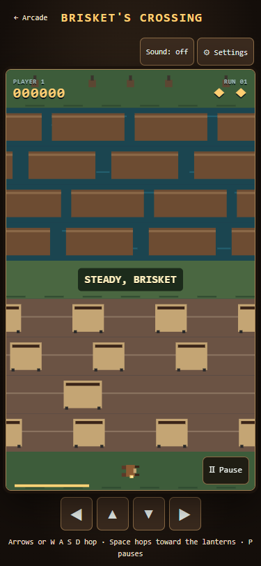
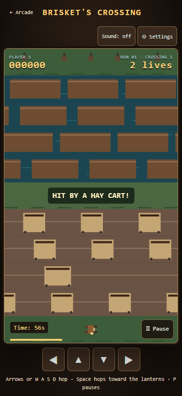
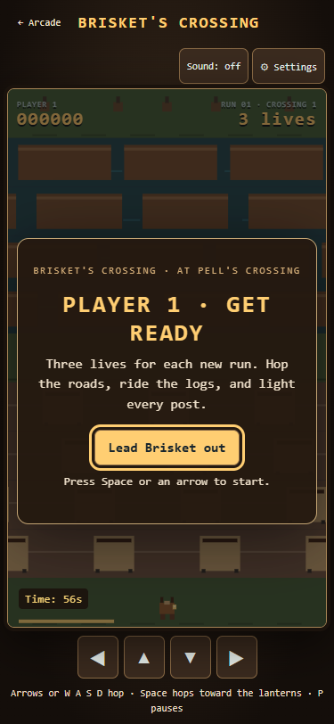
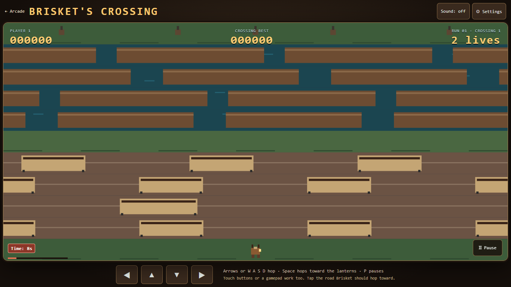

# AC3.3: Brisket newcomer feedback

Claimed in PR #244 after Flint's 2026-10-12 first-time playtest. Baseline: Generations main 31a09ac (Brisket v0.1.2). No version bump or public release bundled.

## What changed

- Existing nonfinal recovery now names its cause: hay cart, river, exhausted time, or a missed/filled lantern post. Last-life losses get the same short visible beat before the next player's ready screen or score entry. The underlying model's immediate turn transition is preserved; the UI waits 0.75 seconds before showing the next screen. Recovery still freezes movement/clock and waits for released input.
- Time has a readable label and seconds, with a solid urgent treatment in the last ten seconds (no flashing).
- Every new attempt starts with the existing three lives. The ready screen says so; the attract demo does not show a depleted player-life counter. Visible/accessible text says "1 life".
- RUN counts started sessions; CROSSING counts progressively harder five-lantern crossings inside that session. Two players share one session number and retain their separate turns, scores and lives.
- A completed session is saved/reported before optional initials. Skipping initials preserves the ranked board but still records completed-run count and best run score for the hall and HUD. Repeated completion cannot award the same session twice. Abandoning from pause remains unfinished, now called "Leave this run".
- The subtitle explicitly says "at Pell's Crossing"; the result says "Run complete" rather than implying every lantern was delivered after losing.

The v1 key/validator remain. Three optional fields default safely: runs and completedRuns to zero; bestRunScore to the greater of an existing valid field and the old top score. Loading does not rewrite an old score-only save or invent historical run counts. High-score initials, sorting, two-player rules, lane/collision geometry, difficulty curve, sound and shared code are unchanged.

## Evidence

The Brisket browser page adds cause/final-loss timing, urgent timer/life grammar, session counter, skip-initials progress, completion idempotence, explicit place subtitle, demo-life separation and actual historical score-only reload checks. Model regression also verifies the existing recovery, held-input and later-round curve.

Screenshots: phone 375x812, laptop 1366x768, desktop 1920x1080 and ultrawide 3440x1440. Each captures title, ready, cart loss and urgent time. Hazards and clocks are staged; screenshots freeze the fixture only after the real animation loop registers the cart collision. They do not claim a human fun score or physical phone testing.

The two before-cart images load exact baseline game/model/style/HTML bytes through browser request routing (31a09ac), using the same staged collision and viewport. Existing AC3.2 pinned release verification remains a historical record and is not rerun or modified.

## Final local validation

All 20 suites pass through tools/run-all-checks.cjs, including Brisket 73 checks, native Wildbond 1526/0, Starfall 264/0, catalogue and all 22 unchanged save names. The model regression passes opening gaps, held-input recovery and exact later-round compatibility. Captures were visually inspected. Remote CI and publication remain separate from this local result.
