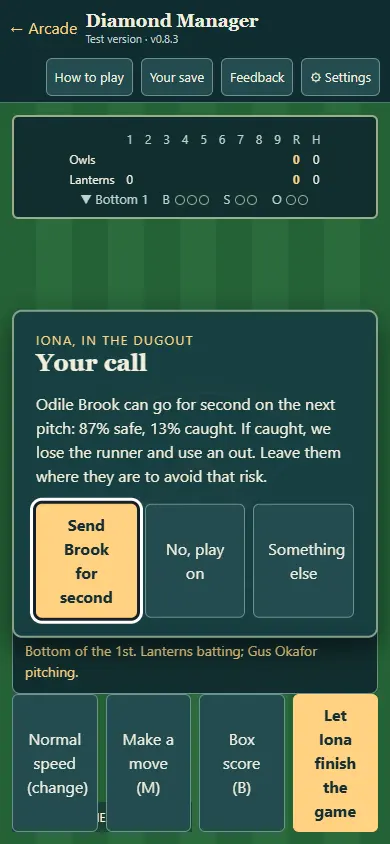
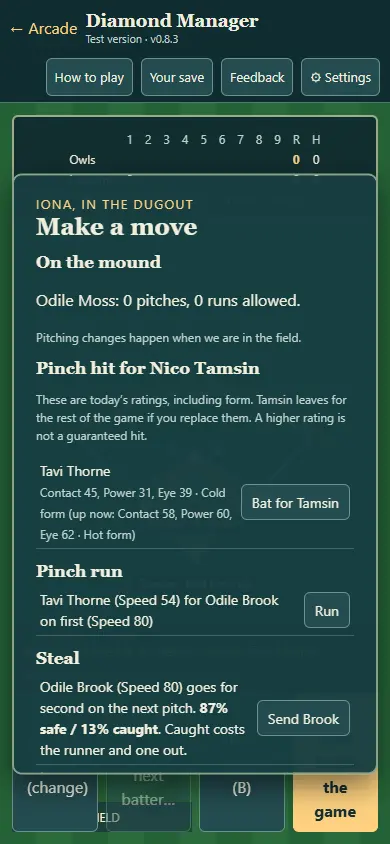
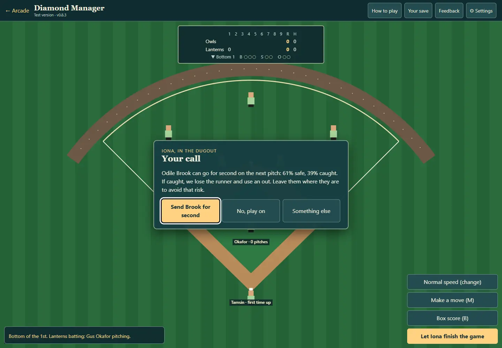
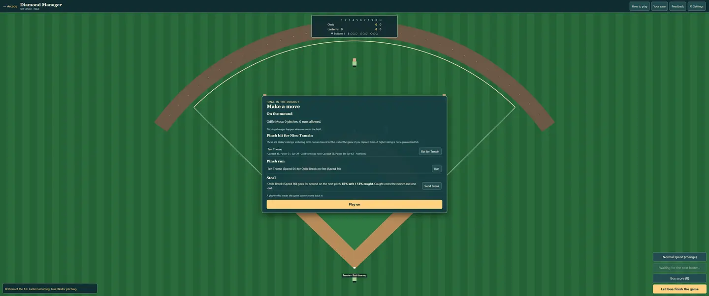

# DM-N1d: dugout decisions with visible risk

PR #347. A managed club now gets a steal decision as early as the first inning when a runner has an open destination, fewer than two outs, at least a 60% chance, and the score is within three runs. One offer per inning; manual steals remain available between batters. No new automated-club behavior or preview dice rolls.

The displayed probability and actual resolution share stealChance: runner Speed versus catcher Glove, bounded at 35–92%; display rounds to whole percent and the caught percentage complements it to 100. Safe moves the runner; caught removes the runner and uses an out (with two outs the manual card warns the inning ends). Declining uses no random roll and records the declined call so it cannot spam that inning.

Pinch-hit suggestions and comparisons show Contact, Power and Eye with the same bounded hot/cold form as the simulation. The one-way substitution is explicit: the replaced player cannot return, and higher ratings never guarantee a hit. The between-batter Make a move button opens immediately; an active plate appearance still finishes before moves.

## Verification

- **128 Diamond Manager checks pass**, nine new: preview formula/bounds/read-only behavior, legal targets, first-inning pause, once-per-inning offers, 200 actual success/failure outcomes with stat/out costs, no automated prompt and seeded preview invariance, save/reload, malformed imported asks and bounded form text. Existing pinch-hit irreversibility and all game/season/balance tests retained.
- browser-checks.json and browser-checks.cjs: controlled fresh-context fixtures at 390×844, 1440×1000, 3440×1440; actual rounded risk/out cost, preserved reloaded prompt, decline, exact current-form comparisons, irreversible-change wording, immediate move panel and Play on control, no viewport overflow or exceptions. No user saves touched. Not a newcomer playtest.
- Aggregate: **22 of 23 suites pass** on main 24571a7 plus this task; only the existing Little Ranch “Left alone, the berries glow (the hint)” fails. Wildbond Godot 1,666 and Starfall Godot 464 pass, as do launcher/catalogue/save/asset/context checks. No assertions weakened or skipped. Final targeted rerun after the timing fix passes all 128.

No version bump, new save schema, altered AI decisions, extra RNG, Godot/shared/art changes or deployment.

