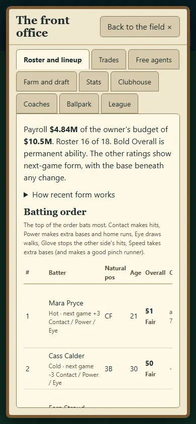
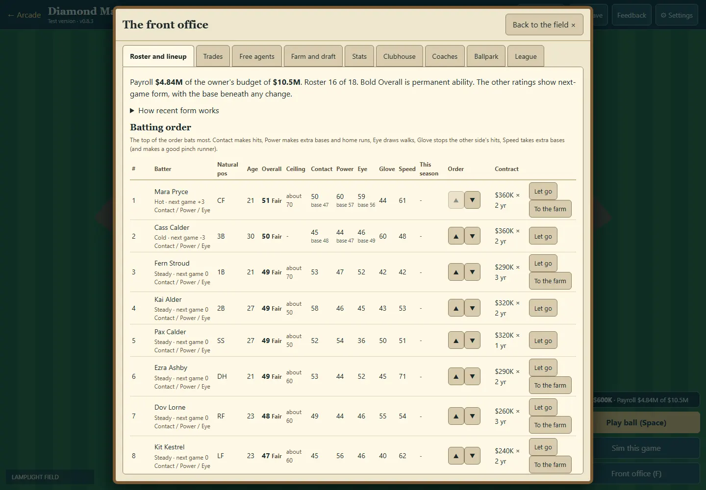
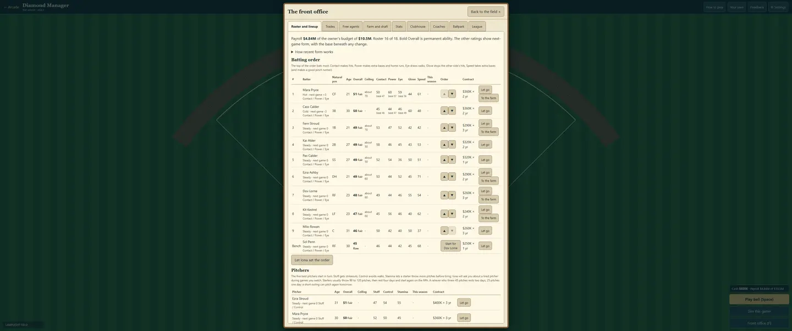
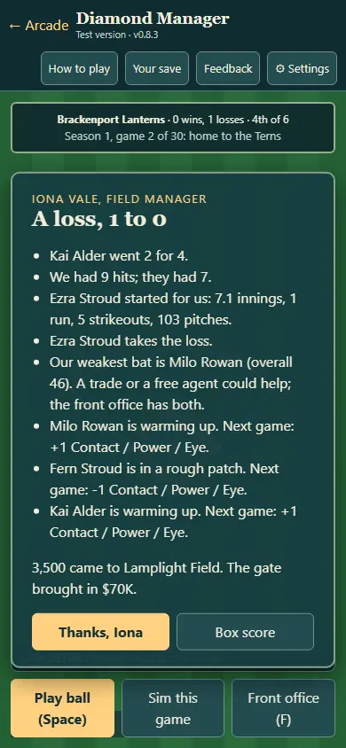
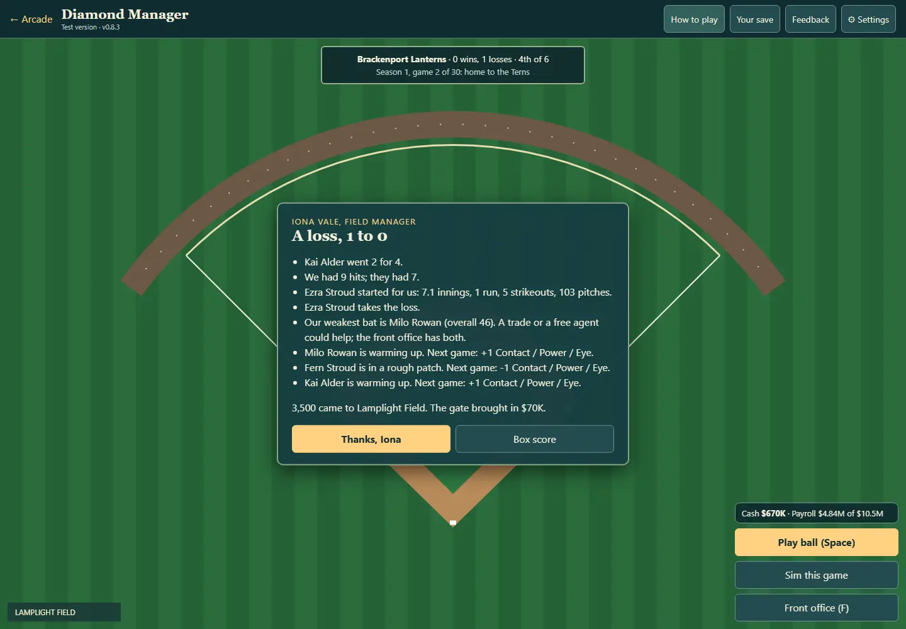
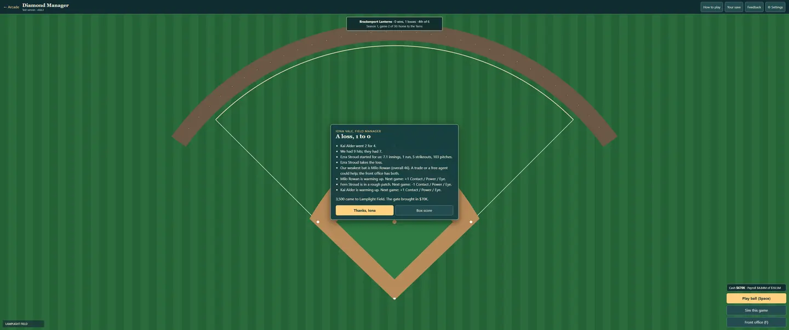

# DM-N1c: recent form

PR #310. Hot/cold form is a temporary next-game adjustment from the last five qualifying appearances, capped at ±3. Permanent ratings, ceilings, Glove, Speed, Stamina and contract values are separate. No new random rolls. Bench/rest days and small cameos do not count. Five neutral qualifying appearances clear any streak; a new season resets everyone.

Batters qualify with three plate appearances: two hits or a homer +1; hitless with three at-bats −1; otherwise 0. Pitchers qualify with nine outs: runs per nine ≤3 earns +1, ≥6 earns −1, otherwise 0. Regular-season and final games count once, using distinct persisted game keys. Old saves receive neutral form without reconstructing historical results; active games survive migration.

## Evidence

- tests/diamond-manager.html: **114 checks pass**, 12 new regressions covering qualifiers, bounded ratings, fade, fatigue, unchanged permanent ability/value/RNG, real plate-appearance integration, old/live saves, invalid imports, final keys, winter reset and readable roster labels.
- browser-checks.json: isolated fresh browser contexts at 390×844, 1440×1000 and 3440×1440; named hot/cold form, current/base values, expandable rules, Iona result note, close controls, no viewport overflow and no page errors. Small WebP captures below.
- Aggregate on main e795357 plus this task: **21 of 22 suites pass**. Only Little Ranch fails: “Left alone, the berries glow (the hint)”. Both Godot suites pass (1,643 Wildbond; 272 Starfall). Its owner was notified; no game assertions are weakened or skipped. Final targeted rerun after shortening phone copy passes all 114.

This is implementation/visual evidence, not a new newcomer playtest. No game version bump or user-save modifications.
