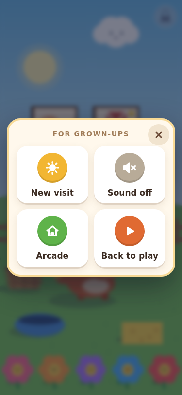
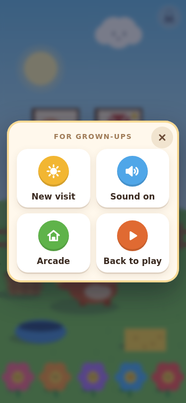
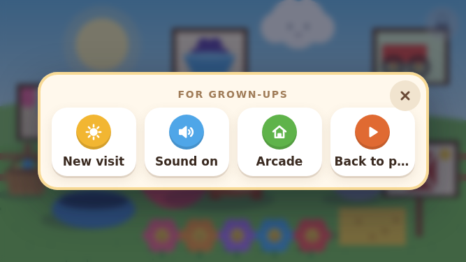

# LRL-4: sound preference reload safety

## Scope

Little Ranch already stores the sound choice in `little-ranch-settings-v1`. This task adds the missing regression and browser evidence; production game code and the save format are unchanged. A visit remains deliberately unsaved and restarts in daytime after reload.

## Reproduction

Run `node tools/run-all-checks.cjs` for the repository aggregate and `node tools/playtest/little-ranch-review.cjs` for the independent Chromium review. The latter uses the existing GitHub Actions workflow, produces `lrl4-report.json`, and captures `lrl4-<width>x<height>-sound-on/off-reloaded/playing.png`.

The added HTML regression cases exercise sound off and sound on through two actual iframe document reloads each. They reacquire the document and `LR` handles after every reload, check the loaded preference and visible control, complete one activity with five flower taps, and verify New visit still works. The original preference bytes are restored in `finally`; all unrelated local/session storage is compared.

The Chromium review repeats both choices twice at 375×812, 667×375 and 1366×768: 12 real `page.reload()` calls in total. Each profile starts empty, seeds unrelated local/session fixtures only once, and uses the real three-second grown-up lock and mouse input to set the preference. After each reload it checks the loaded boolean, label, pressed state, muted class and both icons; five real flower taps complete an activity; New visit resets the day without changing sound. Native Web Audio oscillator creation is observed without replacing its behavior. Sound-on requires running audio contexts, scheduled tones and narration intent. Sound-off requires no oscillators, tones or narration intent. A per-document audit requires no storage mutations after reload, and unrelated bytes must match.

## Limits and acceptance

This is automated Chromium engineering evidence. It does not prove what a person hears, spoken-voice availability, physical-phone/WebView behavior, a newcomer fun score, or the broader launch gate. Playtester or Evan must still confirm that the current build does not crash. The physical-phone and fun-score rows are separate.

Local Chromium could not launch because the execution sandbox rejected its socket; runtime results come from the existing repository CI jobs. Both modified scripts pass local syntax checks. Independent static review found no blocking issue and verified the local file hashes against the implementation commit.

## Verified implementation run

Implementation [70879ea0](https://github.com/ecbarish/generations/commit/70879ea0dbeb7d6a26a7fc663e1cc84c1b27df5f) passed:

- [Aggregate Checks](https://github.com/ecbarish/generations/actions/runs/38646959327): all 28 suites, including 511 Little Ranch assertions (27 added here).
- [Little Ranch browser review](https://github.com/ecbarish/generations/actions/runs/38646959317): 334 assertions, including 60 LRL-4 assertions and 12 actual reload cases.
- Both sound choices restored correctly; every case completed one five-flower activity, then New visit reset activities from 1 to 0.
- Muted: zero tones, narration intents and native oscillators. Enabled: 10 tones, 5 narration intents and 10 native oscillators, all observed audio contexts running.
- Zero storage writes after reload; unrelated local/session fixtures preserved.

The initial six panel screenshots were captured during the opening animation and were rejected by independent visual review. Commit [2329adf8](https://github.com/ecbarish/generations/commit/2329adf8248d914f25b1aafea1240105059cb849) waits for the actual panel/card animations before capture, merges main `99af8974`, and retains #429's two-line bubble isolation in the older friend test. It changes no game code. Its fresh captures and final checks are recorded below.

## Fresh evidence, 2329adf8

- [Aggregate Checks](https://github.com/ecbarish/generations/actions/runs/38647611526): all 28 suites pass; Little Ranch is 511/511.
- [Browser review](https://github.com/ecbarish/generations/actions/runs/38647611078): 334/334, including all 60 LRL-4 checks and all 12 reload cases. GitHub tested PR merge `5f5e3f4c229dc2625e8041fc36d30a13009842d5` for head `2329adf8248d914f25b1aafea1240105059cb849`.
- [Focused checks](checks.json), [complete reload-state report](lrl4-report.json), and [source/run/file hashes](provenance.json) are committed here.
- The image filenames below identify the viewport, selected preference, and whether the control or resumed play is shown. All are fresh captures after the screenshot-timing correction.

### 375x812

### 667x375

### 1366x768

Independent visual review accepted all 12 fresh captures. It noted an existing, non-blocking truncation of “Back to play” at 667×375 and 1366×768; the sound control itself is fully readable. That layout detail is outside this reload task.

The evidence/coordination follow-up also reconciles the latest planning-only main; it does not change either test script or game source. Its exact-head CI and the final Playtester/Reviewer handoff are recorded in [PR #439](https://github.com/ecbarish/generations/pull/439).
