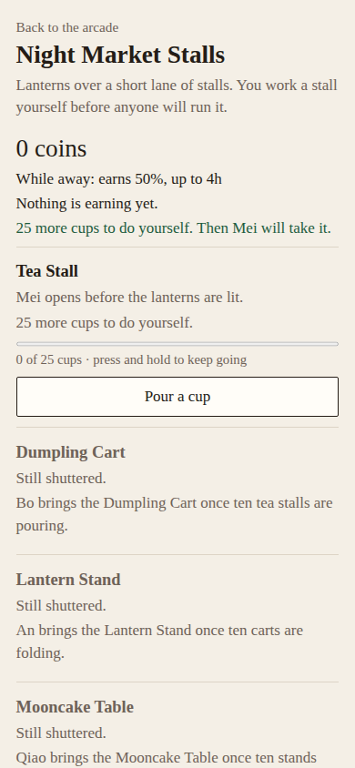
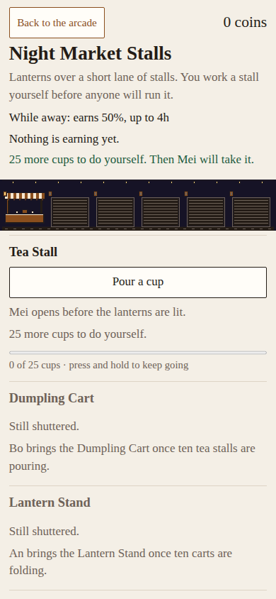
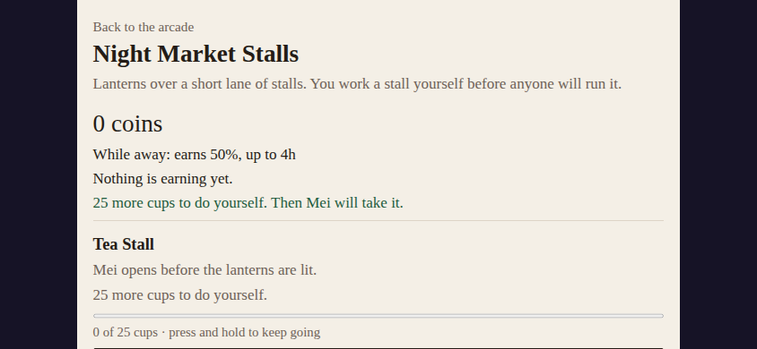
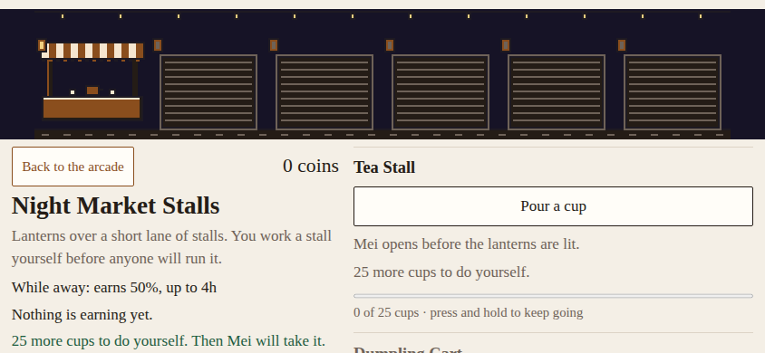
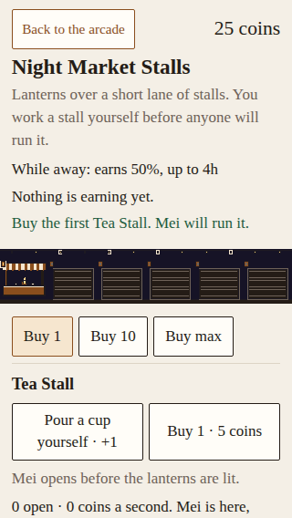
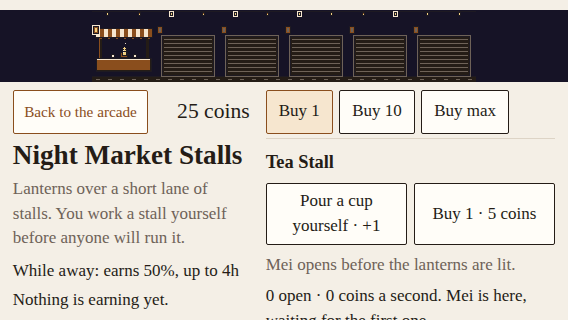

# NM-PHONE: phone navigation and the first stall

Scope: launch-night-market.md item 10 / NM-FIX-8, assigned to dot on issue #373.
This is a layout repair and browser-engineering report. Playtester still owns the
played-phone session (NM-FIX-7), newcomer acceptance and the fun score.

## Reproduced baseline

The exact-head Chromium capture at `7e6273380417015f409c4bac828156ea35def063`
(run 38661166477, artifact 11938498370) contains the unchanged game at main
`b2dd2c70a2f0595f9fb4167d063929900fae6213`.

- Back to the arcade was 112.6 × 17 CSS pixels at all seven measured sizes.
- At 844 × 390, the first Pour button extended to y=433.3, below the viewport.
- At 568 × 320, it extended to y=457.9. At 667 × 375, it extended to y=433.3.
- The plain-ledger portrait first action was already visible. The final checks
  below also include the merged visual strip, which adds height.
- The reported overlap was not reproduced on this baseline. The repair keeps
  navigation in normal flow and regression-checks unobstructed hit targets.

Baseline artifact: https://github.com/ecbarish/generations/actions/runs/38661166477/artifacts/11938498370

## Bounded change

Both arcade links become normal-flow 44px-minimum touch targets with keyboard
focus rings. On phones, Back and the cash box share one row; the first stall's
actions are near its heading and all explanatory text remains below them.
Short landscape uses two columns for status and market work. The decorative
strip keeps its original pixel dimensions, whole-number scaling and drawing
code; it spans the page above those columns. Desktop's normal ledger remains.

Interactive DOM order stays Back → bulk controls when present → each stall's
serve/hire/buy controls → save disclosure → footer. Moving explanatory text
visually after the actions does not change the keyboard sequence. Screen readers
still encounter the original informational content before each stall's actions.

The away summary intentionally remains an acknowledgement before resumed work.
The first-stall fold assertion applies to fresh/ready/hired states and after the
box is dismissed; it does not claim all returning-player text fits at once.

No game.js, lane.js, model, economy, save format, shared engine, launcher, version
or art-asset changes are made by this task. Grok owns the NM-PLAY save residual.

## Reproducible checks

- `node tools/run-all-checks.cjs` remains the unmodified aggregate command.
- `node tools/playtest/night-market-phone.cjs [output-directory]` runs isolated
  Chromium phone emulation and desktop checks and writes screenshots/report.json.
- The additional read-only PR workflow checks out the exact head with persisted
  credentials disabled. It uploads only this harness's evidence. It has no
  secrets, deployment or write permissions and does not replace normal Checks.
- The existing Night Market test page additionally verifies the full visible
  Back and first serve controls, hit testing, no overlap and no horizontal spill
  in fresh, ready-to-hire and hired states through repeated orientation changes.
- The harness uses 320×568, 360×640, 390×844, 568×320, 667×375, 844×390, 932×430 and 1280×800.
  It checks real touch taps, hold/release and cancellation, actual hiring/buying,
  rotation, keyboard navigation, browser Back/Forward, repeated arcade returns,
  a fixture-backed away reload/dismissal, repeated save disclosure and 200% text.
- Every context uses disposable storage; an unrelated sentinel save must remain
  unchanged. The aggregate retains the literal pre-retune v1 save reload tests.

## Integrated evidence

Source head: `ff2b5cb96168ddcdd4e2604013cefae1b7f2e48e`, a normal merge of
main `92e8b990e7a451015b9f3dd4660616aa533f194d`, including the approved lane
from #438. The sole index conflict was resolved by keeping the decorative lane
outside and before the work wrapper. The original art code and tests survive.

[Phone review run 38665372361](https://github.com/ecbarish/generations/actions/runs/38665372361)
passed **264/264 checks** and produced **27 screenshots**. The retained
[integrated report](integrated-report.json) records the exact source head, all
assertions and measurements. The full screen set is in
[artifact 11940856804](https://github.com/ecbarish/generations/actions/runs/38665372361/artifacts/11940856804).
The durable images below are copied directly from that artifact; the two
baseline images come from the unchanged pre-art baseline identified above.

| View | Before (pre-art) | After (with merged art) |
| --- | --- | --- |
| Fresh portrait, 390×844 |  |  |
| Fresh landscape, 844×390 |  |  |

The two tightest hired-state views retain the whole first serve and buy actions:

Back is now 135.4×44 CSS pixels in the measured normal-size phone views.
At 844×390, the fresh Pour button ends at y=250.1 (previously y=433.3 even
without art); at 568×320, it ends at y=178.1 (previously y=457.9).
The hired serve button ends at y=504.5 on 320×568 and y=245.3 on 568×320.
The strip remains whole and centered: 320×60 on the narrowest portrait,
384×72 on 568px landscape, and 768×144 on 844px landscape.

## Verification limits and review

These screenshots are source-head evidence, not a claim that their report names
its later documentation commit. The final exact PR-head aggregate and refreshed
phone evidence are linked in [#456's self-check](https://github.com/ecbarish/generations/pull/456).
Source-head [aggregate Checks](https://github.com/ecbarish/generations/actions/runs/38665372284)
passed, alongside Wildbond export freshness. The normal aggregate retains the prior literal-v1-save and art assertions;
no test or required workflow has been weakened or replaced.
Local Chromium cannot start (`socket() failed: Operation not permitted`), so
actual-browser evidence comes from the documented CI runs, not a local claim.
No physical handset, Safari, audible response, human feel or deployment pass is
implied by these Chromium checks. Only Generations Reviewer may merge.
