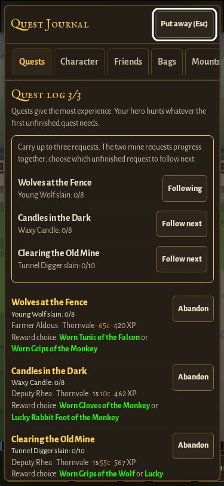
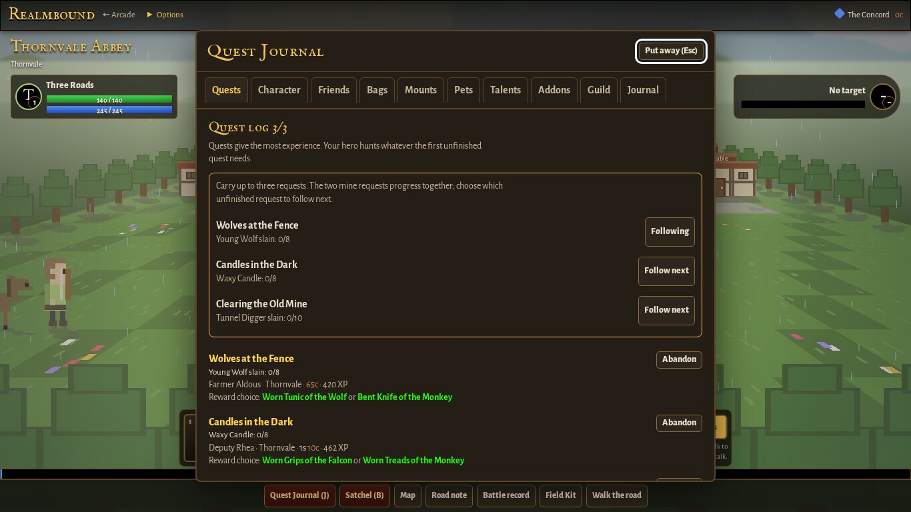
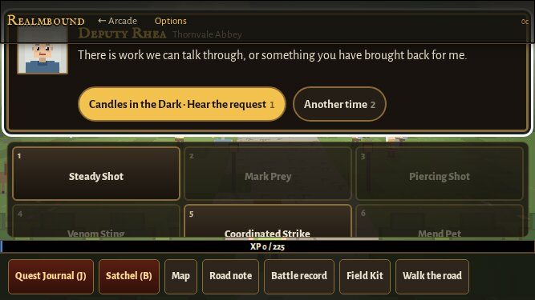
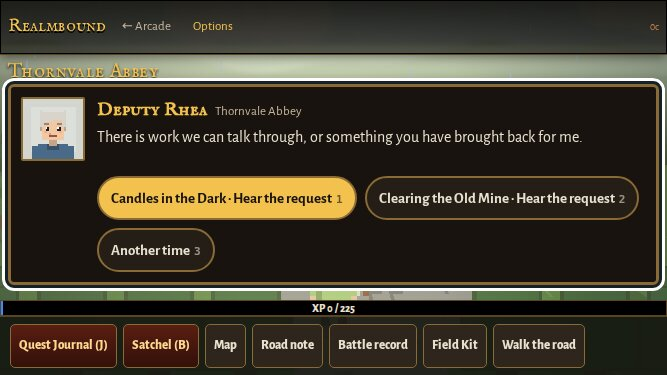

# RB1.12a: overlapping Thornvale requests

Draft PR #283, dot (Adam), 2026-10-13. Implements Cycle 1's existing round-2 feedback, not a new exploratory playtest.

## Scope and save contract

The engine already stores up to three active quest IDs and progresses every matching objective. The problem was the opening route: only Wolves starts automatically, and mine-clearing waited until candle recovery was turned in. Mine-clearing now opens alongside candles at level one. Later Foreman and Grizzlemaw prerequisites remain intact.

The arrival and optional road note explain the extra requests. The carried Journal shows a compact three-objective summary and Follow next controls; this reorders the existing active array and clears an explicit hunt override, without replacing a current encounter. Full slots are explained. Rewards, combat, gathering chance and quest counts are unchanged.

No save schema, key, version or migration changes. Old single-active arrays, progress, reward identities and completed records are preserved. Abandon/reaccept retains pre-generated rewards. Other zones and characters are covered by regression checks.

## Verification

- Claim baseline 79db673: normal Checks run 38403289021 passed.
- New tests: tests/realmbound-parallel-quests.js, included additively in tests/run.html. Covers concurrency, full slots, same-target progress, separate rewards, full bags, repeated completion, abandon/reaccept, v1/v2 saves, multiple characters, actual Journal click, cancel, five viewport widths.
- Existing Realmbound phone capture script additionally captures the opening Journal and Deputy Rhea at all six viewport/text settings, for both PR base and branch. Existing captures retained.
- Local Chromium fails before executing checks because its process-singleton socket is prohibited; the same result occurs with the escalation route. Actual-browser validation uses the repository's unchanged GitHub Actions workflows.
- Source head `56ad188456d69e467dc2705a5de15300f37751cb`: [all 21 suites pass](https://github.com/ecbarish/generations/actions/runs/38406855470), including **9,074 Realmbound scenario checks**. The six-setting [phone review and real browser reload checks pass](https://github.com/ecbarish/generations/actions/runs/38406856043).
- Source review found no save/game-code blocker. Its test-coverage suggestions were implemented. Visual review caught landscape header overlap; Realmbound's measured dialogue height now outranks shared CSS, and short-screen paused town/arrival conversations temporarily use the inactive combat controls' space. Tests verify header/dock clearance and restoration.
- Reviewed phone, large-text Journal, landscape, laptop and ultrawide renders. The capture script restores text scaling after actual reload; this final evidence-only correction and documentation are rerun under normal CI. Exact latest-head results are recorded in PR #283's validation/Tower block.
- Screenshot originals remain in the linked Actions artifacts (72 before/after captures); compressed selected images below are from source head 56ad188. No new Realmbound game code follows that source head.

## Selected renders

No merge, release/version bump or deployment authorized.
