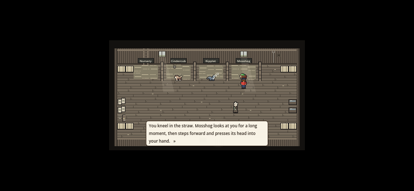
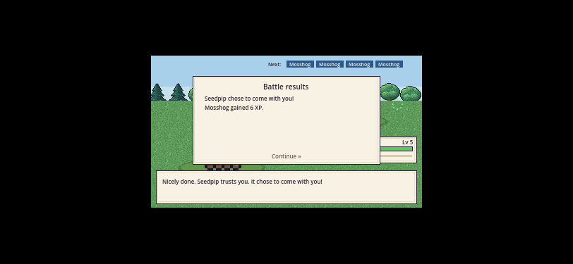

# WB-FUNNEL1: opening timing and immediate dialogue input

Source-only work in [PR #380](https://github.com/ecbarish/generations/pull/380). No save fields, starter-choice design, story text, engine identity or committed web preview changes. NOS-1a..e remain with Wildbond & Starfall Dev Lead. The merged catalogue (#368) is preserved.

## What was wrong

`advance()` already removes the current line immediately. Enter, E, Space, keypad Enter, gamepad A and left-click worked. A native `InputEventScreenTouch` with mouse emulation **off** did nothing. The baseline probe left four lines queued after a press/release.

The narrow fallback accepts a genuine native press when mouse emulation is off and no modal covers the world. With normal touch-to-mouse emulation, Godot sends the synthetic mouse event first; accepting the following touch too would advance two lines. Reverse mouse-to-touch emulation also needs a guard. Both directions are tested. WB-C3's bubble pass-through is unchanged.

## Scripted timings, not a human playtest

The timing runner uses actual input events, normal movement/battle/capture rules and a read-only route/menu strategy. It does not teleport, edit story state, create a creature, force a catch, speed up battle pace or use `--skip-opening`.

Default: Rowan, farm heritage, Cindercub; how-to included; safe Not yet/reopen path included. Godot 4.7.2, headless, simulated 60 Hz. The existing reading protocol budgets 12 seconds for how-to, 30 for the register, 12 for the partner card, and 180 words/minute plus 0.75 seconds for each dialogue line. The rapid protocol replaces reading budgets with two frames, respecting the existing how-to opening grace period. Navigation and catch-meter decisions are scripted and highly efficient.

| Protocol/source | First partner | First battle | First catch |
|---|---:|---:|---:|
| Reading, before: main `8d6886a4bc9189887149b901c4355e96c7e59bf4` | 119.02 s | 214.60 s | 318.30 s |
| Reading, after: `c3b368f8471638268ea8c53667ce2293186c2986` | 119.02 s | 214.60 s | 318.30 s |
| Rapid, after: same source | 10.97 s | 16.77 s | 44.17 s |

The keyboard reading times are unchanged, as expected: that input already advanced immediately. The reading run does **not** meet the separate planned 2:30 first-battle / approximately 3:00 free-roam targets. This task measures the existing opening and makes its lines advanceable; it does not implement the separately owned starter scene or remove story. Rapid numbers are an automated lower-bound-style protocol, never a novice-time guarantee. Different reading budgets, navigation, combat decisions and encounter rolls change the outcome.

The JSON reports beside this note include source SHA, main.gd SHA-256, engine, input count, full transcript, milestone chronology, actual capture attempts and confirmation that the caught creature joined the team. Catch means the first successful capture result, followed by normal results dismissal, roster arrival and return to control. The captured game source is unchanged by the later evidence-gate improvements in this PR.

## Regression coverage

- `wildbond-godot/tests/opening_dialogue.gd`: 16,291 assertions, real viewport input events across every opening dialogue phase, four heritages, three starters and both rival outcomes. Zero elapsed game time between line presses proves there is no reading delay.
- Enter/E/Space/keypad/A, mouse, speech-bubble clicks, native touch, real touch-to-mouse emulation and reverse emulation; echoes, releases and drags do not skip lines. Callbacks run once and keep newly queued lines. Signing/choosing does not eat the next conversation's first line. Native input cannot advance behind overlays.
- Official 4.7.2 local Godot aggregate: **18,530 passed, 0 failed**, including the frozen pre-WB-C2 save and existing migration/old-save coverage. Character, heritage, starter, roster, trust, location and progress still load.
- Evidence-validator tests: **12 passed** (one positive, eleven negative). Threshold fixtures keep their timestamps consistent and assert the specific 180-second error. The original WB-C2 partner and partner-control gates and extra 1366×768 / 3440×1440 partner-control captures remain in place.
- The existing opening workflow now also runs the complete default rapid protocol headlessly. Its six rendered keyboard/touch × starter comparisons continue to exercise the historical WB-C2 baseline (`40fcaf9`) and current source, now through first catch. This historical comparison is distinct from the before/after main comparison above.
- Local Chromium could not launch. Full browser/aggregate and rendered evidence are established by Actions; see the PR's exact-head checks, self-check and Tower status. No local-browser or physical-phone pass is claimed.

## Rendered checkpoints

These two screenshots were downloaded and visually inspected from the successful touch/Mosshog job in [source run 38581693079](https://github.com/ecbarish/generations/actions/runs/38581693079), source head `c3b368f`, artifact `wildbond-opening-touch-2`. They show intact dialogue and the real capture result. The renderer is X11 at 812×375 with injected touch, not a physical phone; black bars are desktop integer scaling. The full workflow supplies all milestone images. The battle-start milestone is taken during the fade; a separate first-battle-choice image shows the readable menu once it opens.





Screenshots document the checkpoint states; event assertions establish the input behavior. Nothing in this record claims the new source is live.

## Reproduce

Use the repository's official Godot 4.7.2 binary and isolated HOME/XDG data/cache directories. Import first, then:

```sh
GODOT=/path/to/Godot_v4.7.2-stable_linux.x86_64
"$GODOT" --headless --path wildbond-godot --editor --import --quit
GODOT="$GODOT" node tools/run-all-checks.cjs
SOURCE_SHA="$(git rev-parse HEAD)" OPENING_OUTPUT=/tmp/wb-reading \
  "$GODOT" --headless --path wildbond-godot --fixed-fps 60 \
  --script "$PWD/tools/audit/wildbond_opening_timing.gd"
SOURCE_SHA="$(git rev-parse HEAD)" OPENING_RAPID=1 OPENING_OUTPUT=/tmp/wb-rapid \
  "$GODOT" --headless --path wildbond-godot --fixed-fps 60 \
  --script "$PWD/tools/audit/wildbond_opening_timing.gd"
python3 tools/audit/validate_wildbond_opening_timing.py /tmp/wb-reading --single
python3 tools/audit/validate_wildbond_opening_timing.py /tmp/wb-rapid --single
python3 tools/audit/test_validate_wildbond_opening_timing.py
```
