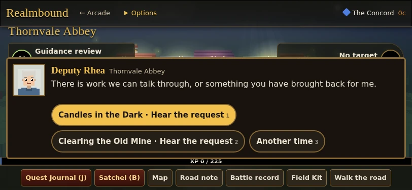
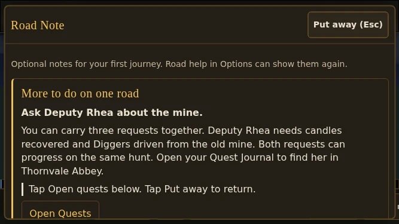
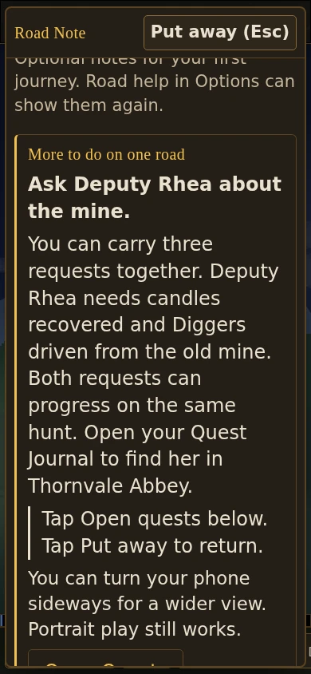
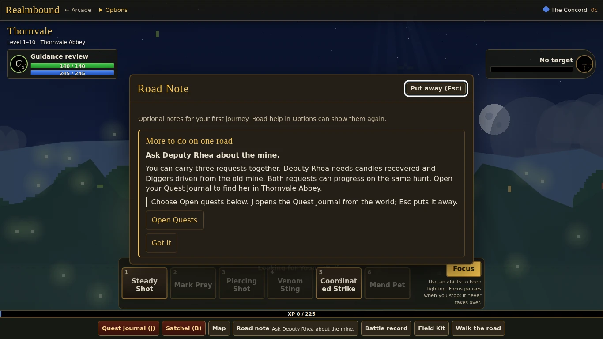
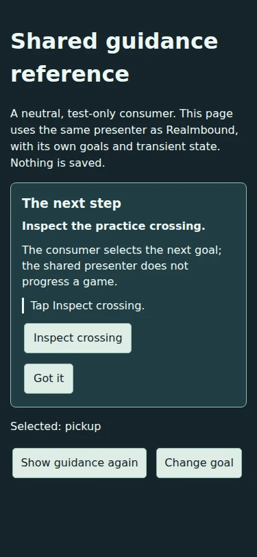

# ONBOARD-KIT1: a small shared browser guidance kit

## Contract

`shared/onboarding.js` exposes `ArcadeOnboarding.create({element,onDismiss,onAction,onInputChange})`.
The returned controller has `update(modelOrNull)`, `getInputMode()` and idempotent `destroy()`.
A model contains `id`, `title`, `goal`, `text`, `inputs: {keyboard,touch}`, optional
`orientation: {portrait,landscape}`, `actions: [{id,label}]`, and optional `dismissLabel`.
Empty content is hidden. Content is text, never HTML. Action IDs are passed back to the game.

The presenter does not read saves, choose goals, progress a quest, pause gameplay, capture movement,
create an overlay, or install a global shortcut. It observes the latest real keyboard/pointer input
and window resizing, and renders in the element the consumer already owns. Coarse pointer is an
initial default only. Touch or pen selects touch advice; mouse or keyboard selects keyboard advice.
Repeated updates reuse buttons so normal refreshes do not steal focus. Destroy removes its listeners.
Consumers are responsible for focus after dismissal and for any scrolling/container placement.

`shared/onboarding.css` provides flow layout, wrapping and 44-pixel minimum button height. Games
supply their own palette. No orientation is required; the consumer supplies optional advice.
This is browser reuse, not a shared Godot system or an engine abstraction.

## Realmbound adapter

`games/realmbound/js/26-onboarding.js` retains `roadHint()`, every existing hint ID/text and all
existing arrival/dismissal/reset/save behavior. The adapter supplies short next steps and input hints,
then delegates rendering to the shared presenter in the existing Road note notebook. The existing
Road note dock button shows the short next step while guidance is available. There is no new
world-space overlay or menu. Quest/Satchel actions use the existing notebook routing.

Heroes without onboarding state still get no unsolicited guidance. Road help remains the explicit
opt-in/reset. Existing arrival replay, `onboarding.hints` and `realmbound-save-v1` stay authoritative.
The presenter has no persistence API and does not add a save field or key.

`tests/onboarding-reference.html` is a second, neutral consumer with in-memory state, two sample
goals and callbacks. It does not adapt another production game or write any storage.

## Verification

- `node --check shared/onboarding.js` and `node --check games/realmbound/js/26-onboarding.js`
- `node tools/run-all-checks.cjs`: unchanged current aggregate, including all existing Realmbound
  arrival, migration, quest, UI and regression checks.
- `node tests/onboarding-browser.cjs . <evidence-directory>`: focused actual Chromium keyboard/touch,
  layout, rotation, large-text, dismissal, repeated opening, saved/legacy progress, fixture and lifecycle checks.
- Additive `Newcomer guidance review` Actions workflow retains screenshots and a machine-readable report.

Implementation `af45611` passed all **21 aggregate suites**, including **9,074 Realmbound checks**,
and **526 focused actual-browser assertions** with **55 screenshots**. The workflow's merge checkout
`bad5cfb` and the PR head have the identical tree `4ffb2a797f89a5fae7516a242a8e4802fad84d70`.

- [Full aggregate](https://github.com/ecbarish/generations/actions/runs/38422624938)
- [Focused browser review and full-resolution artifacts](https://github.com/ecbarish/generations/actions/runs/38422624931)
- [Existing before/after phone capture](https://github.com/ecbarish/generations/actions/runs/38422624901)
- [Detailed assertion/geometry report](browser-report.json)

Coverage: real touch at 320×568, 375×812, 390×844 with 150% text, 667×375 and 812×375;
keyboard at 1366×768, 1920×1080 and 3440×1440; actual resize rotation; arrival, notebook,
Quest Journal, Satchel, dismissal/reset/reopen, reload, raw historical v1/v2 saves, movement;
neutral consumer safe text, callbacks, focus stability, destruction and no storage writes.

The first focused run found a real 812×375 dialogue/header overlap. The fix is limited to short-wide
arrival/town-service conversations and follows existing narrow-phone positioning. The complete suite
then passed; no assertion was removed. An initial aggregate attempt crashed in Godot import before
running tests; retrying the unchanged job passed. Local Chromium could not launch in the sandbox,
so browser evidence is from Actions Chromium 141.0.7390.37 emulation, not a physical phone.

Final evidence/status commits are checked again; see the PR's exact-head check results. Automated
checks are not a new newcomer playtest or evidence of human enjoyment. No merge or publication approved.

## Selected captures

Compressed full-resolution copies; original PNGs remain in the linked artifact.

## Independent source review (2026-10-13)

A separate reviewer checked the presenter, adapter, fixture, existing notebook routes and browser-test
source. The review prompted three corrections: keep the dock goal on one line so desktop XP retains
its space; reconcile reused action buttons to the model's order; and observe input at window capture
so game handlers cannot swallow modality changes. World-action hints now say to put away the note
first. No remaining source blocker was found. Visual acceptance still requires the Actions screenshots
and exact-head checks below; local browser restrictions prevented an independent local browser run.

The independent reviewer subsequently inspected the passing 812x375 arrival/dialogue and representative phone, large-text, desktop and fixture captures: no observed blocker remained. Tested merge and source head tree equality was independently confirmed. Physical devices and other browser engines remain unverified.
