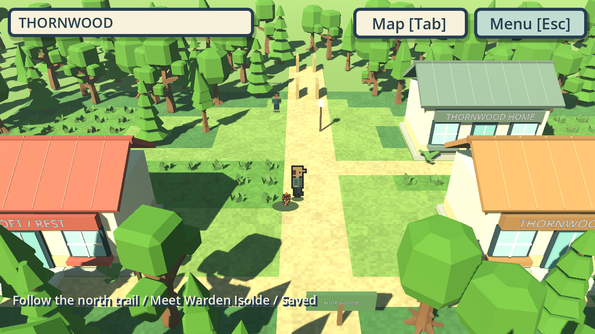
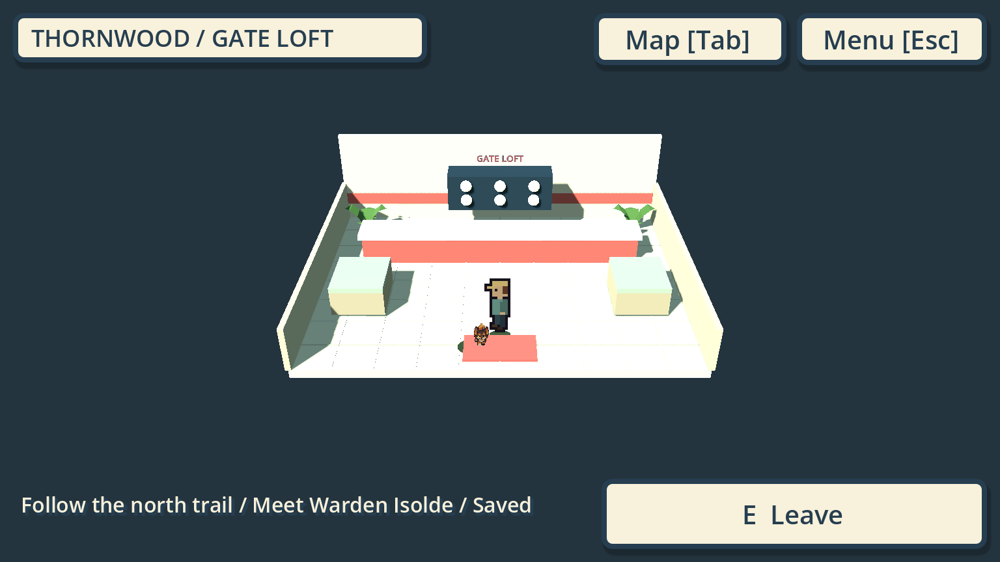
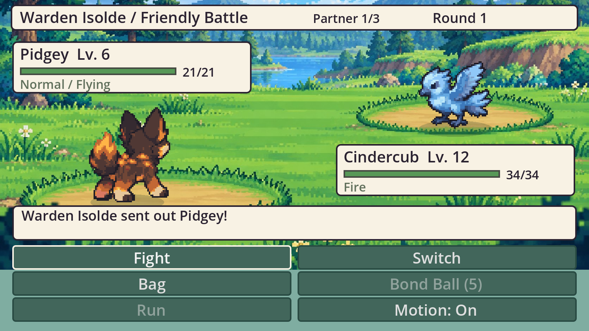
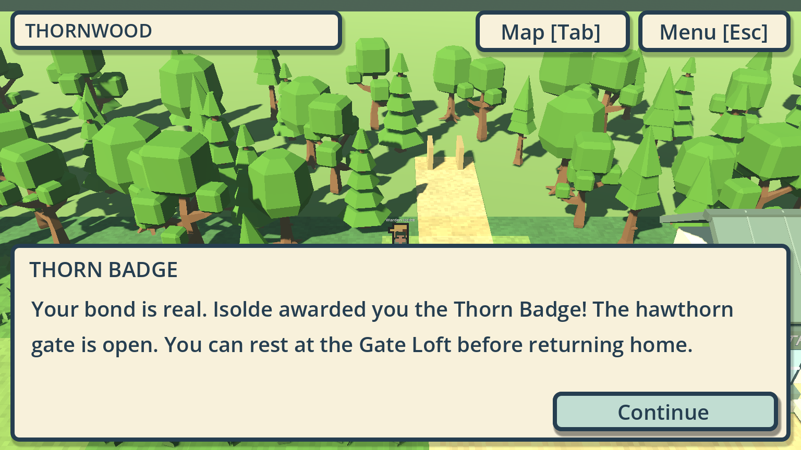

# Connected Thornwood destination

PR [#566](https://github.com/ecbarish/generations/pull/566), `codex/wildbond-thornwood-destination`, stacks on #565. Codex / root for Evan, Lane A, WB-THORNWOOD-DESTINATION. Source implementation for review; not merged, exported or published.

## Playable change

Launch `wildbond-godot/tests/opening/play.tscn` using the existing First Journey launcher. Complete Maren's catch / heal / safe-return outing, then follow Thornwood Trail north into Thornwood town. The canonical source town rows seed a continuous measured map; a two-cell connector joins the existing road. Gate Loft restores HP, PP and burns, returns through its own outdoor door and saves that position. Two additional homes have reachable porches and closed doors.

Isolde waits beside the hawthorn. Her explicit chapter team is Pidgey 6, Wooper 7 and Mosshog 8, using supported identities, art and combat definitions. These are bounded adapted partners; her canonical Pebblepaw 11 / Bogsnap 12 / Thornback 14 roster stays unchanged in production data. The three-opponent battle retains allied HP/PP between opponents, shows Partner 1/3 through 3/3, cancels the defeated opponent's pending action and forbids catching/running. Earlier opponents' XP is pending until a complete win; Return commits it, the inherited final-opponent XP/30 coins and the one-time Thorn Badge. Closing before Return resumes the prior checkpoint. Defeat gives no badge and returns the restored party to Gate Loft for a retry. Completing the challenge prevents repeated reward farming.

The badge opens the physical hawthorn gate and a short approach. The next Saltmarsh route remains physically bounded and unbuilt. Local map and Journey reflect the larger chapter. Isolde reuses the installed caretaker appearance as a temporary visual alias; she faces the player from a stationary post. No new private artwork is imported or committed.

## Compatibility and boundaries

Outer profile schema remains three, with the same filename, catalogue and party records. Nested opening checkpoint version two adds town coordinates and two booleans. Old version-one records retain their party, XP, wallet, bag, quest/trainer results and pickup claims. Before writing an upgraded checkpoint, the complete validated old record is preserved independently in `.pre-opening-v2`. Invalid existing upgrade backups hold writes. A frozen actual prior reader proves that pre-town builds hold version-two checkpoints without writing. Current readers similarly hold future version three in primary, temporary or backup files before recovery. Interior checkpoints remain outdoor doorsteps. Tests use process-specific paths; no real player profile was opened.

Canonical adventure data, source exports, regional graph, other owners' gates/landings, production `main.gd`, public builds and other games are unchanged. Full canonical badge rewards, obedience/level caps, colour/depth story transitions, evolution and the rest of the regional journey remain integration work. Reused Warden introduction/victory lines come from existing source story; no new mystery clue is introduced. Modern rendering remains the existing development presentation.

## Evidence

- 51 new destination checks pass in Forward+ with the external private pack and Compatibility with original fallback actors. Includes actual collision-aware walking, challenge button activation, three supported-move KOs, healing, loss/retry, one-time rewards, saved gate state, old-reader/future-save protection, and double-faint handling.
- Existing suites pass: opening 55, live starters 69, installed actors 328, party summary 88, Pokemon rules 45, journey 48.
- All 28 repository suites pass, including Wildbond 26,976 / 0, Starfall 488 / 0, unchanged save-name checks and agent-context checks. This is engineering verification; human fun, phone delivery and low-end performance are unverified.
- Original/fallback captures below contain no imported private actor art. Matching private Forward+ evidence stays external on Evan's machine. Both renderers' captures were inspected; the local map fits the continuous chapter and has the correct town title.

[Local map](captures/local-map.png) / [Hawthorn gate](captures/hawthorn-gate.png).

Run `Godot --headless --path wildbond-godot --script res://tests/opening/thornwood_checks.gd` from the repository root. Add `-- --private` for the external pack, or `-- --capture ABSOLUTE_OUTPUT` for native isolated captures. Use the existing quiet aggregate runner for all repository suites. Test-only `profile_before_town.gd` freezes the prior reader at #565 commit `051fdd013af1afe1f9169a2dbb68d797f5deec09`.

## Next ownership

[Copyable Claude task](CLAUDE-TASK.md): independent report-only review of #565's encounter blueprint. No message has been dispatched by Codex. Gameplay follow-up: play/review this outing, then measure the Rootwater/Knothollow leg against graph/lesson/arrival dependencies before building it. Do not start another disconnected presentation demo.
