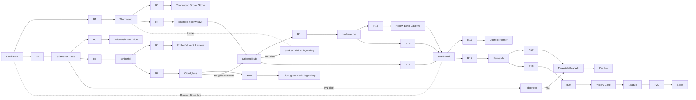

# Wildbond world references: how classic overworlds are woven together

Status: research for the Wildbond world redesign (Wildbond & Starfall Dev Lead owns the design doc). Written in our own words. No maps, code, names or art from any game below should be copied; only the techniques.

## 1. Where Wildbond is today

The current map (`wildbond-godot/data/wildbond.json`, `MAPS`) is a single line of 15 stops: Larkhaven, Thornwood Route, Thornwood, Saltmarsh Route, Saltmarsh Coast, Emberfall Highlands, Cloudglass Pass, Stillreed Basin, Hollowecho Hills, Sunthread Commons, Farwatch Reach, the Returning Light League and the Spire, plus two hidden side pockets (Thornwood Grove, which needs a Stone partner, and Saltmarsh Pool, which needs a Tide partner). Each badge opens the next stop. There are no caves, no water travel, no fast travel, and only Larkhaven has buildings. That is the gap: a Pokémon region is not eight stops, it is a few dozen places knotted together.

## 2. How big a real region is

Counts come from each region's Bulbapedia page and its route pages. Caves, water routes and optional areas are approximate, because a route can be partly sea and "optional" depends on the version.

| Region | Numbered routes | Towns and cities | Caves and dungeons (approx.) | Mostly-water routes (approx.) | Optional / postgame areas (examples) |
|---|---|---|---|---|---|
| Kanto ([region](https://bulbapedia.bulbagarden.net/wiki/Kanto)) | 25 (Route 1 to [Route 25](https://bulbapedia.bulbagarden.net/wiki/Kanto_Route_25)) | 10 plus Indigo Plateau | about 8: [Mt. Moon](https://bulbapedia.bulbagarden.net/wiki/Mt._Moon), [Rock Tunnel](https://bulbapedia.bulbagarden.net/wiki/Rock_Tunnel), [Diglett's Cave](https://bulbapedia.bulbagarden.net/wiki/Diglett%27s_Cave), [Seafoam Islands](https://bulbapedia.bulbagarden.net/wiki/Seafoam_Islands), [Victory Road](https://bulbapedia.bulbagarden.net/wiki/Victory_Road), [Pokémon Mansion](https://bulbapedia.bulbagarden.net/wiki/Pok%C3%A9mon_Mansion), [Power Plant](https://bulbapedia.bulbagarden.net/wiki/Power_Plant), [Cerulean Cave](https://bulbapedia.bulbagarden.net/wiki/Cerulean_Cave) | 3 to 4 ([Route 19](https://bulbapedia.bulbagarden.net/wiki/Kanto_Route_19), 20, 21) | [Safari Zone](https://bulbapedia.bulbagarden.net/wiki/Safari_Zone), Power Plant, Cerulean Cave |
| Johto ([region](https://bulbapedia.bulbagarden.net/wiki/Johto)) | 21 (Routes 26 to [46](https://bulbapedia.bulbagarden.net/wiki/Johto_Route_46), 26 to 28 bridging to Kanto) | 10 | about 9: [Union Cave](https://bulbapedia.bulbagarden.net/wiki/Union_Cave), [Ruins of Alph](https://bulbapedia.bulbagarden.net/wiki/Ruins_of_Alph), [Burned Tower](https://bulbapedia.bulbagarden.net/wiki/Burned_Tower), [Whirl Islands](https://bulbapedia.bulbagarden.net/wiki/Whirl_Islands), [Ice Path](https://bulbapedia.bulbagarden.net/wiki/Ice_Path), Mt. Mortar, Dark Cave, Slowpoke Well, Mt. Silver | 2 to 3 (Routes 40, 41) | Ruins of Alph, Mt. Mortar, all of Kanto after the League |
| Hoenn ([region](https://bulbapedia.bulbagarden.net/wiki/Hoenn)) | 34 (Routes 101 to [134](https://bulbapedia.bulbagarden.net/wiki/Hoenn_Route_134)) | 16 | about 12: [Granite Cave](https://bulbapedia.bulbagarden.net/wiki/Granite_Cave), [Rusturf Tunnel](https://bulbapedia.bulbagarden.net/wiki/Rusturf_Tunnel), [Meteor Falls](https://bulbapedia.bulbagarden.net/wiki/Meteor_Falls), [Sealed Chamber](https://bulbapedia.bulbagarden.net/wiki/Sealed_Chamber), [Sky Pillar](https://bulbapedia.bulbagarden.net/wiki/Sky_Pillar), Seafloor Cavern, Cave of Origin, Shoal Cave and more | about 15 ([Route 105](https://bulbapedia.bulbagarden.net/wiki/Hoenn_Route_105) and most of 106 to 134) | Sealed Chamber, Sky Pillar, Mirage spots |
| Sinnoh ([region](https://bulbapedia.bulbagarden.net/wiki/Sinnoh)) | 30 (Routes 201 to [230](https://bulbapedia.bulbagarden.net/wiki/Sinnoh_Route_230)) | about 14 | about 12: [Mt. Coronet](https://bulbapedia.bulbagarden.net/wiki/Mt._Coronet), [Wayward Cave](https://bulbapedia.bulbagarden.net/wiki/Wayward_Cave), [Old Chateau](https://bulbapedia.bulbagarden.net/wiki/Old_Chateau), Iron Island, Lake caverns, Victory Road and more | 4 to 5 ([Route 218](https://bulbapedia.bulbagarden.net/wiki/Sinnoh_Route_218), 219, 220, 223, 230) | [Battle Zone](https://bulbapedia.bulbagarden.net/wiki/Battle_Zone), [Trophy Garden](https://bulbapedia.bulbagarden.net/wiki/Trophy_Garden), [Sinnoh Underground](https://bulbapedia.bulbagarden.net/wiki/Sinnoh_Underground) |

Overview maps for checking: [Serebii Kanto]( https://www.serebii.net/pokearth/kanto/), [Serebii Hoenn](https://www.serebii.net/pokearth/hoenn/).

Takeaway: roughly two to three routes per town, one cave for every one or two towns, and a quarter or more of the map optional.

## 3. What the regions do

### Loops, branches and shortcuts
- Kanto's middle is a hub: Saffron sits in the centre, and the [Underground Path](https://bulbapedia.bulbagarden.net/wiki/Underground_Path) lets you cross under it while Saffron's gates are shut. [Diglett's Cave](https://bulbapedia.bulbagarden.net/wiki/Diglett%27s_Cave) joins Route 2 (near the start) to Route 11 (near Vermilion), so an early area becomes a two-way shortcut later.
- [Cycling Road](https://bulbapedia.bulbagarden.net/wiki/Cycling_Road) is a long one-way-feeling downhill route that needs the bicycle, turning a vehicle into a shortcut.
- [Rock Tunnel](https://bulbapedia.bulbagarden.net/wiki/Rock_Tunnel) is the only way into Lavender Town early, because Snorlax and Saffron's gatekeepers block the other two routes; when those open later, the east side of Kanto becomes a loop. Snorlax is woken with the [Poké Flute](https://bulbapedia.bulbagarden.net/wiki/Pok%C3%A9_Flute) ([Snorlax](https://bulbapedia.bulbagarden.net/wiki/Snorlax_%28Pok%C3%A9mon%29)).
- [Mt. Coronet](https://bulbapedia.bulbagarden.net/wiki/Mt._Coronet) splits Sinnoh in half; you cross it several times, and each crossing reveals more of it.
- Hoenn's [Rusturf Tunnel](https://bulbapedia.bulbagarden.net/wiki/Rusturf_Tunnel) is blocked by construction early and needs Rock Smash to fully cross, then becomes a direct link between two towns you first reached the long way round.

### Field-move gating that opens revisits
- [HMs](https://bulbapedia.bulbagarden.net/wiki/HM) are taught moves that also work in the overworld: [Cut](https://bulbapedia.bulbagarden.net/wiki/Cut_%28move%29) clears small trees, [Surf](https://bulbapedia.bulbagarden.net/wiki/Surf_%28move%29) crosses water, [Fly](https://bulbapedia.bulbagarden.net/wiki/Fly_%28move%29) returns to visited towns, [Rock Smash](https://bulbapedia.bulbagarden.net/wiki/Rock_Smash_%28move%29), [Waterfall](https://bulbapedia.bulbagarden.net/wiki/Waterfall_%28move%29), [Dive](https://bulbapedia.bulbagarden.net/wiki/Dive_%28move%29) and [Rock Climb](https://bulbapedia.bulbagarden.net/wiki/Rock_Climb_%28move%29) open later layers.
- Non-move keys do the same job: the Poké Flute (Snorlax), Johto's watering can for the [Sudowoodo](https://bulbapedia.bulbagarden.net/wiki/Sudowoodo_%28Pok%C3%A9mon%29) on Route 36, and Hoenn's choice of [Mach Bike](https://bulbapedia.bulbagarden.net/wiki/Mach_Bike) or [Acro Bike](https://bulbapedia.bulbagarden.net/wiki/Acro_Bike), each reaching different spots.
- Metroidvanias use the same idea of abilities that open earlier areas ([Wikipedia: Metroidvania](https://en.wikipedia.org/wiki/Metroidvania)).

### Caves, dungeons and water in the flow
- Caves sit between towns as tests of supplies (Mt. Moon, Union Cave, Granite Cave), and need light (Flash in Rock Tunnel).
- Water routes come in the second half, once Surf is in hand: Kanto's southern sea (Routes 19 to 21) leads to Cinnabar and the [Seafoam Islands](https://bulbapedia.bulbagarden.net/wiki/Seafoam_Islands); Hoenn's eastern half is mostly sea.
- [Victory Road](https://bulbapedia.bulbagarden.net/wiki/Victory_Road_%28Kanto%29) is a final cave that uses every field move you learned.

### Pacing of towns and side stories
- A town every two or three routes, each with a gym and a local problem (Kanto: Pokémon Tower in Lavender; Johto: [Burned Tower](https://bulbapedia.bulbagarden.net/wiki/Burned_Tower) with its legend of the three beasts).
- Healing is always close ([Pokémon Center](https://bulbapedia.bulbagarden.net/wiki/Pok%C3%A9mon_Center)).
- Zelda's [Koholint Island](https://zeldawiki.wiki/wiki/Koholint_Island) threads a [trading quest](https://zeldawiki.wiki/wiki/Trading_Quest) across the whole island so every village has an errand. Stardew's [Community Center](https://stardewvalleywiki.com/Community_Center) [bundles](https://stardewvalleywiki.com/Bundles) reward finishing sets with new access, including the [Minecart](https://stardewvalleywiki.com/Minecart) fast travel.

### Hidden and optional areas
- Hoenn's [Sealed Chamber](https://bulbapedia.bulbagarden.net/wiki/Sealed_Chamber) needs Dive and Braille puzzles; [Secret Bases](https://bulbapedia.bulbagarden.net/wiki/Secret_Base) are tucked into trees and walls.
- Sinnoh's [Trophy Garden](https://bulbapedia.bulbagarden.net/wiki/Trophy_Garden) and [Old Chateau](https://bulbapedia.bulbagarden.net/wiki/Old_Chateau) are side doors off main routes; the [Underground](https://bulbapedia.bulbagarden.net/wiki/Sinnoh_Underground) is a whole second layer.
- Zelda's [Secret Seashells](https://zeldawiki.wiki/wiki/Secret_Seashell) reward digging and poking around; A Link to the Past's [Dark World](https://zeldawiki.wiki/wiki/Dark_World) mirrors the map so known places hide new secrets. Stardew's [Secret Woods](https://stardewvalleywiki.com/Secret_Woods) sit behind a log that needs a tool upgrade, and [Ginger Island](https://stardewvalleywiki.com/Ginger_Island) is a late optional region.

### Legendaries
- Placed at the far end of optional dungeons: Articuno in the Seafoam Islands, Zapdos in the [Power Plant](https://bulbapedia.bulbagarden.net/wiki/Power_Plant), Moltres in Victory Road, Mewtwo in postgame [Cerulean Cave](https://bulbapedia.bulbagarden.net/wiki/Cerulean_Cave).
- Some are released into the world and roam ([Roaming Pokémon](https://bulbapedia.bulbagarden.net/wiki/Roaming_Pok%C3%A9mon)), starting from a story event at the Burned Tower.
- Lugia is in the [Whirl Islands](https://bulbapedia.bulbagarden.net/wiki/Whirl_Islands), reached past whirlpools; Rayquaza tops the [Sky Pillar](https://bulbapedia.bulbagarden.net/wiki/Sky_Pillar); Sinnoh's lake guardians live in three lakes ([Lake Verity](https://bulbapedia.bulbagarden.net/wiki/Lake_Verity)) and its box legends at [Spear Pillar](https://bulbapedia.bulbagarden.net/wiki/Spear_Pillar) on top of Mt. Coronet.

## 4. Design patterns for Wildbond

1. **Two to three routes per town.** Never put two towns next to each other, and never more than three routes without a heal.
2. **A spine with a hub.** One central town all regions touch, crossed by a tunnel before its gates open (Saffron and the Underground Path).
3. **Early places become shortcuts later.** A cave by Larkhaven that only opens late should bring you out halfway across the world (Diglett's Cave).
4. **One "only way through" early, three ways later.** A blocked area forces a cave first, then opens into a loop (Rock Tunnel and Snorlax).
5. **Field abilities from partners, not menus.** Each opens a visible thing you walked past earlier.
6. **Show the gate before the key.** The player should see the cracked rock or the far island hours before they can reach it.
7. **A mountain that splits the world**, crossed several times (Mt. Coronet).
8. **Water is the second half.** Surf turns a coastline into a whole new layer of routes and islands.
9. **Every town has a local problem**, solved in that town or nearby, plus one thread that runs across several towns (trading quest).
10. **Optional pockets behind a single step off the path**: a garden, a mansion, a cave mouth behind a tree.
11. **Legendaries at the end of optional dungeons**, with a story told in the town nearest them, and one roamer released by a story event.
12. **A late mirror or second layer** (Underground, Dark World) so known places hold new secrets.
13. **Fast travel earned mid-game**, to towns you have visited only.
14. **A final cave that uses every field ability** before the League.
15. **Collection rewards open access** (Stardew bundles): finishing a regional request opens a gate or minecart line.

## 5. Suggested Wildbond world skeleton

Each of the 8 current areas becomes a **region** with its own routes, at least one town, and a cave or side area. Names are the real ones from `wildbond.json`; new place names are placeholders for the design doc to replace.

Totals: **20 routes, 10 towns, 7 caves or dungeons, 3 water routes**, 6 optional areas, 3 loops.

### Field abilities (from partners)
| Ability | Partner type | Gates |
|---|---|---|
| Stone Break | Stone partner (already gates Thornwood Grove) | Cracked rock: Thornwood Grove, the Larkhaven back cave (shortcut), Hollowecho cave side passages |
| Tide Ride | Tide partner (already gates Saltmarsh Pool) | Water: Saltmarsh Pool, Saltmarsh Sound, Stillreed lake, Farwatch sea |
| Lantern | Ember partner | Dark caves: Emberfall Vent, the Hollow Echo Caverns, the Victory cave |
| Glide | Air partner, mid-game | Fast travel to any visited town with an inn, and gliding down Cloudglass Pass as a one-way shortcut |

### Regions
| Region (current area) | Routes | Towns | Caves / side areas | Side-quest hook |
|---|---|---|---|---|
| Larkhaven | R1 Larkhaven Lane, R2 Meadow Track | Larkhaven | Larkhaven Burrow (Stone Break, late; comes out in Sunthread) | Nora's lost keepsake, found in the Burrow late game |
| Thornwood | R3 Thornwood Route, R4 Briar Path | Thornwood | Thornwood Grove (hidden, Stone), Bramble Hollow cave | Warden Isolde's missing scouts |
| Saltmarsh Coast | R5 Saltmarsh Route, R6 Dune Walk, W1 Saltmarsh Sound (water) | Saltmarsh Coast, a fishing hamlet | Saltmarsh Pool (hidden, Tide), Tidegrotto (sea cave) | Fisher's tally of tide creatures |
| Emberfall Highlands | R7 Kiln Road, R8 Ashfall Climb | Emberfall | Emberfall Vent (Lantern) | Toren's forge needs ore from the Vent |
| Cloudglass Pass | R9 Glass Steps, R10 Summit Trail | Cloudglass, a mountain lodge | Cloudglass Peak (optional summit, legendary) | Vessa's lighthouse beacon gone dark |
| Stillreed Basin | R11 Reed Causeway, R12 Fen Path, W2 Stillreed Lake (water) | Stillreed (the central hub) | Sunken Shrine under the lake (Tide) | The basin's flooded village story |
| Hollowecho Hills | R13 Echo Ridge, R14 Quarry Track | Hollowecho | Hollow Echo Caverns (Lantern, Stone) | Senna's choir: find the echo stones |
| Sunthread Commons | R15 Loom Road, R16 Market Lane | Sunthread | Old Mill (haunted side dungeon) | Halen's market festival, a trading chain across all towns |
| Farwatch Reach | R17 Watch Road, R18 Cliff Walk, W3 Farwatch Sea (water) | Farwatch | Far Isle (optional island) | Rysa's missing ships |
| League and Spire | R19 Victory Climb, R20 Spire Steps | Returning Light League | Victory Cave (all four abilities), the Spire (postgame) | Spire regulars |

### Loops
- **Loop A, the hub ring:** Stillreed is in the middle. Before its gate opens you pass under it through the Sunken Shrine tunnel; after, Thornwood, Emberfall, Stillreed and Hollowecho all meet there.
- **Loop B, the coast ring:** Saltmarsh Sound (Tide Ride) links Saltmarsh Coast to Farwatch Sea, so the late coast curls back to the early one.
- **Loop C, the Burrow:** Larkhaven Burrow (Stone Break, late) comes out in Sunthread Commons, a Diglett's Cave style shortcut home.
- **Glide down:** Cloudglass Pass to Stillreed is one-way downhill, a Cycling Road style shortcut.

### Legendaries
- A sky guardian atop Cloudglass Peak (optional summit).
- A water guardian in the Sunken Shrine, needing Tide Ride and the flooded-village story.
- A roaming creature released by a story event at the Old Mill.
- The final guardian in the Spire, postgame.

## 6. Phased build order
1. **Phase 1, towns and routes:** split each of the 8 areas into its two routes and give every region a town with an inn and a shop. Keep the badge order; nothing new gates yet.
2. **Phase 2, the first two abilities and loops:** Stone Break and Tide Ride, Thornwood Grove, Saltmarsh Pool, Bramble Hollow, Saltmarsh Sound and Loop A.
3. **Phase 3, caves and Lantern:** Emberfall Vent, Hollow Echo Caverns, Victory Cave.
4. **Phase 4, Glide and fast travel** between visited towns.
5. **Phase 5, optional areas and legendaries:** Cloudglass Peak, Sunken Shrine, Old Mill, Far Isle, the Burrow shortcut.
6. **Phase 6, side-quest threads:** one per town plus the Sunthread trading chain.

Old saves must keep loading: each phase should map old map ids to their new region so a save made at a stop resumes in that region's town.
