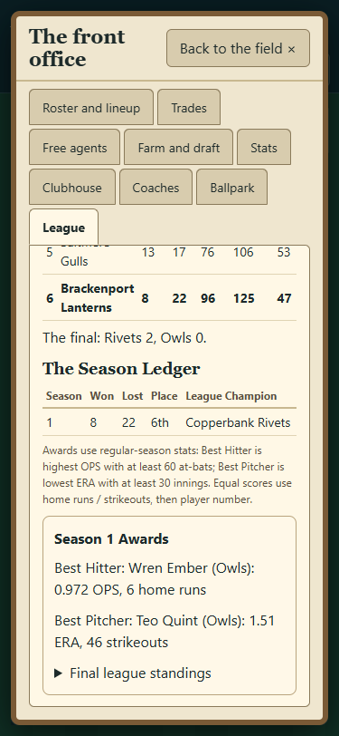
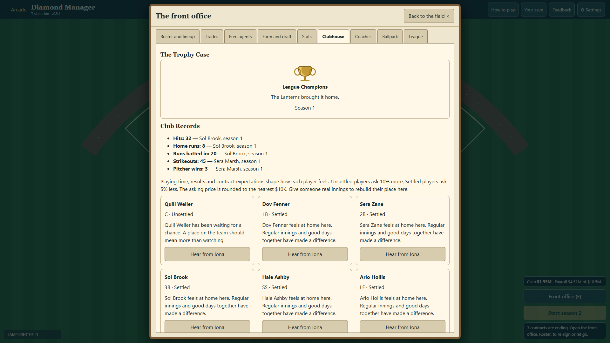

# DM7 rendered browser evidence

Run serve.ps1 on an available port, then:

```
node tests/diamond-history-ui.cjs http://localhost:8773
```

The script uses fresh isolated browser contexts at 375x812, 1366x768, 1920x1080 and 3440x1440. It simulates seed 501 through the real 30-game season and final functions, opens the season-end award report, follows its ledger button, visits the Clubhouse and reloads the saved history. The player's actual saves are not used. No horizontal page overflow or page errors.

Each width has ledger-W.png, awards-W.png, clubhouse-W.png and trophy-W.png. Ledger, awards and records are from the actual simulated season. The championship flag is staged only for the Trophy Case capture, then restored before save/reload; the 8-22 Lanterns did not win that season. This distinguishes a rendering fixture from earned gameplay evidence.




This is a browser regression flow and rendered review, not a full manual season or a physical-phone touch test.

Before captures use parent 0c42c85 on an independent serve.ps1 instance at port 8774 with the same seed and season functions: before-ledger-W.png and before-clubhouse-W.png at phone and desktop widths. New captures use this DM7 branch at port 8773.
