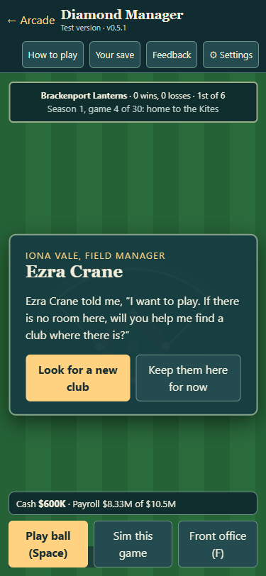
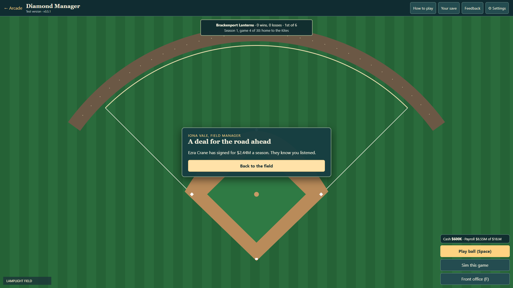

# Diamond Manager morale evidence (DM4)

PR #207 follows coaches PR #196. No version bump or preview export.

## Design

Mood starts at 50 and stays between 0 and 100. Actual appearances add 2; available benched stars lose 3, other players lose 1. Wins add 1 and losses subtract 1. Pitchers are not punished for ordinary rest or rotation: bench pressure starts only when rested and at least seven days without an outing. A final-year contract below 75% of the neutral asking price subtracts 3 per game, so even a regular-playing underpaid star can raise a concern.

Stars below 35 ask for playing time/a trade after three missed appearances, or a better contract when underpaid. Requests never force a departure. Playing again and recovering to 45 clears a trade concern; an affordable new deal clears a contract concern. Incoming players start fresh. No player ratings or game-simulation probabilities change.

Unsettled players ask 10% more; settled players (70+) ask 5% less, rounded to the nearest $10K. These terms are stated in the Clubhouse clipboard. Iona speaks over the field, naming the player and offering the existing trade screen, a priced new deal, or postponement. Records stay in the in-game clipboard.

## Reproduce

Serve this worktree with serve.ps1 on an available port. With Playwright on NODE_PATH:

```
node tools/run-all-checks.cjs
node tests/diamond-morale-ui.cjs http://localhost:8771
```

Diamond Manager has 78 checks: legacy saves, actual appearance/bench/result effects, pitcher rest, underpaid regular players, duplicate game recording, random-stream preservation, bounded state, named requests and recovery, exact asking prices, budget rollback, new deals, save/reload, shared salary fallback and actual trade resets.

## Rendered UI evidence

The UI script uses isolated browser contexts and staged league fixtures, not a user's save or a claim of a complete manual season. At 375x812, 1366x768, 1920x1080 and 3440x1440 it opens the Clubhouse, hears the named trade request, verifies the requested player is selected in the actual trade screen, completes an affordable contract, reloads and verifies the salary/request persist. No horizontal overflow or page errors.

Each width has clubhouse-W.png, trade-request-W.png, deal-request-W.png and deal-signed-W.png. These are real browser captures. The fixture creates the trade concern through four recorded bench losses and stages the contract concern explicitly; simulation checks separately exercise natural contract concerns from neutral mood.



