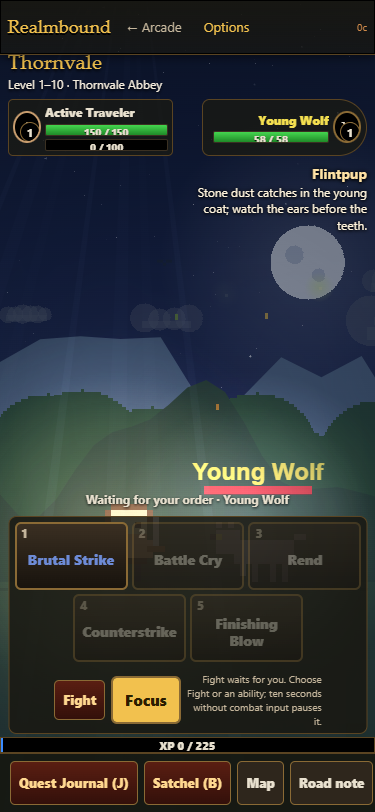
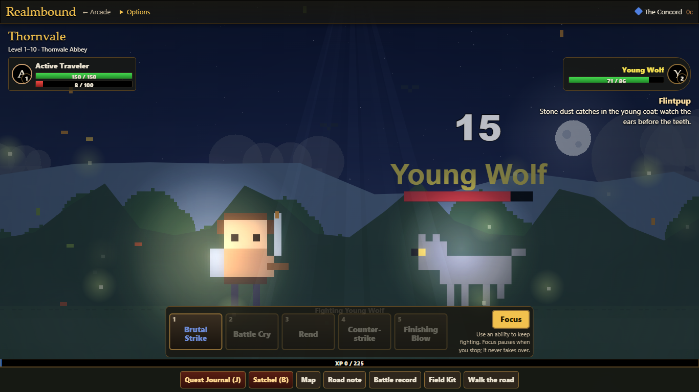
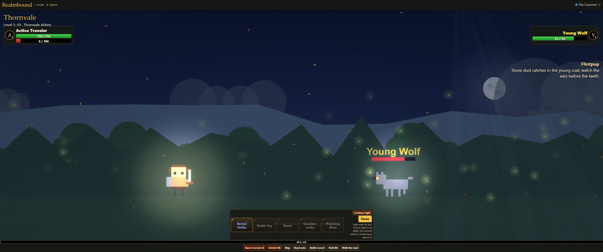
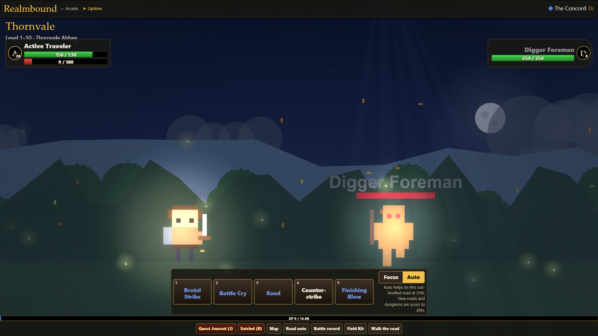
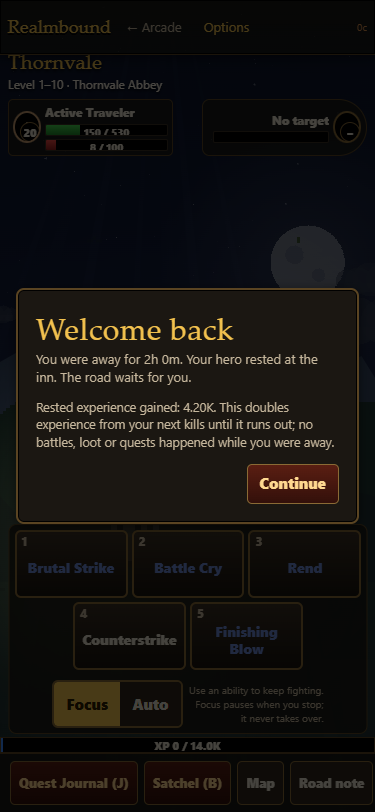

# Realmbound active-play UI evidence (RB1.11)

Isolated Chromium contexts, phone 375x812, laptop 1366x768, desktop 1920x1080 and ultrawide 3440x1440. Staged heroes exercise the actual Fight/pause/Auto controls and save/reload flow; they are not a natural first-hour playthrough or a human fun score. The first-session before captures remain in ../realmbound-first-session/ (including Focus leaving town).

Run your own checkout's serve.ps1, then:

```
node tests/realmbound-active-play-ui.cjs http://localhost:8765
```

This run used a serve.ps1 copy rooted at the isolated checkout on port 8776, preserving Claude's existing server and saves. Tests use a separate browser context per width and close them afterward. Physical phone/touch hardware is not validated. Native tab-visibility assertions were skipped: automated Chromium reported every tab visible, including the off-screen headed/minimized attempt. An explicit staged hidden-property/visibilitychange fixture tests the real application handler and interval guard; it proves that branch, not native focus. Screenshots are size proxies, not hardware tests.






