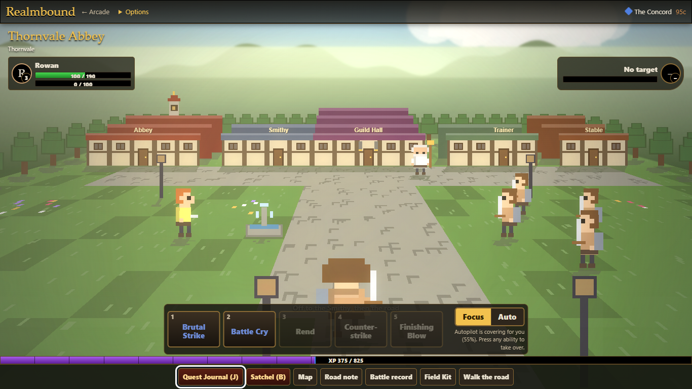
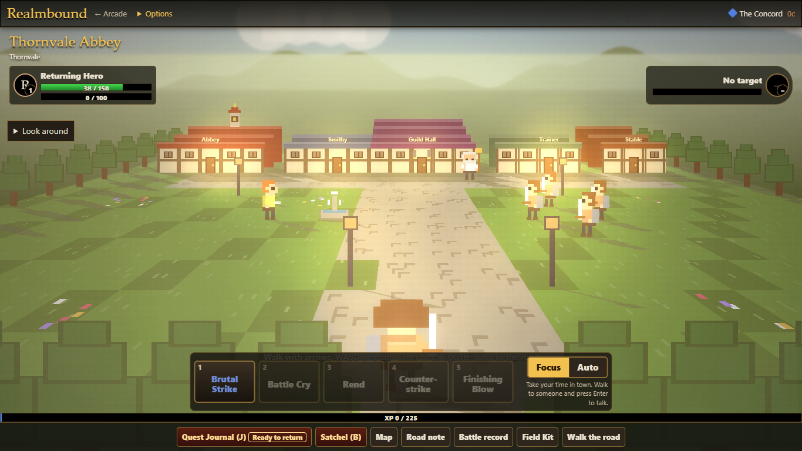
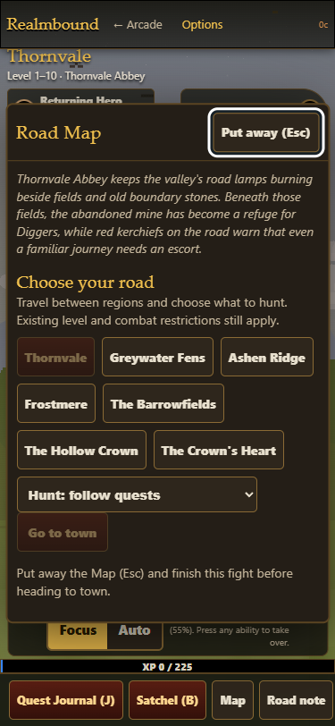

# Realmbound first-session evidence

The named desktop-create/arrival/first-fight/journal/quest-ready/town/turnin/reward-choice/completion/reload captures are from one real UI-only exploratory session. desktop-focus-town-before and desktop-focus-left-before show idle Focus delegating and leaving town before the fix. A few filenames describe capture intent; the actual state and limitations are recorded in the audit.

The map-fight-W, focus-town-W and inn-W captures come from the separate staged UI regression. It stages a ready first request and wounded hero, then uses the actual portrait reward and Keeper choice and validates save/reload. These are rendering/regression fixtures, not natural progression or a claim of human enjoyment.

```
node tests/realmbound-first-session-ui.cjs http://localhost:8775
```

serve.ps1 was used through a temporary copy with only root/port changed, outside Claude's checkout. Isolated browser storage; 375x812, 1366x768, 1920x1080 and 3440x1440. Physical touch-device testing is still outstanding.




