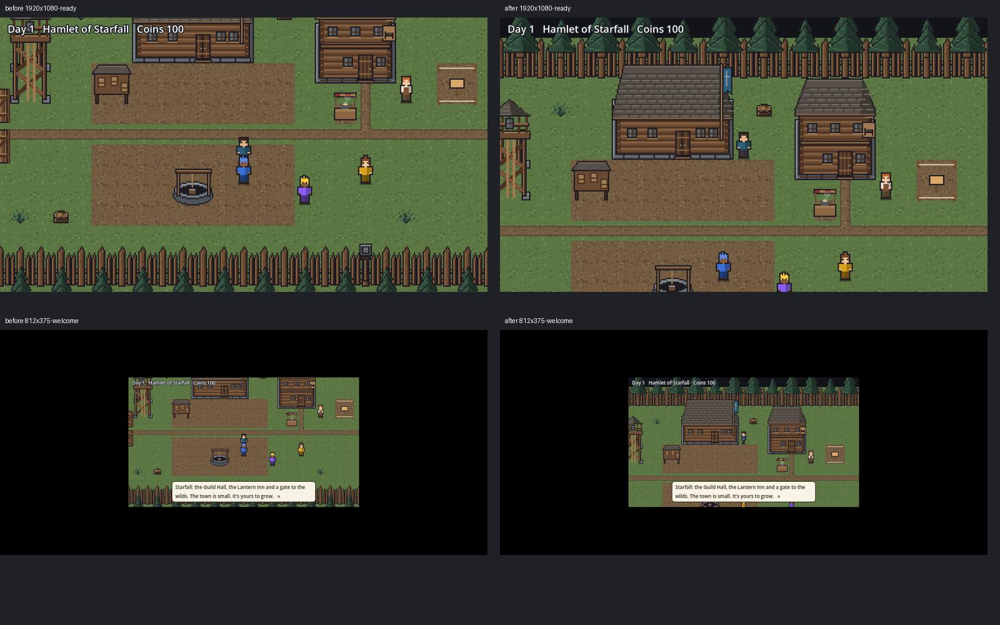

# SF2.6c: Starfall opening view

PR [#200](https://github.com/ecbarish/idle-arcade/pull/200). Source change only: no preview export, merge or deployment.

## Result

New towns start at (15,5), beside the Guild Hall, instead of (14,10). The camera's northern limit is one tile above the map. These are the only two runtime lines changed: no zoom, movement, collision, UI, save format or progression changes. Both complete textures fit, with at least 28 logical pixels above them for the status and SF2.10 goal text. Existing towns retain their saved position and progress.

Removed only the unused house.png, nature.png and floor.png plus their import files. CREDITS.md now records the original frontier environment and keeps attribution for music, sound effects and emotes. ART-SF-8 square decoration is separate.

Original full-resolution captures:
- [Desktop before](before-1920x1080-ready.png) / [after](after-1920x1080-ready.png)
- [Phone landscape welcome before](before-812x375-welcome.png) / [after](after-812x375-welcome.png)

## Verification

[Renderer run](https://github.com/ecbarish/idle-arcade/actions/runs/38181202710), for branch source `964acaa68d3fe70d9ba746550ea1d5f495cc8b0a` (GitHub tested its synthetic merge with main). The manifest records the exact checked-out source. Baseline `4e5b83b0ed31f21b823e69694a415ac2c2b3b26f` reproduces the clipped roofs. Godot 4.7.2, real X11/Xvfb GL compatibility renderer, actual framebuffer PNGs, not a drawing/reconstruction or headless image.

- 32 nonblank captures: desktop 1920×1080, laptop 1366×768, phone landscape 812×375, ultrawide 3440×1440. Eight before, 24 after, all size checked and rejected if blank/black.
- Welcome, dialogue-dismissed opening, guild board, inn approach, counter and return to the opening at each size. Camera stays attached after repeated service routes.
- 501 legal construction layouts: zero unreachable service or plot targets.
- Starfall native suite: 227 passed, zero failed locally (Godot 4.6.3); official Godot 4.7.2 also passes 227/0. [Required Checks CI](https://github.com/ecbarish/idle-arcade/actions/runs/38181202732) passes all 18 browser/native suites (Wildbond 1503/0).
- Old saves: pre-SF2.6c square position (14,10) and coins preserved; existing roof-position relocation, plot preservation and outside-gate save tests retained.
- Runtime source scan confirms no loads of the three removed environment tiles.
- Claude confirmed #195 changes labels/goal/hint code only. Status/caption stay where they were; the planned y=13 goal and y=178 hint fit the reserved space.

The native phone screenshots retain the existing integer-scale letterboxing. No browser export was tested or changed in this source PR. These checks establish framing/reachability, not a complete phone-usability redesign. The inn and hall remain exterior landmarks; this task adds no walk-in interiors.

## Rerun

Use `.github/workflows/starfall-opening-view.yml`, or import both projects with official Godot 4.7.2, then run `tools/audit/starfall_opening_view.gd` through Xvfb with OPENING_OUTPUT, OPENING_BASELINE and SOURCE_SHA set. Run `tools/audit/starfall_maps.gd` with AUDIT_OUTPUT pointing to reachability.json, then `python3 tools/audit/validate_starfall_opening.py opening-review`. Run the unchanged aggregate `node tools/run-all-checks.cjs` with GODOT set.

Full capture manifests: [before](before-manifest.json), [after](after-manifest.json). The renderer artifact contains every PNG, logs and exhaustive reachability JSON.
