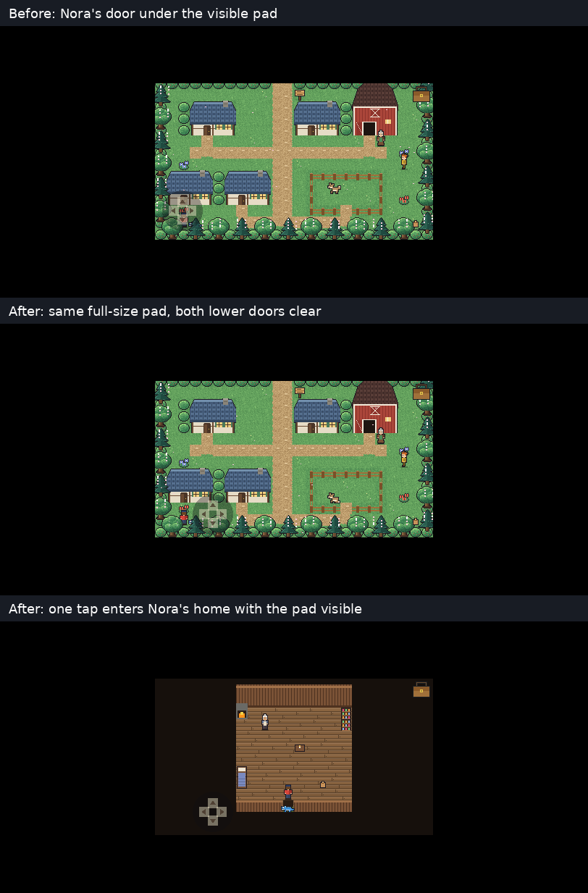
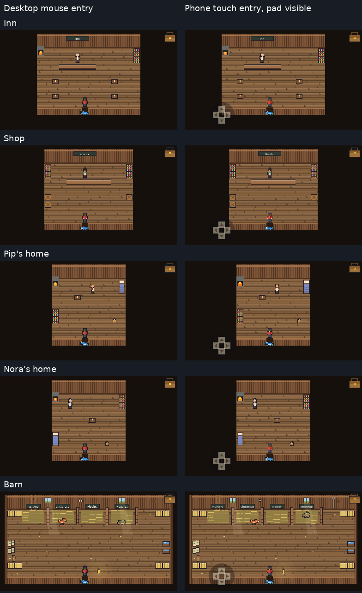

# Wildbond building input repairs — 2026-10-11

PR #177 repairs two confirmed entrance-input problems. Nothing here exports or deploys the web preview.

## Changes
- `main.gd`: accept a registered door target only in Larkhaven's free-play state, matching keyboard entry. The player still walks the route; collision and distance rules are unchanged.
- `touch_pad.gd`: move the existing pad from (38,176) to (80,184) on the 384×216 canvas. The complete 32-pixel hit radius stays onscreen and clears Nora's and the shop's full door rectangles. Arrow size, actions, Auto/Always/Never options, keyboard and saves are unchanged.

The earlier tap rejection is the existing [#137 report](https://github.com/ecbarish/idle-arcade/pull/137#issuecomment-6098889694). The separate map review remains #176.

## Verification

Implementation head: `b135a7b62685b700de518238ab6facb7adc4f1af`.
Rendered CI merge tree: `82e11a9c8ab9bdcaba63c9200453838092e938bd`, combining that head with main `a0934b6c0fa76e2fc65f659e54754d20ec092bd1`.

- [Full checks](https://github.com/ecbarish/idle-arcade/actions/runs/38160709857): all 17 suites pass; Wildbond 1503/0, Starfall 167/0. Includes existing old-save tests and 163 new door/pad checks.
- [Rendered input checks](https://github.com/ecbarish/idle-arcade/actions/runs/38160709862): 150 entry/exit/re-entry transitions, zero failures, 256 nonblank screenshots.
- Original 90 cases: five buildings × mouse/touch/keyboard × three transitions × desktop/phone sizes.
- Additional 60 cases: all five buildings with the default Auto pad already visible, three transitions, at 1920×1080, 812×375, 844×390 and 960×540.
- 16 actual directional hold/release checks, four release-on-hide checks, and 16 Auto/Always/Never visibility checks pass. No world tap leaks from the pad.
- The same partner walks the approach, enters, leaves and re-enters. Exit/re-entry uses the actual previous landing, with no reset or direct transition call.
- Native checks preserve intro/modal/transition restrictions, other-map behavior, one- and three-tile approaches, keyboard control and exact rectangle/circle clearance.
- Independent source review found no blocking production issue. Its suggested exact rectangle-clearance assertion was added.

## Evidence

The first image uses unaltered full 812×375 captures with labels added. The second is a contact sheet: desktop frames reduced by an integer factor, phone game-view crops at native resolution. No gameplay pixels were retouched. Full frames, event witnesses, coordinates, settings and source IDs are in artifact `wildbond-door-input-review` (11709908091) on the rendered run.

The before image is from successful tap-guard-only run [38159843078](https://github.com/ecbarish/idle-arcade/actions/runs/38159843078), which separately confirmed Nora's default-pad interception. The new run requires all visible-pad transitions to succeed; no interception exemption remains.

## Reproduce and limits

Run `node tools/run-all-checks.cjs` with Godot 4.7.2 for the full suite. The separate `.github/workflows/wildbond-door-inputs.yml` imports the real project and runs `tools/audit/wildbond_door_inputs.gd` under Xvfb/Mesa, then validates coverage and image pixels.

The rendered fixture injects actual Godot mouse, screen-touch and physical-key events through the normal handlers. Camera/stretch transforms are checked against independently positioned X11 cursor coordinates. It never calls `_tap`, `_step`, `_go` or `_switch` to force a tested transition. Authored `_skip_opening` and initial positioning set up each scenario; `no_save` and `settings.keep=false` are set before scene initialization.

This verifies native Godot's rendered input pipeline at phone-shaped sizes, not physical iOS/Android browsers. No save/schema/settings-format, production preview, game version, merge or deployment changes are included.
