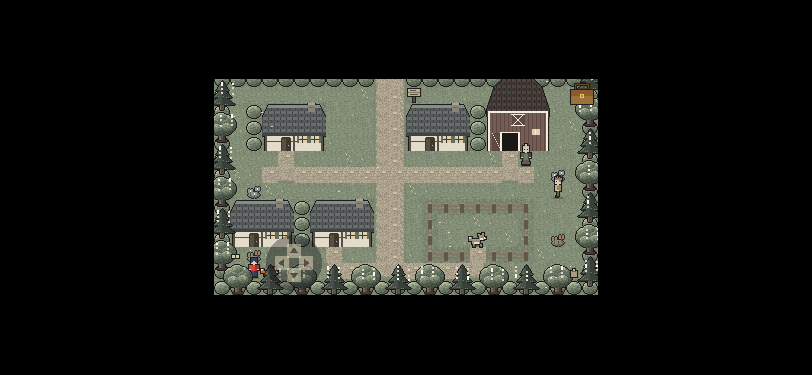
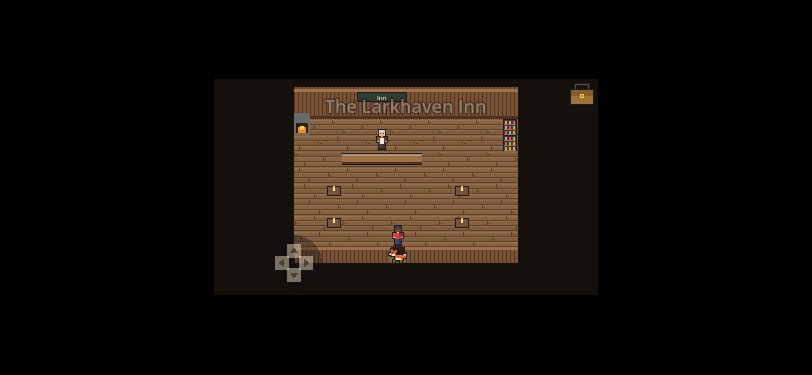
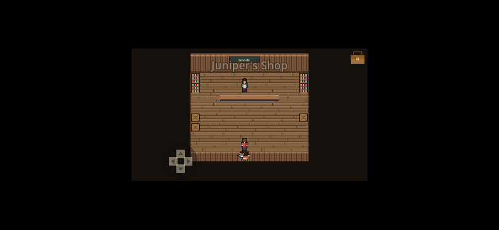
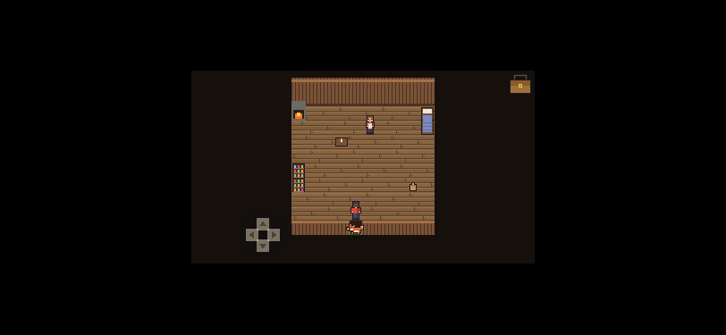
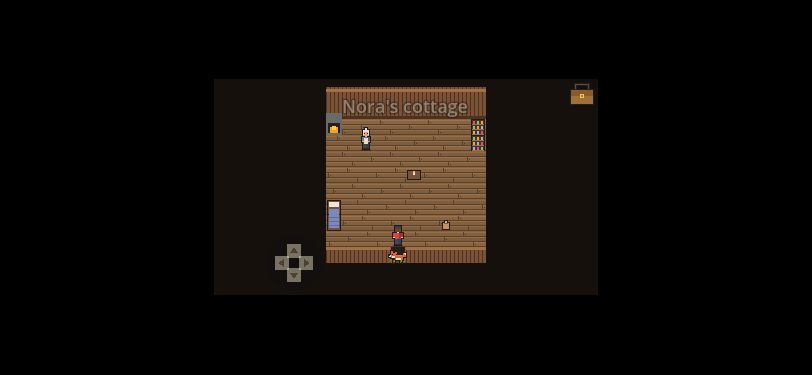
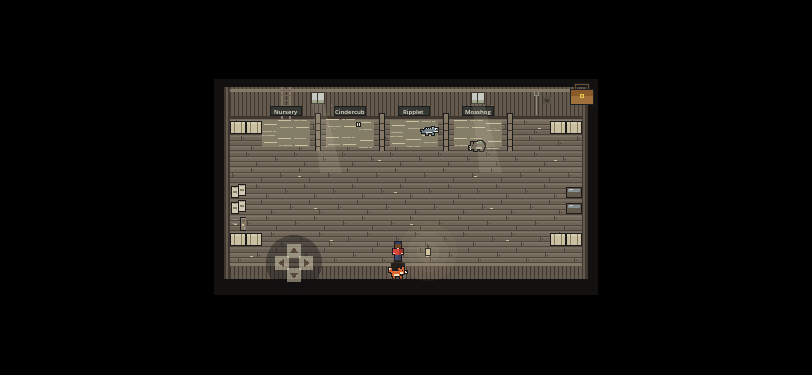

# Wildbond doorway web release evidence

Source `480dfc4`; exported and reviewed in [run 38163220162](https://github.com/ecbarish/idle-arcade/actions/runs/38163220162), [complete artifact](https://github.com/ecbarish/idle-arcade/actions/runs/38163220162/artifacts/11712045626). 353 checks, 119 nonblank screenshots, 60 door transitions, 20 fresh-save reloads and 12 pad hold/release checks pass. All captures show the exact pack recorded in play/wildbond/build.json. Phone screenshots use Chromium touch emulation with Auto controls, not physical hardware.

## Nora doorway with full-size pad visible

## All five touch entries

Desktop counterparts are included beside these images. The complete artifact also contains exit/re-entry, 844×390 and 960×540, legacy save and pad captures.
